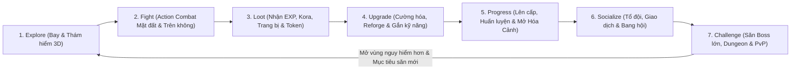

# 01. Product Vision & Core Gameplay Loop

**Phân hệ:** `01_GDD` · **Tài liệu:** `01_Product_Vision_and_Core_Loop.md`  
**Trạng thái:** Baseline khóa cho MVP & Vertical Slice

---

## 1. Tầm Nhìn Sản Phẩm (`Product Vision`)

### 1.1. Tuyên ngôn thiết kế (Elevator Pitch)
**ZENITH: INFINITE UNIVERSE** là tựa game **PC 3D Open-World Action MMORPG** lấy bối cảnh vũ trụ võ thuật khoa huyễn *Helios Expanse*, nơi người chơi tự khởi tạo một chiến binh thuộc chủng tộc riêng, tự do bay lượn 3 chiều không giới hạn qua những vùng đất rộng lớn, giao chiến tốc độ cao cả trên mặt đất lẫn không trung, săn lùng Boss khổng lồ, thu thập và tối ưu trang bị ngẫu nhiên, khai mở các tầng **Hóa Cảnh (`Ascension`)** và cùng hàng trăm người chơi khác kiến tạo vị thế trong một thế giới sống liên tục (*Persistent World*).

### 1.2. Năm Trụ Cột Trải Nghiệm (`Core Design Pillars`)
1. **Freedom of 3D Flight (Tự do bầu trời thực thụ):** Bay không phải là thú cưỡi bị khóa độ cao hay kỹ năng lướt ngắn hạn. Không gian 3D theo phương thẳng đứng (hẻm núi sâu, đỉnh tháp, đảo bay dị thường trọng lực) là sân khấu di chuyển và chiến đấu tự nhiên.
2. **Visceral High-Speed Action Combat (Thực chiến tốc độ cao có chiều sâu):** Mọi đòn đánh đều có trọng lượng, cửa sổ hủy hoạt ảnh (`Cancel Window`), hất tung mục tiêu lên trời rồi lao theo truy kích (`Aerial Pursuit`), đối kháng chưởng lực và phản đòn tức thời (`Vanish Counter`).
3. **Addictive Farm & Build Craftsmanship (Cày cuốc gây nghiện & Đa dạng hướng Build):** Kết hợp cảm giác săn quái rơi đồ ngẫu nhiên giàu cảm xúc với hệ thống *Affix Budget*, *Set Bonus* và *Boss Pity Token* — đảm bảo công sức cày cuốc luôn mang lại tiến triển rõ rệt.
4. **Living Persistent Ecosystem (Hệ sinh thái nhiều người chơi sống động):** Người chơi nhìn thấy nhau luyện tập ngoài vùng hoang dã, lập đội 5 người càn quét khu nguy hiểm, tụ hội hàng chục chiến binh vây đánh *World Boss* và giao thương tại đô thị trung tâm.
5. **Respectful Player Progression (Phát triển đa chiều, chống Pay-to-Win):** Sức mạnh chiến đấu chỉ đến từ kỹ năng điều khiển và quá trình chơi thực tế; tuyệt đối không bán trực tiếp chỉ số hay trang bị mạnh nhất trong cửa hàng tiền thật.

### 1.3. Ma Trận Tham Chiếu Thể Loại (`Genre Benchmark Synthesis`)

| Hệ thống tham chiếu | Tinh hoa cơ học tiếp thu | Điểm cải tiến riêng của `ZENITH: INFINITE UNIVERSE` |
| :--- | :--- | :--- |
| **3D Open-World Action RPG** | Chuyển động nhân vật mượt, camera góc nhìn thứ ba linh hoạt, thế giới có điểm nhấn thị giác dẫn đường tự nhiên. | Thay cơ chế leo trèo chậm bằng **Bay 3D tự do** kết hợp địa hình phân tầng độ cao 800m–1.5km. |
| **Sandbox Online Worlds** | Cảm giác thế giới chung đông đúc, sự kiện ngẫu nhiên ngoài bản đồ, tương tác xã hội tự nhiên giữa người chơi. | Tích hợp hệ thống quy tắc an toàn vùng đô thị và phân kênh thông minh để không biến thế giới thành bãi hỗn chiến độc hại. |
| **Classic Grinding MMORPGs** | Nhịp điệu farm quái mượt, săn Boss theo khung giờ, hồi hộp nhặt đồ hiếm có dòng thuộc tính đột biến, đập đồ nâng cấp. | Chuyển hóa hoàn toàn lên không gian Action 3D kèm cơ chế **Bảo hiểm Cường hóa** và **Boss Pity Token** chống ức chế cực đoan. |
| **3D Arena Brawlers** | Tốc độ đòn đánh uy lực, bay bám mục tiêu, hất văng xuyên địa hình, hiệu ứng hào quang bùng nổ khi biến hình. | Chuẩn hóa về kiến trúc **Dedicated Server Authoritative** chơi ổn định với 20–40 người cùng giao tranh thay vì chỉ đối kháng 1v1 P2P. |

---

## 2. Đối Tượng Người Chơi Mục Tiêu (`Player Personas`)

1. **The Power Grinder (Người thích cày cuốc & Tối ưu Build — 35%):** Đam mê săn Elite/Boss để tìm trang bị có tổ hợp dòng phụ hoàn hảo (*Crit + Chi Damage + Ascension Efficiency*), thử nghiệm các công thức phối đồ độc dị.
2. **The Action Combat Purist (Người mê kỹ năng chiến đấu — 25%):** Thích làm chủ thời điểm *Perfect Guard*, *Vanish Counter*, nối chuỗi combo không chiến và khẳng định trình độ trong *Arena PvP* cân bằng.
3. **The Cosmic Explorer & Collector (Người thích khám phá & Sưu tầm — 20%):** Yêu thích cảm giác bay xuyên mây tìm hang động ẩn, giải thử thách *Training Trials*, sưu tầm đủ bộ ngoại trang (*Transmog*), danh hiệu và mở khóa mọi nhánh *Ascension*.
4. **The Guild Vanguard (Người chơi cộng đồng — 20%):** Thích dẫn dắt tân thủ, tổ chức đội hình săn *World Boss*, xây dựng bang hội và tranh hạng mùa giải.

---

## 3. Vòng Lặp Gameplay Cốt Lõi 7 Giai Đoạn (`Core Gameplay Loop`)

### Phân tích chi tiết từng mắt xích trong vòng lặp

| Giai đoạn | Hành động chính của người chơi | Phản hồi cảm giác (Game Feel) | Dữ liệu hệ thống tác động |
| :--- | :--- | :--- | :--- |
| **1. Explore** | Cất cánh bay qua hẻm núi, dùng `Resonance Visor` quét tín hiệu quái tinh anh, mạch tinh thạch hoặc rương ẩn trên đỉnh núi cao. | Cảm giác tự do tốc độ, gió rít bên tai, tầm nhìn mở rộng từ trên cao. | Streaming ô bản đồ (`World Partition`), phát hiện POI, kích hoạt Dynamic Event. |
| **2. Fight** | Lao xuống mở giao tranh bằng đòn lao kích, nối combo cận chiến hất tung, bay đuổi trên không, xả chưởng `Solar Lance` và bật `Ascension` khi gặp nguy hiểm. | Rung chấn màn hình vừa đủ (`Hitstop 40–70ms`), âm thanh va chạm đanh gọn, hào quang năng lượng rực sáng. | GAS tính toán `Stamina`, `Chi`, Cooldown, Hitbox phía Server. |
| **3. Loot** | Nhặt cột sáng vật phẩm rơi riêng (*Personal Loot*), nhận `EXP`, `Kora`, `Astral Shards`, trang bị ngẫu nhiên và `Boss Core Token`. | Tia sáng phẩm cấp (Tím/Vàng/Đỏ) kèm hiệu ứng âm thanh đặc trưng tạo hưng phấn tức thì. | Go `LootService` quay CSPRNG, ghi `inventory_items` & `loot_history`. |
| **4. Upgrade** | Mở túi đồ so sánh dòng `Affix`, cường hóa vũ khí/giáp tại NPC, khóa dòng tốt để `Reforge` dòng phụ, lưu mẫu ngoại hình vào tủ `Transmog`. | Thấy rõ chỉ số `Combat Resonance` và hiệu quả thực chiến (hồi Chi nhanh hơn, chưởng đau hơn) tăng lên ngay. | Go `EconomyService` trừ `Kora`/`Shards` theo giao dịch ACID, cập nhật `AttributeSet`. |
| **5. Progress** | Tăng `Level`, hoàn thành bài khảo hạch `Gravity Chamber` để mở giới hạn `Potential` và đột phá tầng `Ascension` mới. | Mở khóa hoạt ảnh biến hình mới, thay đổi hào quang và mở rộng nhánh combo. | Cập nhật `character_potential`, `character_ascensions`, cấp `GameplayTag` mới. |
| **6. Socialize** | Ghép `Party` 5 người cùng càn quét bãi quái cấp cao, trao đổi trang bị `Unbound`, đóng góp tài nguyên xây `Guild`. | Sự gắn kết đồng đội khi phối hợp khống chế Boss và chia sẻ thành quả. | `PartyService`, `GuildService`, `TradeTransactions`. |
| **7. Challenge** | Chinh phục *Regional Boss*, *World Boss* 3 giai đoạn, *Instance Dungeon* hoặc so tài kỹ năng tại *Balanced Arena PvP*. | Thử thách kỹ năng đọc chiêu thức, né đòn diện rộng và phối hợp sát thương dồn dập. | `Instance Server` / `World Boss Contribution Tracker`, xếp hạng `Leaderboard`. |

---

## 4. Ba Vòng Lặp Phiên Chơi Theo Thời Lượng (`Session Cadence Loops`)

Một MMORPG bền vững phải phục vụ tốt cả người chơi chỉ rảnh 15 phút buổi trưa lẫn người chơi cày sâu 3 tiếng cuối tuần:

### 4.1. Micro Loop (1 – 5 Phút): Phản hồi tức thời
- **Hoạt động:** Tiêu diệt 1–2 cụm quái thường hoặc 1 quái *Elite* tuần tra; thu thập một mạch tinh thạch `Astral Vein` trên vách đá; hoàn thành một thử thách bay xuyên vòng năng lượng ngắn.
- **Phần thưởng đảm bảo:** Thanh `EXP` nhích lên thấy rõ, túi nhận `Kora` và nguyên liệu cơ bản, kiểm tra nhanh 1–2 món đồ vừa rơi.
- **Mục tiêu tâm lý:** *"Đánh thêm một bãi quái nữa thôi!"*

### 4.2. Meso Loop (15 – 30 Phút): Mục tiêu phiên ngắn trọn vẹn
- **Hoạt động:** Hoàn thành chuỗi nhiệm vụ tuần tra khu vực; vượt 1 tầng khảo hạch *Gravity Training Trial*; lập tổ đội hạ *Mini-Boss* hoặc *Regional Boss* trong vùng để gom `Core Token` và săn đồ *Rare/Epic*; quay về *Neo Haven City* cường hóa và dọn túi đồ.
- **Phần thưởng đảm bảo:** Ít nhất 1 nâng cấp nhỏ cho nhân vật (tăng 1 cấp độ, nâng 1 bậc cường hóa, tăng điểm `Mastery Marks` mở khóa kỹ năng phụ, hoặc tích thêm 10–20% tiến độ đổi đồ Boss).
- **Mục tiêu tâm lý:** Người chơi thoát game sau 25 phút vẫn cảm thấy nhân vật mạnh hơn lúc mới đăng nhập.

### 4.3. Macro Loop (1 – 3 Giờ): Hoạt động đỉnh cao & Cộng đồng
- **Hoạt động:** Tham gia sự kiện *World Boss* xuất hiện theo chu kỳ toàn máy chủ; lập đội 5 người chinh phục *Dungeon/Boss Instance* độ khó cao để săn mảnh *Set Equipment (2/4/6 món)*; thực hiện chuỗi nhiệm vụ đột phá **Hóa Cảnh (`Ascension Awakening Trial`)**; đấu xếp hạng *Arena PvP* hoặc sự kiện *Guild Boss*.
- **Phần thưởng đảm bảo:** Cơ hội nhận trang bị *Legendary/Mythic*, hoàn thiện *Set Bonus* làm thay đổi hẳn lối chơi, mở khóa danh hiệu uy danh và thăng hạng bảng vàng máy chủ.

---

## 5. Ba Trụ Cột Động Lực Dài Hạn (`Endgame Retention Pillars`)

Để tránh bẫy thiết kế *"chỉ số là thứ duy nhất đáng quan tâm"* (khiến người chơi bỏ game ngay khi chạm trần trang bị hoặc nản lòng khi rớt lại phía sau), tiến trình dài hạn được chia đều thành 3 trục độc lập:

| Trục động lực | Mục tiêu cụ thể của người chơi | Tính độc lập với chỉ số chiến đấu |
| :--- | :--- | :--- |
| **1. Character Power (Đỉnh cao Võ Đạo)** | Tối ưu hóa 8 món trang bị theo hướng Build riêng, hoàn thành các mốc `Potential` khó nhất, làm chủ tầng `Ascension` cao cấp để chinh phục Boss cấp Tinh Vực. | Trục sức mạnh cốt lõi cho nội dung PvE cấp cao. |
| **2. Collection & Mastery (Sưu tầm & Bản sắc)** | Mở khóa bộ sưu tập `Transmog` (giáp chiến, áo võ đạo, kính `Visor`, màu sắc `Aura Mantle`), danh mục bách khoa toàn thư quái vật/kỹ năng, danh hiệu hiếm từ các thành tựu khám phá không tưởng (không cộng chỉ số đè bẹp người khác). | Người chơi cấp trung bình vẫn có thể sở hữu bộ ngoại hình cực ngầu nhờ khám phá bí mật hoặc hoàn thành thử thách kỹ thuật. |
| **3. Social Prestige (Vị thế Cộng đồng)** | Trở thành chiến binh có điểm kỹ năng cao nhất trong *Arena PvP* (nơi chỉ số được chuẩn hóa), người dẫn đầu bảng đóng góp *Guild*, hoặc đội trưởng chuyên dẫn tân thủ vượt Boss nhận huy hiệu *Vanguard Mentor*. | Tôn vinh kỹ năng tay và đóng góp xã hội thay vì số giờ cày đơn thuần. |

---

## 6. Nguyên Tắc Thiết Kế Thương Mại Hóa Lành Mạnh (`Monetization Guardrails`)

Ngay từ kiến trúc dữ liệu ban đầu, hệ thống phải ngăn chặn mọi cơ chế phá vỡ sự công bằng của vòng lặp `Fight → Loot → Upgrade`:
- **Cho phép kinh doanh (Cosmetic & Convenience hợp lý):** Trang phục `Transmog` thuần ngoại hình, hiệu ứng màu sắc phụ trợ cho biến hình/dịch chuyển, mở rộng thêm ô kho chứa đồ phụ (`Account Stash Tabs`), thẻ đổi tên/chỉnh sửa ngoại hình nhân vật, Battle Pass mùa giải thưởng ngoại trang.
- **Tuyệt đối cấm kinh doanh:** Không bán trang bị có chỉ số, không bán đá `Astral Shards` tăng tỉ lệ đập đồ bằng tiền thật, không bán bùa miễn rớt cấp cường hóa độc quyền Cash Shop, không bán lượt hồi sinh không giới hạn trong Raid/Boss cạnh tranh.
