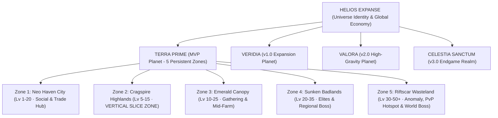
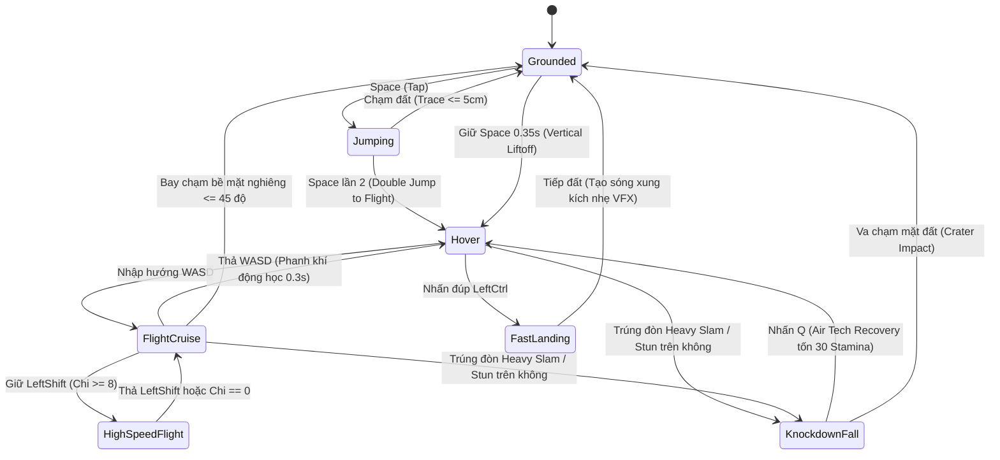

# 02. World Design & 3D Flight Mechanics

**Phân hệ:** `01_GDD` · **Tài liệu:** `02_World_Design_and_Flight_Mechanics.md`  
**Trạng thái:** Baseline khóa cho MVP (`Terra Prime`) & Vertical Slice (`Cragspire Highlands`)

---

## 1. Kiến Trúc Thế Giới Mở Liên Tục (`Persistent Universe Structure`)

Thế giới của **ZENITH: INFINITE UNIVERSE** được thiết kế theo mô hình **Liên kết Đa Tầng Tinh Vực**, kết hợp giữa trải nghiệm liền mạch về mặt nhận thức người chơi và khả năng phân tải vật lý theo vùng máy chủ:

### Nguyên tắc tổ chức Không gian Thế giới
1. **Không gian 3 chiều thực thụ (True Z-Axis Design):** Khác với MMORPG truyền thống nơi bản đồ chủ yếu trải phẳng theo trục `X-Y`, mọi Zone trên *Terra Prime* đều được quy hoạch theo **3 tầng độ cao**:
   - **Ground Stratum (`Z: 0m – 120m`):** Thung lũng, đường mòn, khu trại an toàn, bãi quái mặt đất cho người mới làm quen.
   - **Canopy / Cliff Stratum (`Z: 120m – 450m`):** Vách núi cheo leo, cầu đá tự nhiên, tổ quái biết bay, mạch tinh thạch quý và hang động ẩn lưng chừng núi.
   - **Sky / Anomaly Stratum (`Z: 450m – 850m+`):** Các khối đá lơ lửng do dị thường trọng lực, luồng khí xoáy tăng tốc (`Astral Wind Tunnels`) và đấu trường trên mây của Boss không chiến.
2. **Dynamic Channeling (Phân kênh mềm khi quá tải):** Mỗi Zone có ngưỡng tối ưu **80 người chơi (Soft Cap)** và trần cứng **100 người chơi (Hard Cap)** cho một process Dedicated Server. Khi vượt ngưỡng, `World Coordinator` tự động mở thêm `Channel 2, 3...` của cùng Zone đó, đồng thời cho phép thành viên cùng `Party` dịch chuyển tức thì về chung một Channel tại vùng an toàn.

---

## 2. Quy Hoạch Bản Đồ Hành Tinh `Terra Prime` (MVP — 5 Zones)

| Mã Zone | Tên Khu Vực | Cấp Độ Đề Xuất | Kích Thước Khung | Vai Trò Gameplay & Điểm Nhấn Địa Hình |
| :--- | :--- | :--- | :--- | :--- |
| `zone_neo_haven` | **Neo Haven City** | `1 – 20` *(Hub mọi cấp)* | `2.0km × 2.0km × 600m` | Siêu đô thị mái vòm năng lượng mặt trời. Khu an toàn 100%, Học viện Võ Đạo (*Martial Academy*), Khu Chợ Giao Thương, Phòng Tập Trọng Lực, Cổng dịch chuyển liên vùng. |
| `zone_cragspire` | **Cragspire Highlands** *(Vertical Slice)* | `5 – 15` | `2.0km × 2.0km × 800m` | Quần thể cột đá bazan khổng lồ và thác nước đổ từ đảo đá lơ lửng. Nơi người chơi tập bay 3D, farm quái cơ bản/tinh anh và đối đầu Boss đầu tiên (*Colossus Kael*). |
| `zone_emerald_canopy` | **Emerald Canopy** | `10 – 25` | `3.0km × 3.0km × 900m` | Rừng đại thụ cao hàng trăm mét với tán cây đan thành tầng sàn thứ hai trên không. Giàu tài nguyên thảo dược tinh thể và quái thú săn mồi tốc độ cao. |
| `zone_sunken_badlands` | **Sunken Badlands** | `20 – 35` | `3.5km × 3.5km × 800m` | Hệ thống hẻm núi đá đỏ sâu thăm thẳm, pháo đài của băng đảng cướp cơ giới, nhiều *Elite Monster* canh giữ rương nguyên liệu cường hóa bậc trung. |
| `zone_riftscar` | **Riftscar Wasteland** | `30 – 50+` | `4.0km × 4.0km × 1200m` | Vùng đất bị xé toạc bởi vết nứt không gian tím thẫm, cột sét năng lượng và mảnh thiên thạch trôi nổi. Có vùng *Contested PvP* tự nguyện và hố triệu hồi *World Boss*. |

> **Lưu ý về Cấp độ Mở rộng:** Dải cấp độ `50 – 100` trong giai đoạn MVP được phục vụ thông qua các **High-Resonance Sub-Zones (Vùng Dị Thường Cấp Cao)** nằm ở tầng cao `Sky Stratum` của *Sunken Badlands* / *Riftscar Wasteland* cùng chế độ **Hardcore Boss Instances (Lv 60 / 80 / 100)** trước khi mở hành tinh *Veridia* ở bản `v1.0`.

---

## 3. Tiêu Chuẩn Thiết Kế Một Vùng Bản Đồ (`Zone Design Checklist`)

Mọi Zone ngoài đô thị bắt buộc đáp ứng đủ **9 thành phần tiêu chuẩn** trước khi đưa vào sản xuất:

1. **Outpost Safe Zone (Trạm Tiền Tiêu An Toàn — tối thiểu 2 điểm/Zone):** Có kết giới bảo vệ (quái không thể xâm nhập, khóa PvP), đặt NPC sửa đồ, Hòm thư, Rương kho và Cột Cộng Hưởng (`Resonance Beacon` để hồi sinh/dịch chuyển).
2. **Grinding Pockets (Bãi Farm Quái Thường — 6 đến 10 cụm/Zone):** Mật độ 8–15 quái/cụm, thời gian hồi sinh (`Respawn Time`) nhanh `12 – 18 giây` để duy trì nhịp cày liên tục cho 1–2 đội chơi.
3. **Aerial Patrol Corridors (Hành Lang Quái Bay — 3 đến 4 tuyến/Zone):** Buộc người chơi sử dụng kỹ năng bay chiến đấu hoặc dụ quái xuống mỏm đá.
4. **Elite Strongholds (Cứ Điểm Quái Tinh Anh — 3 điểm/Zone):** Quái máu dày gấp `6x` quái thường, có kỹ năng báo hiệu đỏ (`Telegraph`), thời gian hồi sinh `90 giây`, tỉ lệ rơi trang bị *Uncommon/Rare* cao.
5. **Boss Arena (Đấu Trường Boss Vùng — 1 đến 2 điểm/Zone):** Khu vực địa hình thoáng đường kính tối thiểu `120m` và trần không trung thoáng `200m` để camera không bị kẹt vách đá khi không chiến đông người.
6. **Exploration Trials (Thử Thách Khám Phá — 5 đến 8 điểm/Zone):** Đua bay qua cổng cộng hưởng giới hạn thời gian, giải phong ấn tinh thể nhận `Mastery Marks` lần đầu.
7. **Resource Veins (Mạch Tài Nguyên Thu Thập):** Tinh thạch `Astral Ore` mọc ở vách núi cao/hang sâu, tính lượt thu thập cá nhân theo chu kỳ hồi để tránh tranh cướp tiêu cực.
8. **Boundary Gateways (Cổng Ranh Giới Chuyển Vùng):** Hẻm núi hẹp, cầu năng lượng hoặc cổng phóng tinh vân đóng vai trò vùng đệm (`Transition Volume`) cho cơ chế *Zone Transfer*.
9. **Secret Caverns / Sky Ruins (Khu Vực Bí Mật):** Không hiện sẵn trên bản đồ nhỏ; chỉ phát hiện khi đeo `Resonance Visor` dò sóng hoặc bay xuyên qua thác nước/tầng mây dày.

---

## 4. Hệ Thống Di Chuyển & Cơ Chế Bay 3D (`Locomotion & 3D Flight System`)

Bay tự do 3D là **chữ ký nhận diện quan trọng nhất** của dự án. Thiết kế phải giải quyết bài toán cân bằng: **Bay khám phá phải cực kỳ sướng và thoải mái**, nhưng **bay tốc độ cao trong chiến đấu phải có chiều sâu quản lý năng lượng** để ngăn tình trạng người chơi bỏ chạy vô tận khi sắp thua.

### 4.1. Bảy Chế Độ Di Chuyển Chuẩn

| Mã Chế Độ | Tên Chế Độ | Cách Kích Hoạt (PC Mặc Định) | Tốc Độ Cơ Bản (`cm/s` UE5) | Quy Tắc Tiêu Hao Năng Lượng |
| :--- | :--- | :--- | :--- | :--- |
| `Walk / Jog` | Di chuyển mặt đất | `WASD` | `550 cm/s` (`5.5 m/s`) | `0` Chi / `0` Stamina. |
| `Ground Sprint` | Chạy bứt tốc | Giữ `Left Shift` + `WASD` trên đất | `900 cm/s` (`9.0 m/s`) | `0` ngoài giao tranh; `4 Stamina/s` trong giao tranh. |
| `Hover` | Lơ lửng tại chỗ | Nhấn đúp `Space` trên không | `0 – 250 cm/s` (trôi nhẹ) | **`0 Chi/s` mọi lúc** (kể cả đang khóa mục tiêu không chiến). |
| `Flight Cruise` | Bay hành trình 3D | `WASD` + hướng chuột (hoặc `Space`/`Ctrl` lên xuống) khi đang ở trạng thái bay | `1,100 cm/s` (`11.0 m/s`) | **`0 Chi/s` ngoài giao tranh**; tiêu hao rất nhẹ `1.5 Chi/s` khi đang dính trạng thái `InCombat`. |
| `High-Speed Flight` | Bay siêu thanh (`Boost`) | Giữ `Left Shift` khi đang bay (bùng hào quang xé gió) | `2,400 cm/s` (`24.0 m/s`) | Cú kích hoạt đầu tốn `8 Chi`, sau đó duy trì theo công thức động bên dưới. |
| `Burst Dash / Vanish` | Lướt tức thời 8 hướng | Nhấn `Q` + hướng di chuyển | Xung lực `3,800 cm/s` trong `0.18s` | `20 Stamina` mỗi lần lướt (có `0.15s` khung bất tử `i-frame` đầu). |
| `Astral Blink / Travel` | Dịch chuyển tức thời / Liên hành tinh | Kỹ năng tiện ích / Cổng Tinh Vân | Tức thời (có `1.5s` tụ ấn ngoài giao tranh) | `35 Chi` (trong vùng) hoặc phí dịch chuyển `Kora` giữa các vùng xa. |

### 4.2. Công Thức Toán Học Tiêu Hao `Chi` Khi Bay Tốc Độ Cao

Chi phí duy trì `High-Speed Flight` mỗi giây ($D_{\text{flight}}$) giảm dần khi người chơi nâng chỉ số tiềm năng **`FlightEfficiency`** ($\text{FE} \in [0, 100]$):

$$
D_{\text{flight}} = D_{\text{base}} \times M_{\text{combat}} \times \left( 1 - 0.65 \times \frac{\text{FE}}{\text{FE} + 50} \right)
$$

Trong đó:
- $D_{\text{base}} = 10\text{ Chi/s}$.
- $M_{\text{combat}} = 1.0$ khi thám hiểm ngoài giao tranh (`OutOfCombat`), và $M_{\text{combat}} = 1.8$ khi đang trong giao tranh (`InCombat`, tức vừa gây hoặc nhận sát thương trong vòng `8.0 giây` gần nhất).
- Khi nhân vật đạt $\text{FE} = 100$ ở giai đoạn giữa/cuối game, hệ số giảm đạt $43.3\%$, kết hợp tốc độ hồi `Chi` tự nhiên ngoài giao tranh khiến người chơi cấp cao có thể **bay siêu thanh xuyên suốt cả bản đồ gần như không cạn thanh năng lượng**.

### 4.3. Hành Vi Khi Cạn Kiệt `Chi` Trên Không (`Graceful Chi Exhaustion`)

Để tuyệt đối tránh trải nghiệm khó chịu kiểu *"hết năng lượng bị rơi tự do chết tức tưởi"*:
1. Khi `CurrentChi <= 0`, nhân vật **KHÔNG bị rơi tự do mất kiểm soát** (trừ khi trúng đòn khống chế cứng `Knockdown/Slam` của đối phương).
2. Nhân vật tự động hạ từ `High-Speed Flight` về trạng thái `Flight Cruise / Controlled Glide` (tốc độ giảm còn `750 cm/s`, hạ độ cao từ từ với vận tốc rơi tối đa êm ái `-200 cm/s` và vẫn điều hướng tiếp đất an toàn được).
3. Khóa kích hoạt lại `High-Speed Flight` trong `2.5 giây` (`State.Debuff.ChiExhausted`) cho đến khi `Chi` hồi phục tối thiểu đạt `15% MaxChi`.

### 4.4. Máy Trạng Thái Chuyển Tiếp Mặt Đất ↔ Không Trung (`Flight State Machine`)

---

## 5. Đặc Tả Bản Đồ Vertical Slice: `Cragspire Highlands`

Trong giai đoạn **Vertical Slice**, đội ngũ và AI Coding Agent chỉ xây dựng duy nhất vùng `zone_cragspire` nhưng đạt chuẩn chất lượng hoàn chỉnh:

- **Quy mô lưới `World Partition`:** Bản đồ `2,048m × 2,048m`, chia ô lưới (`Cell Size`) `128m`, bán kính nạp (`Loading Range`) `384m` cho địa hình chi tiết và `HLOD` cho các cột đá ở xa đến `2,000m`.
- **Phân khu chức năng trong `Cragspire Highlands`:**
  1. **Skywatch Outpost (`Tọa độ Tây Nam, Z = +85m`):** Trạm tiền tiêu an toàn của Liên Minh, có NPC Huấn luyện viên, NPC Cửa hàng `Kora`, NPC Đổi `Colossus Core Token` và Cột Cộng Hưởng.
  2. **Shattered Basin (`Tọa độ Trung Tâm, Z = +20m đến +140m`):** Thung lũng đá nứt với 5 bãi quái thường *Crag Ravager* (Lv 6–10) và các mỏm đá thấp để tập combo hất tung.
  3. **Windcarved Pillars (`Tọa độ Đông Bắc, Z = +150m đến +520m`):** Rừng cột đá thẳng đứng có 3 luồng khí xoáy dọc, nơi tuần tra của biến thể tinh anh *Apex Ravager* (Lv 12) và 4 mạch tinh thạch `Astral Shard T1`.
  4. **Titan's Altar (`Đảo đá lơ lửng phía Bắc, Z = +620m`):** Đấu trường tròn đường kính `160m` nằm lơ lửng giữa tầng mây — nơi triệu hồi và giao chiến 3 giai đoạn với Boss **Vanguard Colossus Kael (Lv 15)**.
