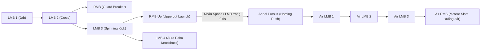

# 03. Action Combat System

**Phân hệ:** `01_GDD` · **Tài liệu:** `03_Action_Combat_System.md`  
**Trạng thái:** Baseline khóa cho MVP & Vertical Slice

---

## 1. Kiến Trúc Ba Lớp Của Hệ Thống Chiến Đấu (`Three-Layer Combat Model`)

Hệ thống chiến đấu của **ZENITH: INFINITE UNIVERSE** từ bỏ hoàn toàn lối đánh đứng yên chọn mục tiêu ấn phím chờ hồi chiêu (*Tab-Targeting truyền thống*), thay bằng **3D Aerial Action Combat** gồm 3 lớp gắn kết chặt chẽ:

1. **Lớp 1 — Spatial Positioning & Flight Mobility:** Kiểm soát khoảng cách 3 chiều, góc tiếp cận từ trên cao/sau lưng, lướt tránh đòn (`Burst Dash`) và bay bám mục tiêu (`Aerial Pursuit`).
2. **Lớp 2 — Martial Melee & Cancel Windows:** Chuỗi đòn cận chiến kết hợp đánh nhẹ (`Light`), đánh mạnh phá giáp (`Heavy`), hất tung (`Launch`), đập xuống đất (`Meteor Slam`) cùng các cửa sổ hủy hoạt ảnh hợp lệ để người chơi phản ứng tức thì.
3. **Lớp 3 — Resource Economy (`Chi` & `Stamina`) & Ascension Timing:** Cân đối giữa `Stamina` (phòng thủ/thoát khống chế) và `Chi` (kỹ năng chưởng lực/duy trì trạng thái `Ascension`). Ai cạn cả hai thanh tài nguyên trước sẽ rơi vào thế bị động hoàn toàn.

---

## 2. Bộ Điều Khiển PC Chuẩn (`PC Input Mapping — Enhanced Input`)

Tất cả các phím đều cho phép người chơi gán lại (`Keybind Remapping`) qua `UE5 Enhanced Input User Settings`:

| Đầu vào mặc định | Hành động (Mặt đất) | Hành động (Không chiến 3D) | Tài nguyên tiêu thụ |
| :--- | :--- | :--- | :--- |
| `W / A / S / D` | Di chuyển 8 hướng theo góc nhìn Camera | Bay lượn theo mặt phẳng hướng nhìn | `0` |
| `Space` (Nhấn / Giữ) | Nhảy đơn / Giữ `0.35s` để cất cánh `Hover` | Bay nâng độ cao (`+Z`) | `0` |
| `Left Ctrl` (Nhấn / Đúp) | Cúi / Nhấn đúp không tác dụng | Hạ độ cao (`-Z`) / Nhấn đúp tiếp đất nhanh | `0` |
| `Left Shift` (Giữ) | Chạy bứt tốc (`Ground Sprint`) | Bay siêu thanh (`High-Speed Flight`) | `Stamina` (Đất) / `Chi` (Bay) |
| `Left Mouse (LMB)` | Đánh nhẹ (`Light Attack` chuỗi 1–4) | Không chiến nhẹ (`Aerial Light` chuỗi 1–4) | Hồi `+4 Chi` mỗi đòn trúng |
| `Right Mouse (RMB)` | Đánh mạnh (`Heavy Attack`) / Giữ để Tụ lực phá đỡ | Đập mạnh / Hất văng (`Knockback` / `Slam`) | Hồi `+8 Chi` mỗi đòn trúng |
| `V` (Giữ) | Đỡ đòn (`Energy Guard`) — Nhấn đúng `0.15s` đầu = `Perfect Guard` | Đỡ đòn 360° trên không | Trừ `Stamina` khi nhận đòn |
| `Q` | Lướt né (`Burst Dash`) / Nhấn lúc vừa trúng đòn = `Vanish Counter` | Lướt 8 hướng trên không / `Vanish Counter` sau lưng | `20 Stamina` (`45 Stamina` nếu `Vanish`) |
| `Middle Mouse` hoặc `Tab` | Bật / Tắt `Hard Lock-On` (Lăn chuột đổi mục tiêu) | Khóa mục tiêu 3D không trung | `0` |
| `1 / 2 / 3 / 4` | Kỹ năng chủ động (`Active Chi / Martial Skills`) | Kỹ năng chủ động không chiến | `Chi` + `Cooldown` |
| `R` | Tuyệt kỹ tối thượng (`Ultimate Skill`) | Tuyệt kỹ tối thượng không chiến | `80 – 100 Chi` + `Cooldown` |
| `X` | Tụ Nội Khí tại chỗ (`Active Chi Charge`) | Tụ Nội Khí trên không | Hồi nhanh `+18% MaxChi/s` |
| `C` | Kích hoạt Hóa Cảnh (`Ascension` — Giữ `1.2s` để tắt chủ động) | Kích hoạt Hóa Cảnh trên không | Ngưỡng `Chi` + Duy trì |
| `F` | Tương tác NPC / Nhặt nhanh / Cột Cộng Hưởng | Tương tác vật thể trên không | `0` |

---

## 3. Cận Chiến, Nối Đòn Không Trung & Frame Data (`Melee & Aerial Combo System`)

### 3.1. Cấu Trúc Nhánh Combo Chuẩn (Áp dụng ngay cho Vertical Slice)

### 3.2. Bảng Frame Data Mẫu (Quy chiếu ở `60 FPS` — `1 Frame = 16.67ms`)

Mọi `AnimMontage` cận chiến bắt buộc định nghĩa rõ 4 vùng thời gian qua `AnimNotifyState`:

| Đòn đánh | Startup (Khởi phát) | Active (Khung sát thương) | Recovery (Thu đòn) | Cancel Window (Hủy sang Dodge / Skill / Đòn kế) | Hệ số Skill ($K_{\text{skill}}$) | Hiệu ứng Trúng đòn (`Hit Reaction`) |
| :--- | :---: | :---: | :---: | :---: | :---: | :--- |
| `LMB 1` | `6f (0.10s)` | `4f` | `12f` | Mở từ frame `9` cho `Dodge/Guard`, frame `10` cho `LMB 2` | `0.65` | `Light Flinch` (`0.25s`) |
| `LMB 2` | `7f (0.12s)` | `4f` | `14f` | Mở từ frame `11` | `0.75` | `Light Flinch` (`0.25s`) |
| `LMB 3` | `9f (0.15s)` | `5f` | `16f` | Mở từ frame `14` | `0.90` | `Medium Stagger` (`0.40s`) |
| `LMB 4 (Finisher)` | `12f (0.20s)` | `6f` | `22f` | Chỉ hủy được bằng `Burst Dash` hoặc `Chi Skill` từ frame `18` | `1.35` | `Horizontal Knockback` (`12m`) |
| `RMB (Charged)` | `22f (0.37s)` | `6f` | `24f` | Hủy được bằng `Dodge` trước frame `16` (`Feint`) | `1.60` | **Phá trạng thái `Guard` (`Guard Crush`)** |
| `Uppercut Launch` | `11f (0.18s)` | `5f` | `18f` | Mở ngay sang `Aerial Pursuit` khi xác nhận trúng | `1.10` | Hất tung mục tiêu lên độ cao `+9m` (`Airborne`) |
| `Aerial Pursuit` | `8f` (Lao bám) | `4f` | `10f` | Nối thẳng sang `Air LMB 1` | `0.80` | Giữ mục tiêu lơ lửng (`Air Juggle`) |
| `Air RMB (Slam)` | `14f (0.23s)` | `6f` | `26f` | Hủy sang `Beam Skill` ngay khi mục tiêu chạm đất | `1.75` | Đập văng chéo xuống mặt đất (`Ground Bounce`) |

### 3.3. Cơ Chế Phòng Thủ Chủ Động & Thoát Chuỗi Đòn (`Defensive Counterplay`)
Để người chơi không bị khóa chết từ 100% xuống 0% máu trong một chuỗi combo liên hoàn:
- **Perfect Guard (`Just Block`):** Nhấn `V` trong `0.15s` trước khi đòn đánh chạm người → Giảm `100%` sát thương, không tốn `Stamina`, hồi `+15 Chi` và làm đối phương cận chiến khựng lại `0.35s`.
- **Vanish Counter (Thoát Khống Chế Tức Thời):** Khi đang bị dính chuỗi combo (`Hitstun`), nhấn `Q` tiêu tốn **`45 Stamina`** (gấp đôi lướt thường) để biến mất dạng tia chớp và xuất hiện cách sau lưng kẻ tấn công `3.5m` ở trạng thái trung lập. Có thời gian hồi nội tại `4.0s` để buộc người chơi tính toán thời điểm dùng.
- **Boss Poise / Super Armor (`Thanh Bền Bỉ`):** Boss và *Elite Monster* có thanh `Stagger Gauge` riêng; chúng không bị hất tung bởi từng đòn lẻ mà chỉ rơi vào trạng thái `Staggered / Vulnerable (4.0s)` khi người chơi đánh vỡ thanh này bằng đòn `Heavy` và kỹ năng.

---

## 4. Hệ Thống Kỹ Năng Nội Khí (`Chi Combat Archetypes`)

Tất cả kỹ năng chủ động được phân thành **6 nhóm chuẩn**, mỗi kỹ năng cấu hình qua `UZIUSkillDataAsset`:

| Nhóm kỹ năng | Kỹ năng mẫu (Vertical Slice / MVP) | Đặc tính cơ học | Chi Cost | Cooldown | Cast Time | Tính năng đặc biệt |
| :--- | :--- | :--- | :---: | :---: | :---: | :--- |
| **1. Chi Volley (Đạn Năng Lượng)** | `Starbreaker Barrage` | Bắn liên hoàn 6 luồng đạn `Chi` dẫn đường nhẹ ở tầm trung (`28m`), vừa bay vừa bắn được. | `18 Chi` | `5.0s` | `0.15s` | Duy trì áp lực và ngắt tụ khí của đối thủ. |
| **2. Piercing Beam (Chưởng Xuyên Phá)** | `Solar Lance` | Tụ lực ngắn rồi phóng luồng tia sáng đường kính `1.8m`, dài `45m`, sát thương đa đoạn (`6 ticks`). | `35 Chi` | `10.0s` | `0.45s` (Giữ tụ tối đa `1.2s` tăng `+35%` sát thương) | Xuyên qua nhiều mục tiêu trên đường thẳng; bẻ góc bám nhẹ tối đa `15°/s`. |
| **3. AoE Detonation (Bạo Khí Vùng)** | `Astral Nova` | Giải phóng xung kích cầu năng lượng bán kính `8m` quanh bản thân, đẩy lùi kẻ địch vây quanh. | `30 Chi` | `14.0s` | `0.25s` | Có `Super Armor` chống gián đoạn trong lúc phát chiêu. |
| **4. Martial Rush (Đột Kích Cận Chiến)** | `Comet Fang` | Lao vọt `22m` tới mục tiêu, nếu trúng đầu tiên sẽ khóa chuỗi 3 cú đấm chớp nhoáng. | `25 Chi` | `8.0s` | `0.20s` | Rút ngắn khoảng cách cực nhanh cả trên không lẫn mặt đất. |
| **5. Barrier / Utility (Khiên & Dịch Chuyển)** | `Aegis Sphere` / `Astral Blink` | Dựng cầu chắn hấp thụ sát thương trong `2.5s` hoặc bước nhảy không gian khóa mục tiêu. | `25 – 35 Chi` | `12.0 – 16.0s` | `0.10s` | Khắc chế các đòn đại chiêu của Boss hoặc thoát vùng nguy hiểm. |
| **6. Ultimate (Tuyệt Kỹ Tối Thượng)** | `Nova Collapse` | Ngưng tụ quả cầu tinh vân khổng lồ trên cao rồi ném xuống gây vụ nổ bán kính `14m`. | `90 Chi` | `45.0s` | `0.90s` | Sát thương diện rộng cực lớn, có góc quay camera nhấn mạnh uy lực `0.4s` đầu (không che khuất tầm nhìn). |

---

## 5. Hệ Thống Định Hướng & Khóa Mục Tiêu 3D (`Free Aim & Smart 3D Lock-On`)

Không chiến 3D tốc độ cao sẽ thất bại nếu người chơi mất dấu đối phương hoặc khóa nhầm quái nhỏ khi đang đánh Boss. Hệ thống hỗ trợ chuyển đổi tức thì giữa 2 chế độ:

1. **Free-Aim Action Mode (Mặc định khi càn quét đám đông):** Tâm ngắm tinh gọn ở giữa màn hình (lệch nhẹ lên trên `12%` chiều cao khung hình để không bị lưng nhân vật che). Kỹ năng định hướng bắn theo tia chiếu từ Camera qua tâm ngắm (`Camera Raycast` tối đa `60m`).
2. **Hard 3D Lock-On Mode (Khi đối đầu Boss / Elite / PvP):**
   - Camera tự động nội suy góc quay sao cho **cả nhân vật người chơi (ở 1/3 dưới khung hình) và mục tiêu bị khóa luôn nằm trong vùng nhìn rõ (`Safe Framing Box`)**, kể cả khi mục tiêu bay vọt lên đỉnh đầu góc `±75°`.
   - **Thuật toán chấm điểm chọn mục tiêu (`Target Priority Score`):**
     $$S_{\text{target}} = w_{\text{angle}} \cdot \left(1 - \frac{\theta}{\theta_{\max}}\right) + w_{\text{dist}} \cdot \left(1 - \frac{d}{d_{\max}}\right) + B_{\text{tier}} + B_{\text{aggro}}$$
     Trong đó: $\theta_{\max} = 45^\circ$, $d_{\max} = 55\text{m}$, $w_{\text{angle}} = 0.50$, $w_{\text{dist}} = 0.25$; điểm ưu tiên phân hạng $B_{\text{tier}} = +0.40$ cho **Boss**, $+0.20$ cho **Player địch (PvP) / Elite**, và $0.0$ cho quái thường; $B_{\text{aggro}} = +0.15$ nếu mục tiêu vừa gây sát thương lên người chơi. Nhờ $B_{\text{tier}}$, khi bấm khóa mục tiêu trước mặt Boss, hệ thống **luôn bắt trúng Boss trước tiên** thay vì bắt nhầm quái con đứng cạnh!
   - Tự động nhả khóa nếu mục tiêu bay khuất sau vật cản đặc quá `2.0 giây` hoặc vượt cự ly `70m`.

---

## 6. Toán Học Sát Thương & Cân Bằng `PvE` vs `PvP` (`Combat Balance Formulas`)

### 6.1. Công Thức Sát Thương Thống Nhất (Xử lý tại Server)

Mọi đòn đánh Vật lý (`Physical`) hoặc Nội khí (`Chi`) đều đi qua quy trình 4 bước:

1. **Sát thương gốc theo loại kỹ năng:**
   $$\text{BaseDmg} = \left( \text{StatAtk}_{\text{type}} \times K_{\text{skill}} + \text{SkillFlatBonus} \right)$$
   *(Đòn cận chiến dùng `PhysicalAttack`; kỹ năng chưởng lực dùng `ChiAttack`; tuyệt kỹ lai dùng `0.5 PhysicalAttack + 0.5 ChiAttack`).*
2. **Nhân hệ số Khuếch đại (Ascension, Trang bị & Chí mạng):**
   $$\text{AmpDmg} = \text{BaseDmg} \times \left(1 + \sum \text{DmgBonus}_{\text{affix/set}}\right) \times M_{\text{ascension}} \times M_{\text{crit}}$$
   Trong đó $M_{\text{crit}} = 1.50 + \text{BonusCritDmg}$ khi quay trúng `CritRate` (trần cơ bản `CritRate <= 75%`), ngược lại $M_{\text{crit}} = 1.0$.
3. **Giảm trừ Phòng thủ & Kháng (`Defense Mitigation`):**
   $$M_{\text{def}} = \frac{100 + 15 \times \text{Lv}_{\text{attacker}}}{100 + 15 \times \text{Lv}_{\text{attacker}} + \text{EffectiveDef}_{\text{defender}}} \times \left(1 - \text{Resistance}\right)$$
   *(Khi phòng thủ ngang chuẩn cấp độ, $M_{\text{def}} \approx 0.50$; không bao giờ giảm xuống `0` hay âm như công thức trừ thẳng).*
4. **Hệ số Chênh lệch Cấp độ ($\Delta_{\text{level}}$ trong PvE):**
   - Gọi $\delta = \text{Lv}_{\text{attacker}} - \text{Lv}_{\text{defender}}$.
   - Nếu đánh quái cao hơn quá nhiều ($\delta \le -10$): sát thương bị phạt lũy tiến xuống sàn `0.15x` (ngăn người cấp 5 rỉa chết Boss cấp 40).
   - Nếu vượt cấp quái ($\delta > 0$): sát thương tăng tối đa tới trần `1.35x` từ chênh lệch cấp, phần chênh lệch vượt trội còn lại đến tự nhiên từ lượng `Attack` lớn hơn của trang bị cấp cao.

### 6.2. Cơ Chế Chuẩn Hóa Từng Phần Cho Đấu Trường (`PvP Balance Layers`)

| Chế độ | Quy tắc áp dụng chỉ số & Hóa Cảnh | Trải nghiệm mục tiêu |
| :--- | :--- | :--- |
| **PvE (Zones, Dungeons, Bosses)** | **100% Raw Hybrid Power.** Mọi điểm cấp độ, cường hóa, dòng `Affix` và bậc `Ascension` đều phát huy toàn bộ sức mạnh. | Thỏa mãn tối đa cảm giác trưởng thành từ tân thủ lên cường giả càn quét quái vật. |
| **Balanced Arena PvP (1v1 / 3v3)** | **Soft-Template Compression:** Quy chuẩn các chỉ số gốc về mặt bằng Level 100, giữ nguyên **tỷ lệ phân phối Build** (VD: dồn Crit hay dồn Chi Recovery) và hiệu ứng kích hoạt Set, nhưng nén biên độ tổng lực tối đa chênh không quá `22.5%`. Duy trì `Ascension` tiêu hao `Chi` nhanh gấp `1.5x` để biến hình trở thành lá bài chiến thuật thay vì bật vĩnh viễn. | Kỹ năng đọc đòn, *Perfect Guard*, *Vanish* và quản lý tài nguyên quyết định 80% chiến thắng. |
| **Contested Zone / Guild War PvP** | Giữ chênh lệch trang bị thực tế nhưng áp trần giảm sát thương nhận vào mỗi giây (`PvP Burst Cap: không một đòn đơn lẻ nào gây quá 45% MaxHP` lên người chơi cùng ngưỡng cấp ±10) để tránh hiện tượng bốc hơi trong 0.1 giây không kịp phản ứng. | Vẫn tôn vinh giá trị đầu tư trang bị của chiến binh bang hội nhưng giữ nhịp giao tranh có tính chiến thuật. |
