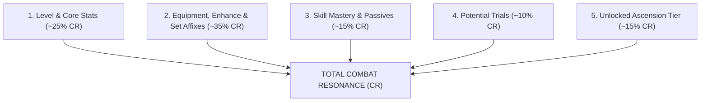
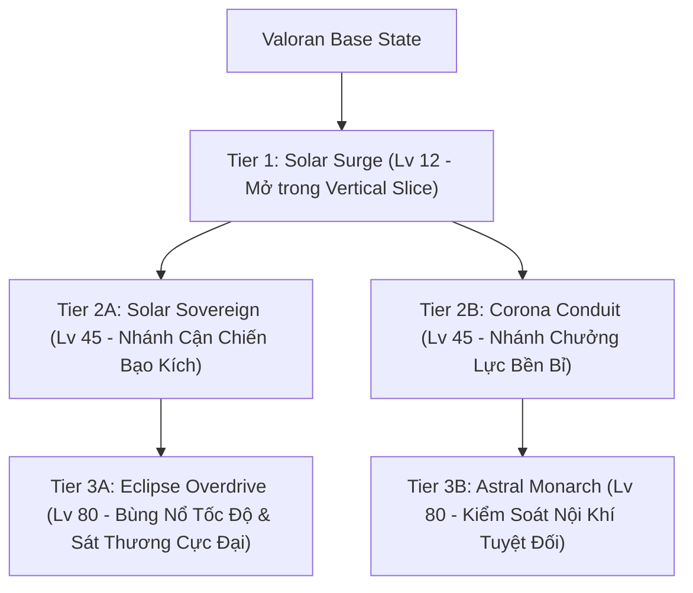

# 04. Character Creation & Hybrid Progression System

**Phân hệ:** `01_GDD` · **Tài liệu:** `04_Character_and_Hybrid_Progression.md`  
**Trạng thái:** Baseline khóa cho MVP (Level 1–100, 3 Chủng tộc) & Vertical Slice (`Valoran` Lv 1–15)

---

## 1. Hệ Thống Tạo Nhân Vật (`Character Creation`)

Người chơi không chọn các lớp nhân vật khóa cứng (*Tank / Healer / DPS*), mà khởi tạo một võ giả duy nhất thông qua:
1. **Lựa chọn Chủng tộc (`Race`):** Trong MVP mở 3 chủng tộc gốc (**Valoran**, **Terran**, **Sylvanar**); giai đoạn sau mở rộng thêm **Cryon**, **Aetherborn**, **Machina**.
2. **Tùy biến Ngoại hình (`Customization`):** Tỷ lệ cơ thể (trong khung chuẩn bộ xương chung ±8% chiều cao để đồng nhất Hitbox PvP), khuôn mặt, kiểu tóc/tinh thể sừng, màu mắt, hình dáng **Tinh Văn (`Astral Crest`)**, giọng hô chiến đấu và màu sắc hào quang cơ bản (`Base Chi Tint`).
3. **Chọn Khuynh hướng Võ học Khởi đầu (`Starter Martial Style`):** Quyết định món trang bị tân thủ và kỹ năng ô số `1` ban đầu, nhưng hoàn toàn có thể học mọi nhánh khác trong quá trình chơi.

### Bảng So Sánh 3 Chủng Tộc MVP (Cân bằng gốc tại Level 1)

| Chủng tộc | HP Gốc | Chi Gốc | Stamina | Phys Atk | Chi Atk | Defense | Nội tại Chủng tộc (`Racial Passive`) |
| :--- | :---: | :---: | :---: | :---: | :---: | :---: | :--- |
| **Valoran** | `520` | `100` | `100` | `24` | `18` | `16` | **`Battle Fervor`**: Mỗi khi mất 10% HP hoặc thực hiện *Perfect Guard*, nhận 1 cộng dồn *Fervor* (+2.5% Phys/Chi Atk trong 12s, tối đa 5 cộng dồn). |
| **Terran** | `480` | `120` | `110` | `20` | `22` | `17` | **`Harmonic Chi Flow`**: Giảm `8%` lượng `Chi` tiêu thụ của mọi kỹ năng chủ động, tăng `+15%` tốc độ hồi `Chi` cơ bản và `+5% Cooldown Reduction`. |
| **Sylvanar** | `580` | `110` | `100` | `18` | `20` | `21` | **`Crystalline Regen`**: Ngoài giao tranh 5s tự tạo lớp khiên tinh thể bằng `8% MaxHP`; tăng `+12%` hiệu quả hồi phục nhận vào và giảm `10%` thời gian chịu khống chế. |

---

## 2. Hệ Thống Chỉ Số Ba Tầng (`Three-Tier Attribute Architecture`)

Mỗi khi lên 1 Level (từ Lv 2 đến Lv 100), nhân vật nhận phần tăng trưởng tự động theo chủng tộc cộng với **5 Điểm Thuộc Tính Tự Do (`Stat Points`)** để phân bổ vào 5 thuộc tính gốc (`Vitality`, `Spirit`, `Endurance`, `Strength`, `Fortitude`), từ đó quy đổi sang 3 tầng chỉ số thực chiến:

### 2.1. Nhóm Chỉ Số Cơ Bản & Quy Đổi (`Core Attributes`)
- **Vitality (`VIT`):** `+12 MaxHP` và `+0.2 HP Regen/s` mỗi điểm.
- **Spirit (`SPI`):** `+3.5 Chi Attack`, `+2.5 MaxChi` và `+0.12 Chi Recovery/s` mỗi điểm.
- **Endurance (`END`):** `+1.5 MaxStamina` (trần cộng thêm từ điểm tiềm năng là `+100`) và `+0.35 Stamina Regen/s` mỗi điểm.
- **Strength (`STR`):** `+3.5 Physical Attack` và `+0.15% Guard Break Power` mỗi điểm.
- **Fortitude (`FOR`):** `+2.8 Defense` và `+0.08% All Resistance` mỗi điểm.

### 2.2. Nhóm Chỉ Số Chiến Đấu (`Combat Secondary Attributes` — Từ Trang bị, Kỹ năng & Buff)
- `PhysicalAttack` / `ChiAttack`: Sức tấn công vật lý và nội khí.
- `CritRate` (Khởi điểm `5%`, trần cứng `75%`) & `CritDamage` (Khởi điểm `150%`, trần mềm `300%`).
- `AttackSpeed` (Biên độ `100% – 140%` để giữ hoạt ảnh rõ ràng không bị giật khung hình) & `MovementSpeed` (`100% – 130%`).
- `ChiRecovery`: Hồi `Chi` tự nhiên mỗi giây (Cơ bản `3.5 Chi/s` ngoài giao tranh, `1.5 Chi/s` trong giao tranh).
- `CooldownReduction` (`CDR` — Trần cứng `40%`).

### 2.3. Nhóm Chỉ Số Tiềm Năng (`Potential Attributes` — Chỉ mở qua Khảo hạch & Huấn luyện)
Khác hoàn toàn với điểm Level, **5 chỉ số Tiềm năng không thể cộng bằng điểm lên cấp hay mua bằng tiền**, mà chỉ tăng khi người chơi vượt qua các **Training Trials** và nhiệm vụ cột mốc:

| Mã Chỉ Số (`PotentialSet`) | Thang Điểm | Tác Dụng Thực Chiến | Nguồn Mở Khóa Chính |
| :--- | :---: | :--- | :--- |
| `AscensionEfficiency` | `0 – 100` | Giảm tốc độ rút `Chi/s` khi duy trì trạng thái Hóa Cảnh tối đa tới `-45%`. | Nhiệm vụ Đột phá Hóa Cảnh & Hạ Boss cùng cấp một mình. |
| `ChiControl` | `0 – 100` | Tăng độ ổn định chưởng lực, giảm độ lệch đường đạn và giảm chi phí tụ lực tối đa `-20%`. | Khảo hạch Điều Khí tại Học viện *Neo Haven*. |
| `EnergyCapacity` | `0 – 100` | Mở rộng trần `MaxChi` thêm tối đa `+150 Chi` (rất quan trọng để tung chuỗi `Beam + Ultimate`). | Hấp thụ tinh hoa tại các *Resonance Shrines* ẩn khắp thế giới. |
| `FlightEfficiency` | `0 – 100` | Giảm tiêu hao `Chi` khi `High-Speed Flight` (theo công thức ở tài liệu `02`). | Hoàn thành đường đua không trung (*Aerial Rings Trials*). |
| `AstralResistance` | `0 – 100` | Giảm sát thương từ hiệu ứng môi trường dị thường (trọng lực cao, bức xạ vết nứt) và sát thương chuẩn của Boss. | Tầng sâu *Gravity Training Chamber*. |

---

## 3. Mô Hình Sức Mạnh Lai (`Hybrid Progression Power Model`)

Điểm **Combat Resonance (`CR`)** hiển thị trên hồ sơ nhân vật phản ánh tổng hòa 5 nguồn sức mạnh thay vì chỉ phụ thuộc một nguồn duy nhất:

> **Ý nghĩa thiết kế:** Một người chơi chỉ cày Level chay lên cấp 50 nhưng mặc đồ sơ sài và bỏ qua *Training Trials* sẽ yếu hơn rõ rệt so với một người chơi cấp 42 đã hoàn thiện bộ *Set 4 món*, rèn tốt chỉ số `Potential` và thành thạo tầng `Ascension` đầu tiên.

---

## 4. Đường Cong Cấp Độ `Level 1 – 100` (`Leveling Curve`)

Công thức lượng `EXP` cần thiết để thăng từ cấp $L$ lên $L+1$:

$$
\text{EXP}_{\text{next}}(L) = \left\lfloor 120 \times L^{2.15} + 80 \times L \right\rfloor
$$

| Giai Đoạn | Khoảng Level | Thời Gian Chơi Dự Kiến (Tích lũy) | Nội Dung Trọng Tâm |
| :--- | :---: | :---: | :--- |
| **Vertical Slice Cap** | `1 – 15` | `2.5 – 4 giờ` | Làm quen Bay 3D, Combo không chiến, farm tại *Cragspire Highlands*, mở khóa `Ascension Bậc 1`, hạ Boss *Colossus Kael*. |
| **Early Game** | `1 – 20` | `5 – 7 giờ` | Hoàn thành chương mở đầu tại *Neo Haven* & *Cragspire*, mở khóa đầy đủ 4 ô kỹ năng và chức năng Cường hóa/Party. |
| **Mid Game** | `21 – 50` | `20 – 35 giờ` | Thám hiểm *Emerald Canopy*, *Sunken Badlands*, *Riftscar*; săn *Elite* và *Regional Boss* ghép bộ Set đầu tiên; gia nhập Guild. |
| **Late Game** | `51 – 80` | `50 – 80 giờ` | Vùng dị thường tầng cao, *Hardcore Dungeons*, chinh phục tầng `Ascension Bậc 2`, tối ưu hóa dòng `Affix` trang bị *Epic/Legendary*. |
| **Endgame (MVP Cap)** | `81 – 100` | `90 – 130+ giờ` | *World Boss* cấp Tinh Vực, Boss Instance cấp 100, mở khóa nhánh `Ascension Đỉnh Cao`, thi đấu mùa giải *Arena PvP*. |

---

## 5. Hệ Thống Khảo Hạch Huấn Luyện (`Interactive Training System`)

Huấn luyện không phải là bấm nút treo máy chờ thanh thời gian chạy, mà là **các bài kiểm tra kỹ năng thực chiến ngắn (90 – 180 giây)** đặt tại Học viện *Neo Haven* hoặc Trạm Tiền Tiêu:

1. **Gravity Chamber Trials (Phòng Tập Trọng Lực — Bậc `2G` → `50G`):**
   - Trong phòng tập, tốc độ di chuyển và độ cao nhảy bị đè nặng nếu chỉ số `AstralResistance` thấp; các hình nhân máy phóng lưới tia laser tốc độ tăng dần và ảo ảnh võ sư liên tục tấn công.
   - Sống sót và đánh bại ảo ảnh trong thời gian quy định sẽ thưởng lượng lớn `Mastery Marks` + tăng vĩnh viễn điểm `AstralResistance` và `EnergyCapacity`.
2. **Master Sparring Duels (Đấu Tập Cùng Võ Sư NPC):**
   - Yêu cầu điều kiện kỹ thuật cụ thể (ví dụ: *"Thực hiện thành công 5 lần Perfect Guard và kết liễu Võ sư Kaelen bằng đòn Aerial Slam"*).
   - Phần thưởng: Mở khóa trực tiếp bí kíp kỹ năng mới hoặc nhánh biến thể của kỹ năng hiện có.
3. **Chi Resonance Calibration (Khảo Hạch Điều Khí):**
   - Giữ thanh tụ năng lượng nằm trong vùng dao động hẹp trong khi vừa bay lách qua chướng ngại vật để nâng chỉ số `ChiControl` và `FlightEfficiency`.

---

## 6. Hệ Thống Hóa Cảnh (`Ascension Transformation Trees`)

Mỗi chủng tộc sở hữu một **Cây Hóa Cảnh phân nhánh (Non-linear Ascension Tree)** thay vì một đường thẳng độc đạo, cho phép người chơi chọn trạng thái biến hình khớp với hướng Build của mình.

### Ví dụ chuẩn: Cây Hóa Cảnh của tộc `Valoran`

### Bảng Thông Số Chi Tiết Các Trạng Thái Hóa Cảnh (`Valoran`)

| Trạng thái | Điều kiện Mở khóa | Yêu cầu Kích hoạt | Hệ số Khuếch đại ($M_{\text{ascension}}$ & Buff) | Chi phí Duy trì & Rủi ro | Thay đổi Bộ Kỹ năng & Thị giác |
| :--- | :--- | :--- | :--- | :--- | :--- |
| **`Solar Surge`** *(Tier 1 — VS)* | Đạt `Lv 12` + Vượt bài khảo hạch *Trial of the First Spark* | `Chi >= 50` (Hoạt ảnh bùng nổ `0.65s`, đẩy lùi nhẹ kẻ địch sát bên `3m`) | `+18% Phys & Chi Atk`, `+10% Move/Flight Speed`, `+8% Defense` | Rút `4.5 Chi/s` (giảm theo `AscensionEfficiency`). Khi `Chi == 0` tự thoát trạng thái. | Kích hoạt **Aura Mantle** ánh vàng cam rực lửa, tinh văn vai sáng rực; đòn `LMB 4` phóng thêm sóng khí tầm trung. |
| **`Solar Sovereign`** *(Tier 2A)* | `Lv 45` + Hạ 3 *Regional Boss* + `AscensionEfficiency >= 35` | `Chi >= 65` | `+32% Phys Atk`, `+15% CritRate`, `+20% CritDamage` | Rút `7.5 Chi/s`, giảm `-5% Resistance` (đổi thủ lấy công). | Đòn `Aerial Pursuit` dịch chuyển tức thì thay vì bay thường; đòn `Heavy` tích điện nhanh gấp đôi. |
| **`Corona Conduit`** *(Tier 2B)* | `Lv 45` + `ChiControl >= 40` | `Chi >= 65` | `+30% Chi Atk`, `-15% Chi Skill Cost`, `+12% Defense` | Chỉ rút `4.0 Chi/s` cực kỳ ổn định cho trận đánh Boss dài hơi. | Chưởng `Solar Lance` tăng `25%` bề rộng tia và xuyên giáp thêm `15%`. |
| **`Eclipse Overdrive`** *(Tier 3A)* | `Lv 80` + Vượt *Gravity Trial 30G* | `Chi >= 85` | `+50% All Atk`, `+20% Attack/Flight Speed` | Rút `12.0 Chi/s` + khi kết thúc chịu `4.0s` trạng thái giảm `30%` tốc độ hồi `Chi` (*Overheat*). | Vòng tinh văn nhật thực đen-vàng xoay sau lưng; mở khóa tuyệt kỹ biến thể `Eclipse Obliteration`. |

---

## 7. Hệ Thống Build & Tái Phân Bổ (`Build Archetypes & Respec`)

Người chơi có thể định hình rõ 3 hướng Build chủ đạo (và các biến thể lai) trên bất kỳ chủng tộc nào:

1. **Vanguard Striker (Cận chiến Áp sát & Phá giáp):** Dồn điểm `STR` + `VIT`, săn trang bị cộng `PhysicalAttack`, `AttackSpeed`, `Stamina Regen`, dùng nhánh Hóa Cảnh `Solar Sovereign` và kỹ năng `Martial Rush` + `Barrier`.
2. **Astral Blaster (Pháo Đài Nội Khí Tầm Xa):** Dồn điểm `SPI`, săn trang bị cộng `ChiAttack`, `CritRate`, `CooldownReduction`, dùng nhánh `Corona Conduit` để xả liên hoàn `Starbreaker Barrage` và `Solar Lance` từ không trung.
3. **Hybrid Duelist (Chiến Binh Toàn Năng PvP/Solo Boss):** Cân bằng `STR / SPI / END`, tận dụng chuỗi cận chiến hất tung hồi nhanh `Chi` rồi hủy hoạt ảnh đòn đập đất sang chưởng `Solar Lance` chắc chắn trúng (`True Combo Finisher`).

**Chính sách Đổi Build (`Respec Policy`):**
- **Miễn phí 100%** từ `Level 1` đến `Level 20` để tân thủ thoải mái thử nghiệm.
- Từ `Level 21+`, người chơi có thể lưu sẵn **3 Bộ Hồ Sơ Trang Bị & Kỹ Năng (`Loadout Presets`)** chuyển đổi miễn phí tại vùng an toàn; riêng việc tẩy lại toàn bộ Điểm Thuộc Tính Gốc (`Stat Points`) tiêu tốn một lượng hợp lý `Kora` tại Học viện (có trần phí cố định để không trừng phạt người chơi muốn đổi gió ở Endgame).
