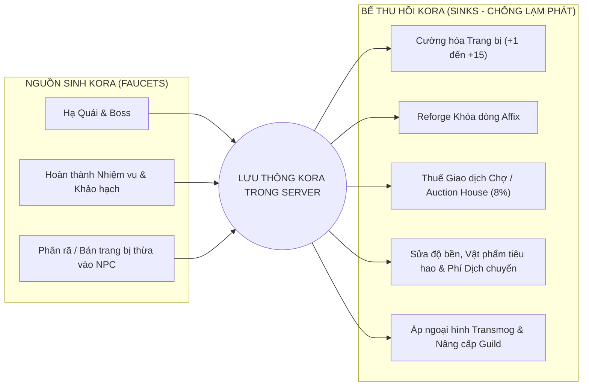

# 05. Loot, Equipment & Economy Design

**Phân hệ:** `01_GDD` · **Tài liệu:** `05_Loot_Equipment_and_Economy.md`  
**Trạng thái:** Baseline khóa cho MVP & Vertical Slice

---

## 1. Hệ Thống Trang Bị 8 Ô & Transmog (`Equipment Slots & Visual Decoupling`)

Mỗi nhân vật sở hữu **8 ô trang bị chiến đấu (`Stat Slots`)** độc lập hoàn toàn với **5 ô ngoại hình hiển thị (`Transmog / Outfit Slots`)**:

| Mã Ô (`ESlotType`) | Tên Ô Trang Bị | Nhóm Chỉ Số Chính Cố Định (`Implicit Base Stats`) | Hiển Thị Ngoại Hình 3D? |
| :--- | :--- | :--- | :--- |
| `HEAD` | **Headgear / Resonance Visor** | `MaxChi`, `CritRate` hoặc `Accuracy` | Có (Kính `Visor`, băng trán, mũ giáp nhẹ — có nút ẩn/hiện). |
| `BODY` | **Battle Tunic / Chestplate** | `MaxHP`, `Defense` (Tỷ trọng phòng thủ lớn nhất) | Có (Áo võ phục, giáp chiến Tinh Vực). |
| `LEGS` | **Greaves / Martial Pants** | `MaxHP`, `Defense`, `Stamina Regen` | Có (Quần võ đạo, giáp chân). |
| `HANDS` | **Gauntlets / Bracers** | `PhysicalAttack`, `ChiAttack`, `AttackSpeed` | Có (Găng tay, hộ uyển phát quang). |
| `FEET` | **Boots / Thruster Sabatons** | `Defense`, `MovementSpeed`, `FlightSpeedBonus` | Có (Giày chiến đấu). |
| `ACC_1` | **Astral Ring** | `PhysicalAttack` hoặc `ChiAttack` thuần | Không (Chỉ số thuần). |
| `ACC_2` | **Resonance Pendant** | `ChiRecovery`, `CooldownReduction`, `Resistance` | Không (Chỉ số thuần). |
| `SPECIAL` | **Relic Core (Lõi Thánh Vật)** | Hiệu ứng đặc biệt theo Chủng tộc / Kỹ năng / Hóa Cảnh | Hiển thị hiệu ứng hạt sáng nhỏ quanh thắt lưng hoặc lưng khi bật chọn. |

**Quy tắc Transmog:** Khi người chơi nhặt được bất kỳ trang bị nào có mẫu 3D mới và chọn khóa (`Bind`) món đồ đó, mẫu ngoại hình sẽ được mở khóa vĩnh viễn trong **Wardrobe (`Tủ Ngoại Trang`)**. Người chơi tốn một lượng nhỏ `Kora` để áp ngoại hình yêu thích lên bất kỳ món đồ mạnh nào đang mặc.

---

## 2. Hệ Thống Phẩm Cấp & Ngân Sách Dòng Phụ (`Rarity & Affix Budget System`)

### 2.1. Sáu Bậc Phẩm Cấp (`EZIUItemRarity`)

| Phẩm cấp | Màu hiển thị | Số dòng phụ (`Random Affixes`) | Hệ số Chỉ số Gốc | Hiệu ứng Nội tại Riêng (`Unique Passive`) |
| :--- | :--- | :---: | :---: | :--- |
| `COMMON` | Trắng (`#E0E0E0`) | `0 – 1` | `1.00x` | Không |
| `UNCOMMON` | Xanh lá (`#4CAF50`) | `1 – 2` | `1.08x` | Không |
| `RARE` | Xanh lam (`#2196F3`) | `2 – 3` | `1.16x` | Không |
| `EPIC` | Tím (`#AB47BC`) | `3 – 4` | `1.25x` | Có thể thuộc bộ `Set Equipment` |
| `LEGENDARY` | Vàng cam (`#FF9800`) | `4` | `1.35x` | **1 Dòng Đặc Hữu (`Signature Effect`)** hoặc mảnh `High-Tier Set` |
| `MYTHIC` | Đỏ Tinh Vân (`#FF1744`) | `4 + 1 Innate` | `1.42x` | **Biến đổi cơ chế kỹ năng** (Giới hạn mặc tối đa `2 món Mythic` cùng lúc để chống lệch cân bằng) |

### 2.2. Tại sao đồ `Epic` chuẩn Build vẫn thắng đồ `Legendary` lệch dòng?
Hệ thống được thiết kế để người chơi **đọc và săn đúng dòng thuộc tính** thay vì nhắm mắt mặc đồ có màu hiếm hơn:
- Chênh lệch chỉ số gốc (`Base Stat`) giữa `Epic` và `Legendary` cùng cấp độ chỉ là **~8%** (`1.35 / 1.25 = 1.08`).
- Trong khi đó, **4 dòng phụ (`Affixes`) khớp hoàn hảo với Build** (ví dụ: `+12% Chi Damage`, `+7.5% Crit Rate`, `+18%Crit Damage`, `+9% Cooldown Reduction` cho một *Astral Blaster*) đóng góp tới **+35% – +45% hiệu suất đầu ra thực tế** so với một món `Legendary` rơi ra toàn dòng lệch (`+HP Regen`, `+Physical Damage`, `+Guard Stamina`).

### 2.3. Phân Nhóm Bể Thuộc Tính Ngẫu Nhiên (`Affix Pools`)
Mỗi món trang bị khi rơi ra được Server chọn không trùng lặp các dòng từ 4 bể trọng số (mỗi dòng có `Tier 1` đến `Tier 5` tùy theo `ItemLevel`):
1. **Offensive Pool:** `Flat/Percent PhysicalAttack`, `Flat/Percent ChiAttack`, `CritRate`, `CritDamage`, `GuardPenetration`.
2. **Defensive Pool:** `Flat/Percent MaxHP`, `Flat/Percent Defense`, `AllResistance`, `StaggerReduction`.
3. **Utility Pool:** `ChiRecovery`, `MaxChi`, `CooldownReduction`, `MovementSpeed`, `StaminaCostReduction`.
4. **Special / Build-Enabling Pool (Chỉ xuất hiện từ `Rare+`):** `AscensionEfficiency`, `SolarLanceDamageBonus`, `AerialComboDamageBonus`, `ChiGainOnMeleeHit`.

---

## 3. Trang Bị Theo Bộ (`Set Equipment`)

Các món trang bị từ *Dungeon*, *Regional Boss* và *Pity Shop* mang mã `set_id`. Mặc đủ mốc `2 / 4 / 6` món kích hoạt hiệu ứng cộng hưởng mà không bắt buộc cố định cứng từng vị trí (có 7 món trong 1 bộ để người chơi linh hoạt chừa 1–2 ô mặc đồ `Legendary/Mythic` rời!).

**Ví dụ chuẩn trong Vertical Slice — Bộ `Cragspire Vanguard Set` (Item Level 15, Epic):**
- **2 Món:** `+8% Physical Attack` và `+8% Chi Attack`.
- **4 Món:** Đòn `Aerial Pursuit` tiêu tốn `0 Stamina` và tăng `+20%` sát thương cho đòn đánh kế tiếp trong `3.0 giây`.
- **6 Món:** Khi kích hoạt trạng thái Hóa Cảnh (`Ascension`), giải phóng sóng chấn động gây `220% Atk` sát thương xung quanh và hồi ngay `30 Chi`.

---

## 4. Hệ Thống Nâng Cấp Không Phá Hủy Trang Bị (`Non-Destructive Upgrade System`)

Kế thừa sự hồi hộp khi đập đồ của dòng MMORPG cày cuốc nhưng **loại bỏ hoàn toàn cơ chế nổ mất vĩnh viễn trang bị** gây bỏ game hàng loạt:

### 4.1. Cường Hóa Cấp Độ (`Enhancement +1 → +15`)

| Mốc Cường Hóa | Tỉ Lệ Thành Công Cơ Bản | Hậu Quả Khi Thất Bại | Bảo Hiểm Tích Lũy (`Artisan's Energy`) |
| :---: | :---: | :--- | :--- |
| `+1 → +5` | `100% → 80%` | **Không tụt cấp**, không hỏng đồ, chỉ tiêu hao `Kora` + `Astral Shard T1`. | Mỗi lần xịt tích lũy năng lượng thợ rèn; đủ `100%` lần đập kế tiếp **chắc chắn thành công 100%**. |
| `+6 → +10` | `65% → 35%` | **Không tụt cấp** (có chốt an toàn cứng tại `+5` và `+10`). | Đủ `100% Artisan's Energy` auto thành công. |
| `+11 → +15` | `25% → 8%` | Giữ nguyên cấp (hoặc giảm tối đa `1 bậc` nếu chưa tới chốt `+10`, **tuyệt đối không bao giờ vỡ mất đồ**). | Trần bảo hiểm rõ ràng (tối đa không quá `10 lần` thử ở mốc `+15`). |

### 4.2. Tinh Luyện Dòng Phụ & Khảm Lõi (`Reforge & Socket`)
- **Reforge (Đổi dòng ngẫu nhiên):** Cho phép **Khóa tối đa 1 dòng `Affix` ưng ý**, sau đó tiêu hao `Kora` + `Astral Shards` để quay lại các dòng còn lại. Chi phí `Kora` tăng nhẹ sau mỗi lần quay trên cùng món đồ và đặt lại một phần theo tuần, đóng vai trò bể hút tiền (`Currency Sink`) chủ lực.
- **Socket (Khảm Tinh Hạch — mở từ Level 30):** Vũ khí/Áo giáp có `1 – 2` lỗ khảm viên ngọc cố định chỉ số (`Ruby Resonance: +Phys Atk`, `Sapphire Resonance: +Chi Atk`, `Emerald Resonance: +HP`). Tháo ngọc trả phí `Kora`, không mất ngọc.

---

## 5. Cơ Chế Rơi Vật Phẩm, Chống Khai Thác & Bảo Hiểm Boss (`Loot & Pity Architecture`)

### 5.1. Ma Trận Nguồn Rơi Vật Phẩm (`Loot Sources`)

| Nguồn hạ gục | EXP & Kora | Nguyên liệu (`Astral Shards`) | Trang bị rơi trực tiếp | Huy hiệu Bảo hiểm (`Pity Token`) |
| :--- | :---: | :---: | :--- | :---: |
| **Normal Monster** | Chuẩn `1x` | Tỉ lệ `22%` (`Shard T1`) | `Common (8%)`, `Uncommon (1.5%)` | Không |
| **Elite Monster** | `5.5x` | Tỉ lệ `85%` (`1–2 Shards`) | `Uncommon (35%)`, `Rare (12%)`, `Epic (1.2%)` | Không |
| **Mini-Boss / Dungeon** | `15x` | Chắc chắn `3–5 Shards` | `Rare (60%)`, `Epic / Set Piece (18%)`, `Legendary (1.5%)` | `1 Dungeon Crest` |
| **Regional Boss** *(VD: Kael)* | `30x` | Chắc chắn `6–10 Shards` | `Rare (100% 1 món)`, `Epic / Set (25%)`, `Legendary (2.0%)` | **Chắc chắn `2 – 3 Core Tokens`** |
| **World Boss** | `60x` | Chắc chắn `15+ Shards` cao cấp | Theo bậc Đóng góp (`Epic 50%`, `Legendary 6%`, `Mythic 0.5%`) | **Chắc chắn `5 Sovereign Tokens`** |

### 5.2. Personal Loot & Chống Kéo Cấp / Chống Bot (`Anti-Exploit Rules`)
1. **100% Server-Side Personal Loot:** Khi quái hoặc Boss bị hạ, Go `LootService` tính toán gói phần thưởng riêng biệt cho từng người chơi đủ điều kiện đóng góp (gây tối thiểu `2% HP` lên quái thường/Elite, hoặc đạt ngưỡng điểm đóng góp tối thiểu ở Boss). Không ai có thể cướp đồ rơi dưới đất của người khác.
2. **Anti-Power-Leveling Suppression:** Nếu trong cùng `Party` (hoặc người kết liễu quái ngoài thế giới mở) có người chơi vượt quá cấp quái từ **15 Level trở lên**, người chơi cấp thấp đứng cạnh chỉ nhận `10% EXP` và bị khóa rơi nguyên liệu `Unbound` để triệt tiêu nạn dùng acc cấp 100 kéo dàn acc clone cấp 5 farm tiền.
3. **Diminishing Bot Guard:** Nếu một nhân vật đứng farm lặp đi lặp lại trong bán kính `< 80m` suốt hơn `3 giờ liên tục` với mẫu input bất thường mà không đi làm nhiệm vụ/đổi vùng/vào Boss, tỉ lệ rơi `Kora` và đồ `Unbound` giảm dần, đồng thời hệ thống gắn cờ telemetry để kiểm tra hành vi tự động hóa.

### 5.3. Hệ Thống Bảo Hiểm Săn Boss (`Boss Pity Token & Deterministic Progress`)
Để người chơi không bao giờ rơi vào cảnh *"đánh Boss 200 lần trắng tay"*:
- Mỗi lần hạ Boss **Vanguard Colossus Kael** (Vertical Slice), ngoài tỉ lệ rơi hên xui món **Legendary `Kael's Solar Gauntlets` (2%)** hoặc mảnh **`Cragspire Vanguard Set` (25%)**, người chơi **luôn nhận chắc chắn `2 Colossus Core Tokens`**.
- Tại NPC *Quartermaster* ở trạm tiền tiêu, người chơi dùng `12 Tokens` (tương đương 6 lần hạ Boss) để đổi bất kỳ mảnh *Epic Set* nào còn thiếu, hoặc `40 Tokens` (20 lần hạ Boss) để đổi trực tiếp hộp vũ khí/hộ uyển *Legendary* của Kael (dòng phụ vẫn quay ngẫu nhiên lúc mở hộp để giữ động lực săn tiếp món có dòng hoàn hảo hơn!).

---

## 6. Hệ Thống Kinh Tế & Kiểm Soát Lạm Phát (`Macro Economy & Binding Rules`)

### 6.1. Dòng Chảy Tiền Tệ `Kora` (Faucets vs. Sinks)

### 6.2. Ma Trận Khóa Vật Phẩm (`Item Binding Rules` — Chống RMT & Bot)

Không cho phép giao dịch tự do 100% mọi vật phẩm trong game. Phân loại khóa bắt buộc như sau:

| Loại Vật Phẩm | Trạng Thái Mặc Định | Quy Tắc Giao Dịch | Lý Do Kinh Tế |
| :--- | :--- | :--- | :--- |
| Nguyên liệu `Astral Shards` (rơi từ vùng cấp tương đương) | `UNBOUND` | Giao dịch qua Chợ (`Auction House` / `Direct Trade`). | Tạo sức sống thương mại giữa người chuyên cày nguyên liệu và người chuyên săn Boss. |
| Trang bị `Rare / Epic / Legendary` rơi ngoài thế giới / Dungeon | `BIND_ON_EQUIP (BoE)` | Giao dịch được **khi chưa mặc hoặc chưa cường hóa/Reforge**; ngay khi mặc lên người sẽ chuyển thành `BOUND`. | Ngăn một món đồ mạnh được truyền tay vô hạn qua hàng chục tài khoản làm mất giá trị săn đồ mới. |
| Trang bị đổi từ `Boss Pity Shop`, đồ `Mythic`, vật phẩm Nhiệm vụ & Đột phá `Ascension` | `BIND_ON_PICKUP (BoP)` | **Khóa cứng nhân vật ngay khi nhận**, không thể giao dịch. | Đảm bảo những thành tựu đỉnh cao nhất bắt buộc phải do chính tay chủ nhân vật chinh phục. |
| Tiền tệ `Mastery Marks` & `Boss Core Tokens` | `CHARACTER_BOUND` | Khóa nhân vật. | Ngăn dùng tiền mua đứt tiến trình huấn luyện kỹ năng và bảo hiểm Boss. |
