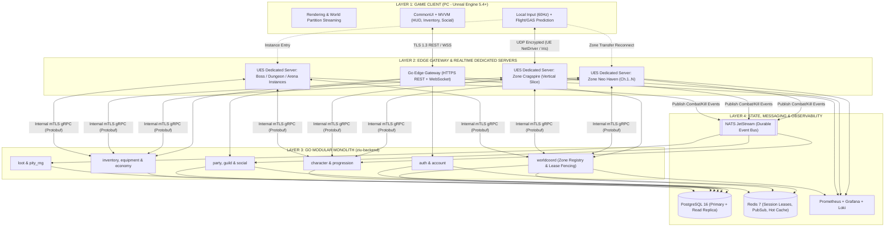

# 01. System Architecture Overview

**Phân hệ:** `02_TECHNICAL_ARCHITECTURE` · **Tài liệu:** `01_System_Architecture_Overview.md`  
**Trạng thái:** Kiến trúc khóa chính thức cho Vertical Slice & MVP

---

## 1. Triết Lý Kiến Trúc Cốt Lõi (`Architectural Philosophy`)

Một tựa game **3D Open-World Action MMORPG** có cơ chế bay lượn và chiến đấu tốc độ cao đứng trước hai cạm bẫy kỹ thuật phổ biến nhất:
1. **Cạm bẫy "Single Giant Server":** Cố nhồi nhét toàn bộ hành tinh và hàng nghìn người chơi vào một process Unreal Dedicated Server duy nhất → CPU nghẽn cổ chai ở luồng vật lý/GAS ngay ngưỡng 120–150 thực thể hoạt động mạnh.
2. **Cạm bẫy "Premature Microservice Explosion":** Chia nhỏ 20 microservices ngay từ ngày đầu khi chưa có nổi 1 vùng bản đồ chơi được → Đội ngũ kiệt sức vì độ trễ mạng nội bộ, distributed transactions và vận hành DevOps.

**Giải pháp kiến trúc của `ZENITH: INFINITE UNIVERSE`:**
- **Ở tầng Mô phỏng Thời gian thực (Simulation Layer):** Tách thế giới thành nhiều process **UE5 Authoritative Dedicated Server theo từng Zone/Channel và Instance**, trong đó mỗi process gộp chung cả **World Simulation + Combat GAS Authority** để đạt độ trễ nội bộ `0ms` giữa chuyển động và tính sát thương.
- **Ở tầng Nghiệp vụ & Dữ liệu bền vững (Backend Layer):** Xây dựng bằng **Go 1.23+ theo mô hình Modular Monolith** (một binary `gamesvc` duy nhất phân tách nghiêm ngặt thành 12 package nghiệp vụ giao tiếp qua interface nội bộ + một binary `gateway` ở biên), kết hợp **PostgreSQL 16**, **Redis 7** và **NATS JetStream**. Khi một phân hệ (như `Chat/Social` hoặc `Loot`) cần scale độc lập ở giai đoạn sau MVP, có thể tách riêng thành microservice trong vài giờ mà không phải viết lại logic.

---

## 2. Kiến Trúc Tổng Thể 4 Lớp (`Four-Layer Topology`)

---

## 3. Phân Định Ranh Giới Trách Nhiệm (`Responsibility Matrix`)

Quy tắc sắt: **Không bao giờ để hai thành phần cùng giữ quyền quyết định chân lý (Source of Truth) cho một loại dữ liệu.**

| Miền dữ liệu / Hành vi | UE5 Client | UE5 Dedicated Server (Zone/Instance) | Go Backend (`ziu-backend` + PostgreSQL) |
| :--- | :--- | :--- | :--- |
| **Vị trí 3D, Vận tốc bay, Trạng thái Hoạt ảnh** | Dự đoán cục bộ (`Client Prediction`) & Nội suy thực thể khác | **Authoritative Owner** trong suốt phiên chơi tại Zone | Chỉ lưu tọa độ `Checkpoint` định kỳ và khi chuyển Zone / Logout |
| **HP, Chi, Stamina, Cooldown, Hitbox, Sát thương** | Hiển thị dự đoán UI & hiệu ứng `GameplayCue` | **Authoritative Owner** (tính toán qua GAS `30Hz`) | Lưu chỉ số gốc (`Base Attributes`) và trạng thái máu/khí lúc ngắt kết nối |
| **AI Quái vật, Giai đoạn Boss, Bảng Aggro/Contribution** | Chỉ nhận trạng thái tái hiện hình ảnh | **Authoritative Owner** (`StateTree` / `BehaviorTree`) | Nhận kết quả tổng kết hạ Boss qua sự kiện `combat.boss.defeated.v1` |
| **Tài khoản, Phiên đăng nhập, Quyền sở hữu Nhân vật (`lease_epoch`)** | Giữ `Access JWT` trên RAM | Kiểm tra `ConnectTicket` từ `worldcoord` khi người chơi vào map | **Authoritative Owner** (Redis Lease + PostgreSQL) |
| **Túi đồ, Cường hóa, Quay Loot, Tiền `Kora`, Giao dịch** | Gửi yêu cầu thao tác & hiển thị kết quả | Nhận thông báo cập nhật chỉ số trang bị mới từ Backend qua gRPC stream | **Authoritative Owner 100%** (Mọi thay đổi kinh tế đi qua ACID SQL Transaction) |
| **Chat, Bạn bè, Tổ đội liên vùng, Bang hội** | Kết nối trực tiếp `WSS` tới `Edge Gateway` | Nhận danh sách `PartyID / GuildID` để tính thưởng EXP nhóm và luật PvP | **Authoritative Owner** |

---

## 4. Công Nghệ Lựa Chọn & Lý Do Kỹ Thuật (`Technology Justification`)

| Thành phần | Phiên bản khóa | Lý do chọn và Giới hạn sử dụng rõ ràng |
| :--- | :--- | :--- |
| **Unreal Engine** | `UE 5.4+` (Source Build bắt buộc để biên dịch `Server Target`) | Cung cấp sẵn `CharacterMovementComponent` có mạng dự đoán, `World Partition` cho bản đồ lớn, `GAS` cho hệ thống kỹ năng/biến hình phức tạp và `Iris / ReplicationGraph` để lọc thực thể theo lưới không gian. |
| **C++20 + Blueprint** | Chuẩn UE Coding Standard | **100% logic mạng, bay, GAS, kiểm tra hitbox viết bằng C++** để đạt hiệu năng CPU cao trên Dedicated Server (nơi mỗi mili-giây tick quyết định chi phí thuê máy chủ). Blueprint chỉ dùng gắn Asset, Montage, Niagara VFX và bố cục UI. |
| **Go (`Golang`)** | `Go 1.23+` | Biên dịch tĩnh ra binary nhẹ vài chục MB, tiêu thụ RAM cực thấp, xử lý hàng chục nghìn kết nối `gRPC` / `WebSocket` đồng thời bằng goroutines mà không chịu hiện tượng GC pause dài. |
| **PostgreSQL** | `PostgreSQL 16` | Hỗ trợ giao dịch ACID nghiêm ngặt, khóa dòng `SELECT ... FOR UPDATE`, kiểu `JSONB` có đánh chỉ mục GIN cho dòng thuộc tính ngẫu nhiên (`rolled_affixes`) mà vẫn giữ toàn vẹn quan hệ cho tiền tệ và túi đồ. |
| **Redis** | `Redis 7` | Quản lý khóa phân tán có thời hạn (`Character Session Lease`), danh sách trạng thái máy chủ Zone sống (`Heartbeat TTL`) và kênh `Pub/Sub` đẩy tin nhắn Chat/Party tức thời giữa các node Gateway. |
| **NATS JetStream** | `NATS 2.10+` | Nhẹ và nhanh hơn rất nhiều so với Kafka cho quy mô MVP/Mid-scale, nhưng vẫn đảm bảo lưu bền sự kiện (`At-least-once delivery` + khử trùng lặp `Nats-Msg-Id`) cho đường ống trả thưởng hạ Boss. |

---

## 5. Lộ Trình Tiến Hóa Kiến Trúc Từ Vertical Slice → Quy Mô Lớn

1. **Giai đoạn Vertical Slice (`10 – 20 CCU`):**
   - `1` process UE5 Dedicated Server chạy map `Cragspire Highlands`.
   - `1` container `ziu-gateway` + `1` container `ziu-gamesvc` + `PostgreSQL` + `Redis` + `NATS` chạy gọn gàng trên một cụm `Docker Compose` duy nhất (có thể chạy toàn bộ ngay trên 1 máy trạm lập trình 32GB RAM!).
2. **Giai đoạn MVP Alpha (`500 – 2,000 CCU` toàn cụm):**
   - `5+` process UE5 Dedicated Server (mỗi Zone 1–3 Channels tùy mật độ người chơi) + nhóm process Instance Server quản lý bởi **Agones trên Kubernetes**.
   - `ziu-gamesvc` chạy `2–3 replicas` không trạng thái (*stateless*) đứng sau cân bằng tải gRPC nội bộ, dùng chung cụm PostgreSQL Managed (có 1 Read Replica) và Redis Sentinel.
3. **Giai đoạn Mở rộng Thương mại (`10,000+ CCU`):**
   - Tách các package `social/chat`, `loot` và `analytics` từ `ziu-gamesvc` thành các deployment độc lập mà không cần sửa đổi giao thức của UE5 Dedicated Server; phân mảnh cơ sở dữ liệu theo Cụm Tinh Vực (`Realm/Region Sharding`) nếu mở máy chủ đa châu lục (SEA, NA, EU).
