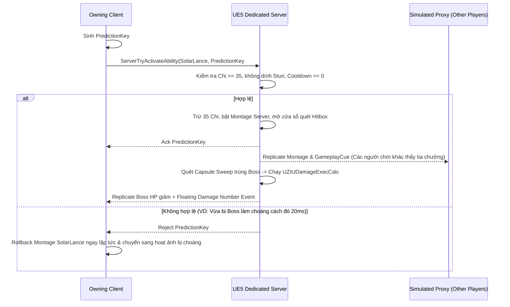

# 02. Network Protocol, Combat Synchronization & Zone Transfer

**Phân hệ:** `02_TECHNICAL_ARCHITECTURE` · **Tài liệu:** `02_Network_Protocol_and_Combat_Sync.md`  
**Trạng thái:** Đặc tả kỹ thuật khóa cho UE5 NetDriver & Go World Coordinator

---

## 1. Ngân Sách Tần Suất Mạng & Mô Phỏng (`Tick Rate & Bandwidth Budget`)

Để chiến đấu hành động trên không đạt cảm giác nhạy bén trong khi một Zone Server vẫn gánh được **80 – 100 người chơi + 150 AI quái vật**, ngân sách tần suất được thiết lập như sau:

| Thành phần xử lý | Tần suất mục tiêu | Ghi chú kỹ thuật triển khai trên UE5 |
| :--- | :---: | :--- |
| **Client Input Sampling & Local Render** | `60 – 144 Hz` | Lấy mẫu phím/chuột mỗi frame trên Client; đóng gói `FSavedMove_ZIUFlight` gửi lên Server tối đa `60 gói/s` (gộp move nếu FPS cao hơn 60). |
| **Dedicated Server Fixed Tick (`NetServerMaxTickRate`)** | **`30 Hz` (`33.33 ms/frame`)** | Điểm cân bằng vàng cho Action MMORPG thế giới mở (riêng `Arena PvP Instance Server` ít người có thể bật cấu hình chạy ở **`60 Hz`**!). |
| **Replication Update Rate (Gần `< 35m`)** | `20 – 30 Hz` | Đồng bộ đầy đủ vị trí, góc quay, trạng thái GAS, hoạt ảnh chiến đấu. |
| **Replication Update Rate (Trung bình `35m – 100m`)** | `10 Hz` | Nội suy chuyển động bay mượt bằng `Hermite/Linear Velocity Extrapolation`, giảm cập nhật chi tiết phụ. |
| **Replication Update Rate (Xa `100m – 250m`)** | `2 – 4 Hz` | Chỉ gửi vị trí thô và cờ trạng thái bay/biến hình hào quang lớn. |
| **Cull Distance (Ngoài `> 250m` đối với Player/Mob thường)** | `0 Hz (Dormant/Culled)` | Không gửi qua mạng (riêng *World Boss* có bán kính hiển thị đặc biệt `500m`). |
| **Ngân sách băng thông mỗi Client** | `< 45 KB/s Down` · `< 12 KB/s Up` | Tránh nghẽn đường truyền gia đình ngay cả trong trận vây đánh Boss 40 người. |

---

## 2. Dự Đoán Phía Client & Hòa Giải Cho Bay 3D + GAS (`Client Prediction & Reconciliation`)

### 2.1. Đồng Bộ Chuyển Động Bay 3D (`CMC Network Prediction`)
Nếu đợi gói tin đi-về (`RTT 50–90ms`) mới cho nhân vật bay hoặc lướt né, người chơi sẽ cảm thấy nhân vật nặng như chì. Quy trình chuẩn:
1. Tại thời điểm $T_c$, người chơi nhấn `Left Shift + Space + W` để bay vọt lên: `UZIUFlightMovementComponent` trên Client lập tức tính vận tốc mới, dịch chuyển nhân vật trên màn hình và lưu bản ghi `(TimeStamp, FlightMode, InputVector, CompressedFlags, EndLocation)` vào bộ đệm `SavedMoves`.
2. Gói tin `ServerMovePacked` gửi qua UDP lên Dedicated Server.
3. Server chạy lại đúng hàm vật lý `PhysCustom_Flight(DeltaTime)` với cùng dữ liệu đầu vào:
   - Nếu sai số vị trí $|\mathbf{P}_{\text{server}} - \mathbf{P}_{\text{client}}| \le 12\text{ cm}$: Server gửi `ClientAckGoodMove`.
   - Nếu sai số $> 12\text{ cm}$ (do va chạm người khác, trúng hiệu ứng đẩy lùi của Boss hoặc gian lận tốc độ): Server gửi `ClientAdjustPosition` kèm trạng thái chuẩn tại $T_s$. Client đặt lại vị trí về $\mathbf{P}_{\text{server}}$ rồi **chạy tua lại (`Replay`) toàn bộ các `SavedMoves` từ sau $T_s$ đến hiện tại** và làm mượt khung hình camera trong `0.08s` để không giật cục.

### 2.2. Dự Đoán Kỹ Năng & Hồi Chiêu Bằng `GAS PredictionKey`
Khi người chơi bấm chuột trái đánh combo hoặc bấm phím `2` phóng chưởng `Solar Lance`:

---

## 3. Bù Trừ Độ Trễ Có Trần Giới Hạn (`Bounded Server-Side Lag Compensation`)

Trong không chiến tốc độ `24 m/s`, vị trí kẻ địch mà Client nhìn thấy thực chất là vị trí trong quá khứ cách đây khoảng `RTT/2 + InterpolationDelay` (`~60–100ms`). Để đòn đánh tầm xa (`Chi Volley`, `Solar Lance`) và đòn lao kích (`Comet Fang`) không bị cảm giác *"bắn xuyên người không mất máu"*:

1. Dedicated Server lưu bộ đệm vòng **Lịch sử Khung Va chạm Đứng đầu (`Bounding Capsule History Ring Buffer`)** trong `250ms` gần nhất (ở `30Hz` chỉ tốn `8 mẫu × 32 bytes = 256 bytes` RAM cho mỗi nhân vật/Boss — cực kỳ nhẹ!).
2. Khi nhận yêu cầu kiểm tra đường bắn tại dấu thời gian khách `ClientViewTimestamp`, Server tính độ lùi thời gian:
   $$T_{\text{rewind}} = \text{ clamp }\left(\text{ServerNow} - \text{ClientViewTimestamp},\; 0\text{ ms},\; \mathbf{150\text{ ms}}\right)$$
3. **Trần cứng `150ms` (`MaxLagCompRewindMs = 150`)**: Bảo vệ người chơi có mạng tốt không bị trúng đòn oan khi họ đã lướt nấp sau cột đá từ rất lâu trước mắt kẻ có ping `500ms`.
4. **Ưu tiên Phòng thủ (`Favor the Defender on i-Frames`):** Nếu tại thời điểm hiện tại của Server (hoặc tại thời điểm tua lại đã xác thực), mục tiêu đang ở trong khung bất tử `Burst Dash i-Frame` hoặc `Perfect Guard`, đòn tấn công **bắt buộc bị vô hiệu hóa** dù màn hình bên tấn công thấy trúng.

---

## 4. Quản Lý Mức Độ Quan Tâm Không Gian 3D (`Iris / ReplicationGraph Interest Management`)

Không bao giờ lặp qua toàn bộ $N \times N$ thực thể mỗi frame. Hệ thống mạng cấu hình **3D Spatial Grid + Relevancy Groups**:

- **Spatial Grid Node (`Cell Size = 100m × 100m`):** Chỉ đánh giá các Actor nằm trong ô hiện tại và 8 ô lân cận. Do game có trục độ cao `Z` lớn, khoảng cách lọc thực tế dùng khoảng cách cầu 3D:
  $$d_{3D}^2 = \Delta x^2 + \Delta y^2 + 0.75\,\Delta z^2$$
- **Always-Relevant Party & Target:** Các thành viên cùng `Party` (tối đa 4 người khác) và mục tiêu đang bị khóa (`LockedTarget`) luôn giữ kết nối trạng thái cơ bản để thanh máu đồng đội và con trỏ dẫn đường hoạt động chính xác.
- **GameplayCue Throttling (Chống bão gói tin VFX khi đánh Boss 40 người):**
  - Các hiệu ứng nổ nhỏ lẻ (`Light Hit Spark`, `Footstep`, `Small Chi Impact`) **không gửi dưới dạng Reliable RPC** mà dùng `Unreliable Multicast / Replicated State` và gộp tối đa `1 hiệu ứng va chạm / 0.15s` đối với đòn của người chơi không cùng Party đứng cách xa `> 25m`.

---

## 5. Giao Thức Chuyển Vùng An Toàn (`Lease-Fenced Zone Transfer Protocol`)

Trong MVP, để đạt độ tin cậy tuyệt đối 100% không mất đồ/nhân đôi nhân vật, quá trình chuyển giữa 2 Zone (ví dụ từ *Neo Haven City* sang *Cragspire Highlands*) sử dụng **Controlled Transition (màn hình chuyển cảnh mờ nhanh `1.5 – 3.0 giây` trong khi giữ kết nối Chat/Party liên tục qua Gateway)**:

### Các Bước Bàn Giao Có Khóa `lease_epoch`
1. **Trigger:** Nhân vật bay vào `AZIUZoneTransitionVolume` tại ranh giới vùng A → B (hoặc kích hoạt Cổng Dịch Chuyển).
2. **Freeze & Snapshot trên Zone A:**
   - Zone A gắn cờ `bIsTransferring = true` lên `AZIUPlayerController`, từ chối mọi thao tác nhặt đồ/dùng kỹ năng mới và gom trạng thái tức thời (`HP`, `Chi`, `ActiveBuffs`, `TargetSpawnTransform` tại vùng B).
   - Zone A gọi gRPC `WorldCoordinator.PrepareZoneTransfer(character_id, current_lease_epoch, snapshot)`.
3. **Atomic Epoch Bump tại Go `WorldCoordinator`:**
   - Kiểm tra khóa Redis `ziu:lease:char:{char_id}` đúng là thuộc về `ZoneA` với `epoch == current_lease_epoch`.
   - Trong một giao dịch PostgreSQL, lưu vào `character_save_snapshots` và cập nhật `characters.last_lease_epoch = epoch + 1`, `current_zone = 'zone_cragspire'`.
   - Chọn instance `ZoneB` còn chỗ trống (ưu tiên Channel có thành viên cùng `Party`), phát hành mã `transfer_ticket` một lần (ký HMAC, hết hạn sau `20 giây`) trên Redis.
4. **Client Travel & Claim trên Zone B:**
   - Zone A gửi `ClientTravel("ZoneB_IP:Port?ticket=...")` cho Client rồi hủy Pawn nhân vật trên Zone A sau `0.2s`.
   - Client kết nối UDP tới Zone B; hàm `AZIUGameMode::PreLogin` trên Zone B gọi gRPC `WorldCoordinator.ClaimCharacterLease(transfer_ticket, zone_b_instance_id)`.
   - `WorldCoordinator` thu hồi vé một lần, nâng `lease_epoch = epoch + 2`, gán chủ sở hữu mới trên Redis là `ZoneB` và trả toàn bộ hồ sơ nhân vật + trang bị cho Zone B khởi tạo Pawn.
5. **Xử lý Sự cố (`Failure Recovery`):**
   - Nếu Client rớt mạng giữa lúc đang chuyển vùng (vé hết hạn `20 giây` không ai nhận): trạng thái nhân vật đã nằm an toàn trong PostgreSQL tại vị trí cổng vào Zone B. Lần đăng nhập sau người chơi xuất hiện nguyên vẹn tại Zone B, không kẹt tài khoản!
