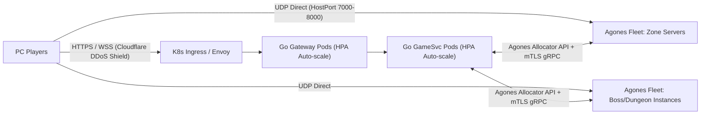

# 05. Deployment, Observability & Anti-Cheat Security

**Phân hệ:** `02_TECHNICAL_ARCHITECTURE` · **Tài liệu:** `05_Deployment_Observability_and_Security.md`  
**Trạng thái:** Đặc tả hạ tầng triển khai (Dev → Production) & Hàng rào bảo mật

---

## 1. Môi Trường Triển Khai Hai Cấp (`Local Docker Compose` → `Kubernetes + Agones`)

### 1.1. Môi trường Phát triển & Kiểm thử Vertical Slice (`docker-compose.dev.yml`)
Để bất kỳ lập trình viên hoặc AI Coding Agent nào cũng có thể dựng toàn bộ hạ tầng Backend chỉ bằng **1 dòng lệnh `docker compose up -d`** trên máy cá nhân Windows/Linux:

```yaml
services:
  postgres:
    image: postgres:16-alpine
    ports: ["5432:5432"]
    environment:
      POSTGRES_DB: ziu_db
      POSTGRES_USER: ziu_admin
      POSTGRES_PASSWORD: ziu_dev_password
    command: ["postgres", "-c", "max_connections=200", "-c", "shared_buffers=512MB"]

  redis:
    image: redis:7-alpine
    ports: ["6379:6379"]
    command: ["redis-server", "--appendonly", "yes"]

  nats:
    image: nats:2.10-alpine
    ports: ["4222:4222", "8222:8222"]
    command: ["-js", "-m", "8222"]

  ziu-gamesvc:
    build: { context: ./backend, dockerfile: Dockerfile.gamesvc }
    ports: ["9090:9090", "9101:9101"] # 9090 Internal gRPC, 9101 Prometheus Metrics
    depends_on: [postgres, redis, nats]

  ziu-gateway:
    build: { context: ./backend, dockerfile: Dockerfile.gateway }
    ports: ["8080:8080", "9102:9102"] # 8080 HTTPS/WS Public API, 9102 Metrics
    depends_on: [ziu-gamesvc, redis]
```
*(Trong quá trình phát triển tính năng C++, UE5 Dedicated Server có thể chạy trực tiếp từ trình biên dịch `ZenithEditor.exe -server -log` kết nối vào `localhost:9090` để debug cực nhanh, hoặc đóng gói Linux Server Image để test tải 20–100 bots).*

### 1.2. Kiến Trúc Sản Xuất Mở Rộng Ngang (`Production Kubernetes + Agones`)
Khi vận hành Alpha/Production trên Cloud, các Dedicated Server là tiến trình **có trạng thái trong RAM (`Stateful In-Memory Process`)**, không thể dùng Deployment Kubernetes thông thường tự ý giết pod khi thu hẹp tải. Hệ thống sử dụng **Agones (`Fleet` & `GameServerAllocation`)**:



- **Quy tắc Cấp phát Thực tế cho 1 UE5 Dedicated Server Pod (100 CCU/Zone):**
  - CPU Request/Limit: `2 vCPU Dedicated` (xung nhịp cao `>= 3.4 GHz` vì vòng lặp chính `GameThread` của Unreal nhạy cảm với hiệu năng đơn nhân!).
  - Memory Request/Limit: `3.5 GB – 4.5 GB RAM` (Server Target đã loại bỏ toàn bộ Texture, Mesh Render Buffer và Audio asset lúc đóng gói `Cook Server`).
- **Quy tắc Bảo trì Không Mất Dữ Liệu (`Zero-Loss Rolling Drain`):**
  1. Đánh dấu Zone Pod cũ sang trạng thái `Draining` (không cho người mới kết nối vào).
  2. Khởi chạy Pod phiên bản mới sẵn sàng ở trạng thái `Ready`.
  3. Gửi thông báo đếm ngược trong game hoặc tự động thực hiện `Lease-Fenced Transfer` chuyển người chơi sang Channel mới, đợi số người chơi trên Pod cũ về `0` mới tắt Pod.

---

## 2. Hệ Thống Quan Sát & Cảnh Báo Sớm (`Observability — Prometheus, Grafana & Structured Logs`)

Mọi binary Go và UE5 Dedicated Server đều xuất chỉ số định dạng OpenMetrics để phát hiện nghẽn cổ chai ngay trong các đợt Load Test:

| Nhóm Chỉ Số | Tên Metric Chuẩn | Ngưỡng Cảnh Báo (`Warning / Critical`) | Ý Nghĩa Chẩn Đoán |
| :--- | :--- | :---: | :--- |
| **UE5 Server Performance** | `ziu_ds_frame_time_ms` (`p50, p95, p99`) | `> 28ms` / `> 33.3ms` | Nếu vượt `33.3ms`, Server tụt dưới `30 Hz` khiến combat bị trễ nhịp. |
| **UE5 Network Health** | `ziu_ds_net_saturated_clients_total` | `> 0` kéo dài `5s` | Băng thông gửi cho từng Client chạm trần `MaxClientRate`, cần siết lại `Iris Cull Distance`. |
| **Lease & Persistence** | `ziu_coord_lease_fence_rejections_total` | `>= 1` | Phát hiện ngay trường hợp Zone Server bị treo rồi tỉnh lại gửi gói lưu muộn (cơ chế bảo vệ đã chặn thành công). |
| **Loot Pipeline** | `ziu_nats_jetstream_consumer_lag` | `> 100 msgs` / `> 1000 msgs` | Hàng đợi phát thưởng Boss bị ứ đọng, cần tăng số worker `LootService`. |
| **Database Contention** | `ziu_pg_tx_lock_wait_ms` (`p99`) | `> 25ms` / `> 100ms` | Xung đột khóa dòng trên bảng `inventory_items` hoặc `character_wallets`. |
| **Macro Economy** | `ziu_econ_kora_net_mint_per_hour` | Lệch `> 3σ` trung bình ngày | Cảnh báo sớm nếu xuất hiện lỗ hổng cày tiền bất thường (exploit) hoặc bot farm quy mô lớn. |

---

## 3. Ma Trận Bảo Mật, Chống Gian Lận & Chống Nhân Đôi (`Security & Anti-Cheat Matrix`)

Trong một game Action MMORPG trên PC, **mọi dữ liệu đến từ máy tính người chơi đều bị coi là không đáng tin cậy (`Untrusted Input`)**:

| Mối đe dọa / Kiểu Hack | Cơ chế Phòng vệ Kiến trúc Bắt buộc | Hành động xử lý khi Phát hiện |
| :--- | :--- | :--- |
| **Speedhack / Time Dilation Hack** *(Tăng tốc thời gian trên Client để bay/đánh nhanh gấp 3 lần)* | Server đối chiếu tổng $\sum \Delta t$ trong các gói `ServerMove` với đồng hồ thực của Server (`ServerWorldTime`). Nếu độ lệch tích lũy vượt quá `120ms`, từ chối bước di chuyển dư thừa và ép `ClientAdjustPosition`. | Ghi điểm vi phạm `MovementAnomalyScore`; tái phạm liên tục tự động ngắt kết nối phiên chơi. |
| **Teleport / No-Clip Flyhack** *(Sửa tọa độ RAM nhảy xuyên núi hoặc bay vượt tốc độ trần)* | Mọi bước `PhysCustom_Flight` trên Server quét va chạm vật lý thật và khóa cứng vận tốc tối đa theo `MaxFlightSpeed * AscensionMultiplier * 1.05` (dung sai mạng 5%). | Kéo giật lùi ngay lập tức về vị trí hợp lệ cuối cùng trên Server. |
| **Cooldown / Infinite Chi / Damage Multiplier Hack** | Client không bao giờ gửi số sát thương lên Server. Client chỉ gửi *"Tôi nhấn kích hoạt kỹ năng ở ô số 2"*. GAS trên Server tự kiểm tra `Chi`, `Cooldown GameplayEffect` và tự tính sát thương từ bảng thuộc tính trên RAM Server. | Yêu cầu kích hoạt bị từ chối êm ái, không có tác dụng nào xảy ra. |
| **Hitbox / Range Expansion Hack** *(Kéo dài đòn đánh thường trúng toàn bản đồ)* | Hình hộp quét va chạm (`Capsule Sweep / Sphere Overlap`) dùng thông số đọc trực tiếp từ `UZIUSkillDataAsset` nạp trên ổ cứng của Dedicated Server, bỏ qua hoàn toàn thông số phía Client. | Không gây sát thương ngoài tầm chuẩn. |
| **Packet Replay / Double-Click Dupe** *(Gửi 50 gói tin Cường hóa / Đổi đồ / Giao dịch trong 1 mili-giây)* | Kết hợp 3 lớp khóa: (1) `Idempotency-Key` bắt buộc trên API, (2) Khóa dòng `SELECT ... FOR UPDATE` trong PostgreSQL, và (3) Cột `version` Optimistic Locking trên `inventory_items`. | Chỉ đúng 1 yêu cầu đầu tiên được thực thi; 49 yêu cầu còn lại trả về kết quả đã cache hoặc mã lỗi `409 Conflict`. |
| **Zone-Boundary Crash Dupe** *(Chuyển đồ cho bạn rồi cố tình làm sập kết nối khi chuyển vùng để hoàn lưu nhân vật cũ)* | Giao dịch trực tiếp (`Direct Trade`) cam kết thẳng vào PostgreSQL **trước**; đồng thời quy trình chuyển vùng dùng `lease_epoch` tăng đơn điệu nên không bao giờ nạp lại bản lưu cũ trước lúc giao dịch. | Triệt tiêu hoàn toàn kịch bản nhân đôi vật phẩm kinh điển của dòng MMORPG. |
