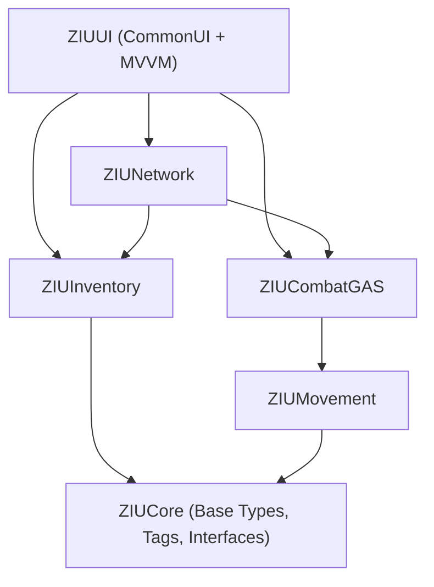

# 01. Unreal Engine 5.4+ Project & C++ Module Structure

**Phân hệ:** `03_UNREAL_GAME_CLIENT` · **Tài liệu:** `01_UE5_Project_and_Module_Structure.md`  
**Engine Chuẩn:** Unreal Engine 5.4+ (Source Build hỗ trợ `Client` & `Server` Targets)

---

## 1. Cấu Trúc Thư Mục Dự Án Unreal (`ZenithInfinite` Directory Layout)

Thay vì gom tất cả hàng trăm file C++ vào một module mặc định duy nhất làm tăng thời gian biên dịch và tạo phụ thuộc vòng tròn, mã nguồn Unreal được tách thành **6 Runtime Modules rõ ràng**:

```text
unreal/ZenithInfinite/
├── ZenithInfinite.uproject
├── Config/
│   ├── DefaultEngine.ini              # Cấu hình NetDriver, Iris/ReplicationGraph, TickRate 30Hz
│   ├── DefaultGame.ini
│   ├── DefaultGameplayTags.ini        # Toàn bộ cây GameplayTag chuẩn hóa (State.*, Ability.*, Cue.*)
│   └── DefaultInput.ini
├── Source/
│   ├── ZenithClient.Target.cs         # Build Target cho PC Player Client (Tắt Server-only gRPC code)
│   ├── ZenithServer.Target.cs         # Build Target cho Dedicated Server (Tắt UI/Audio/Cosmetic VFX)
│   ├── ZenithEditor.Target.cs         # Build Target phát triển cục bộ PIE (Chạy cả 2 vai trò)
│   ├── ZIUCore/                       # Module 1: Khung GameMode, PlayerState, CharacterBase, Interfaces
│   ├── ZIUMovement/                   # Module 2: UZIUFlightMovementComponent, SavedMove, 3D Physics
│   ├── ZIUCombatGAS/                  # Module 3: ASC, AttributeSets, Abilities, ExecCalcs, Targeting
│   ├── ZIUInventory/                  # Module 4: DataAssets vật phẩm, Visual Equipment & Stat Mirror
│   ├── ZIUNetwork/                    # Module 5: ReplicationGraph, ZoneTransfer, Backend gRPC/WS Client
│   └── ZIUUI/                         # Module 6: CommonUI Stack + MVVM ViewModels (Chỉ nạp ở Client/Editor)
└── Content/
    ├── Core/
    ├── Characters/                    # Valoran, Terran, Sylvanar + Shared Skeleton & AnimMontages
    ├── Combat/                        # DataAssets kỹ năng, GameplayEffects, Niagara VFX
    ├── Maps/
    │   ├── TerraPrime/CragspireHighlands/  # Bản đồ World Partition của Vertical Slice
    │   └── TerraPrime/NeoHavenCity/
    └── UI/                            # WBP_ZIU_* sử dụng CommonActivatableWidget
```

---

## 2. Sơ Đồ Phụ Thuộc Giữa Các C++ Modules (`Module Dependency DAG`)

Tuyệt đối không cho phép tham chiếu ngược làm gãy kiến trúc biên dịch:



### Danh sách Plugin bắt buộc bật trong `ZenithInfinite.uproject`
- `GameplayAbilities` (Hệ thống GAS chuẩn của Epic).
- `EnhancedInput` (Xử lý tổ hợp phím bay 3D & tùy chỉnh phím).
- `MotionWarping` (Căn chỉnh khoảng cách lao đấm cận chiến & `Aerial Pursuit`).
- `StateTree` (AI nhẹ, hiệu năng cao cho quái thường và Boss nhiều giai đoạn trên Dedicated Server).
- `CommonUI` & `ModelViewViewModel` (Quản lý lớp giao diện xếp chồng và tách dữ liệu khỏi Widget).
- `ReplicationGraph` *(hoặc `Iris` khi bật cờ thử nghiệm mở rộng)* cho lọc thực thể theo không gian 3D.

---

## 3. Cấu Hình `Build.cs` & Phân Tách Code Chỉ Chạy Trên Server (`WITH_SERVER_CODE`)

Mọi thư viện kết nối nội bộ tới Go Backend (như `gRPC C++ stub`, khóa bí mật mTLS, mã nguồn đẩy sự kiện NATS) **tuyệt đối không được đóng gói vào file chạy `ZenithClient.exe` của người chơi** để ngăn dịch ngược lộ giao thức nội bộ!

```csharp
// Source/ZIUNetwork/ZIUNetwork.Build.cs
using UnrealBuildTool;

public class ZIUNetwork : ModuleRules
{
    public ZIUNetwork(ReadOnlyTargetRules Target) : base(Target)
    {
        PCHUsage = PCHUsageMode.UseExplicitOrSharedPCHs;

        PublicDependencyModuleNames.AddRange(new string[] {
            "Core", "CoreUObject", "Engine", "NetCore",
            "ReplicationGraph", "HTTP", "WebSockets", "Json", "JsonUtilities",
            "ZIUCore", "ZIUCombatGAS", "ZIUInventory"
        });

        // CHỈ biên dịch thư viện gRPC nội bộ & NATS Publisher cho Dedicated Server và Editor!
        if (Target.bWithServerCode)
        {
            PublicDefinitions.Add("ZIU_WITH_BACKEND_GRPC=1");
            // Liên kết thư viện gRPC / Protobuf biên dịch sẵn cho Server
        }
        else
        {
            PublicDefinitions.Add("ZIU_WITH_BACKEND_GRPC=0");
        }
    }
}
```

---

## 4. Ranh Giới Rạch Ròi Giữa `C++` và `Blueprint` (`C++ vs. Blueprint Contract`)

Một trong những nguyên nhân hàng đầu khiến dự án UE5 MMORPG thất bại khi lên 50–100 người chơi là lạm dụng `Blueprint Tick` và viết công thức sát thương trong đồ thị Blueprint. Dự án khóa cứng quy tắc sau:

| Hạng mục triển khai | Bắt buộc viết bằng `C++` | Cho phép cấu hình bằng `Blueprint / DataAsset` |
| :--- | :--- | :--- |
| **Chuyển động & Bay 3D** | `UZIUFlightMovementComponent`, toàn bộ công thức gia tốc, phanh, dự đoán mạng và kiểm tra gian lận tốc độ. | Tinh chỉnh hằng số tốc độ, đường cong gia tốc (`UCurveFloat`) trên `BP_ZIU_PlayerCharacter`. |
| **Hệ thống GAS & Sát thương** | `AttributeSet`, `UZIUDamageExecCalc`, kiểm tra điều kiện kích hoạt, quét Hitbox Server, `AerialPursuit` vector math. | Tạo lớp con của `UGA_ZIU_*` để gán `AnimMontage`, gắn `GameplayEffect` thời gian hồi chiêu và chọn `GameplayCue` VFX. |
| **AI Quái & Boss** | Các `FStateTreeTaskBase` và `FStateTreeEvaluatorBase` tính khoảng cách 3D, bảng điểm `Contribution` và chọn mục tiêu. | Sắp xếp cây trạng thái `StateTree` cho từng loại quái (*Crag Ravager*, *Colossus Kael*). |
| **Giao diện Người dùng (UI)** | Các lớp `UMVVMViewModelBase` lắng nghe sự kiện đổi máu/Chi/túi đồ từ C++ mà **không dùng `Event Tick`**. | Thiết kế bố cục hình ảnh, hoạt ảnh chuyển trang và gắn kết trường dữ liệu (`ViewModel Binding`) trong `WBP_ZIU_*`. |
| **Quy tắc Cấm Tuyệt Đối** | **CẤM 100%** bật `Event Tick` bằng Blueprint trên các Actor nhân vật, quái vật hoặc đạn bay (`Projectile`) xuất hiện số lượng lớn trên Server! | — |

---

## 5. Vòng Đời Nhân Vật Từ Khi Vào Server Đến Khi Rời Đi (`Actor Lifecycle on Dedicated Server`)

1. **`AZIUGameMode::PreLogin`**: Tách tham số `?ticket=<connect_ticket>` từ chuỗi kết nối của Client; gọi bất đồng bộ (hoặc hàng đợi nhanh `< 50ms`) sang `UZIUServerBackendSubsystem::ClaimCharacterLease(ticket)`. Nếu vé giả mạo hoặc hết hạn, từ chối kết nối ngay trước khi cấp phát `APlayerController`.
2. **`AZIUGameMode::PostLogin`**: Nhận gói `CharacterFullLoadout` cùng số `assigned_lease_epoch` từ Go Backend; lưu `lease_epoch` vào `AZIUPlayerState` (chỉ trên Server, không cần replicate số bí mật này xuống Client khác).
3. **`AZIUPlayerState::InitializeAbilitySystem`**: Khởi tạo `UZIUAbilitySystemComponent` (đặt trên `PlayerState` đối với người chơi để giữ bền vững trạng thái khi hồi sinh, và đặt trực tiếp trên `AZIUNPCCharacter` đối với quái vật để tối ưu bộ nhớ!), nạp toàn bộ chỉ số `computed_attributes`, danh sách kỹ năng và nhánh `Ascension` đã mở.
4. **`AZIUGameMode::Logout`**: Đóng gói `CharacterRuntimeSnapshot` cuối cùng, gọi `ReleaseCharacterLease(snapshot)` trả quyền sở hữu ngay lập tức cho Go Backend trước khi hủy Actor.
