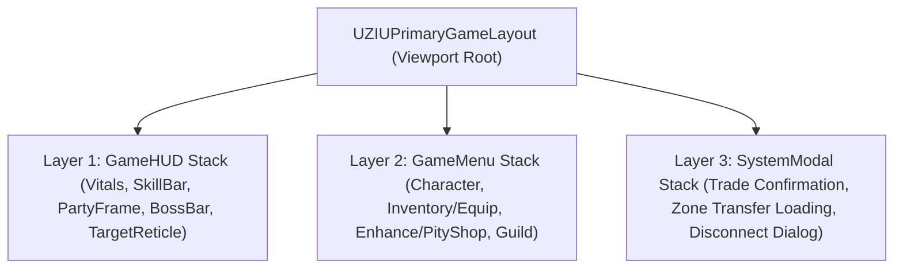

# 04. 3D Aerial Camera, Smart Targeting, Animation & CommonUI

**Phân hệ:** `03_UNREAL_GAME_CLIENT` · **Tài liệu:** `04_Camera_Targeting_Animation_and_UI.md`  
**Modules đích:** `Source/ZIUCombatGAS/`, `Source/ZIUCore/`, `Source/ZIUUI/`

---

## 1. Hệ Thống Camera Không Chiến Thích Ứng (`UZIUAerialSpringArm & Camera Solver`)

Trong không chiến 3D, nếu dùng `USpringArmComponent` mặc định có góc nhìn cố định, nhân vật chính sẽ che khuất hoàn toàn mục tiêu khi đối phương bay cao hơn hoặc thấp hơn `45°`. Hệ thống giải quyết bằng bộ điều khiển động:

### 1.1. Ba Chế Độ Khung Hình Động (`Dynamic Framing Profiles`)

| Trạng thái hiện tại | Độ dài `TargetArmLength` | Độ lệch `SocketOffset (X, Y, Z)` | `FOV` cơ bản | Đặc tính nội suy (`Camera Lag`) |
| :--- | :---: | :---: | :---: | :--- |
| **Exploration / Ground** | `340 cm` | `(0, +45, +65)` *(Lệch nhẹ vai phải)* | `90°` | `PositionLag = 12.0`, êm ái khi ngắm cảnh. |
| **High-Speed Flight (`Boost`)** | `460 cm` *(Kéo xa tạo chiều sâu)* | `(0, 0, +80)` *(Đưa về chính tâm)* | `104°` + Hiệu ứng đường gió viền màn hình | `PositionLag = 18.0`, bám sát gia tốc cao. |
| **Hard 3D Lock-On Combat** | `380 – 520 cm` *(Giãn tự động theo khoảng cách 2 bên)* | `(0, +70, +95)` *(Mở toang vùng nhìn giữa màn hình)* | `94°` | Xoay tự động giữ cả Player và Target trong `Safe Framing Box`. |

### 1.2. Xử Lý Góc Dọc Cực Đoan & Chống Xuyên Địa Hình
- **Mở rộng giới hạn góc Pitch:** Cho phép góc nhìn dọc từ **`-80°` (nhìn thẳng xuống vực khi bay trên cao)** đến **`+80°` (ngước thẳng lên đảo bay)** mà không bị khóa cứng ở `±60°`.
- **Framing Look-At Blend khi `Lock-On`:** Điểm nhìn của Camera không khóa chết 100% vào tâm ngực đối thủ (gây chóng mặt khi đối thủ lướt qua đầu), mà hội tụ vào điểm trọng tâm có trọng số:
  $$\mathbf{P}_{\text{focus}} = 0.30\,\mathbf{P}_{\text{player}} + 0.70\,\mathbf{P}_{\text{target}}$$
  Nếu góc ngẩng tới mục tiêu vượt quá `65°` ở cự ly rất gần (`< 4m`), Camera tự động lùi nhẹ `ArmLength` và làm mờ bán trong suốt nhân vật người chơi (`Dithered Opacity Mask` trên Material khi Camera tiến gần `< 120cm`) để **không bao giờ che khuất động tác ra đòn của Boss**.

---

## 2. Bộ Chọn & Khóa Mục Tiêu Thông Minh (`UZIUTargetingComponent`)

- **Quét ứng viên hiệu năng cao:** Khi người chơi bấm `Middle Mouse / Tab`, thực hiện `OverlapMultiByObjectType` bán kính `5,500cm` trên kênh `ECC_Pawn`, loại bỏ đồng đội (`Same Party / Friendly`) và thực thể đã chết.
- **Kiểm tra che khuất (`Line of Sight`):** Chỉ xét các mục tiêu thông tia nhìn từ Camera (hoặc chỉ bị che bởi tán lá mỏng).
- **Áp dụng hàm điểm ưu tiên $S_{\text{target}}$** (đã định nghĩa tại `01_GDD/03_Action_Combat_System.md`): Boss luôn được cộng `+0.40` điểm ưu tiên nên không bao giờ khóa nhầm quái nhỏ đứng quanh chân Boss.
- **Đổi mục tiêu có hướng (`Flick Switching`):** Khi đang khóa mục tiêu, lăn con lăn chuột hoặc gẩy chuột kèm phím chuyển sẽ chọn ứng viên có góc chiếu màn hình (`Screen-Space Delta X`) gần nhất về phía trái hoặc phải mục tiêu hiện tại.

---

## 3. Kiến Trúc Hoạt Ảnh & Tái Sử Dụng Đa Chủng Tộc (`Animation Blueprint & Montage Architecture`)

### 3.1. Bộ Xương Chuẩn Thống Nhất (`SK_ZIU_HumanoidMaster`)
Cả 3 chủng tộc MVP (`Valoran`, `Terran`, `Sylvanar`) đều chia sẻ chung cấu trúc phân cấp xương chính (`SK_ZIU_HumanoidMaster` tương thích chuẩn UE5 Manny Skeleton mở rộng thêm 4 xương phụ cho `AuraMantle_L/R` và `BackCrest_Ring`), kết hợp **IK Retargeting thời gian thực** cho chênh lệch tỷ lệ chiều cao. Nhờ vậy, **100% thư viện đòn đấm đá, bay lượn và chưởng lực chỉ cần làm một lần là chạy mượt trên mọi chủng tộc**!

### 3.2. Phân Lớp Hoạt Ảnh Trong `ABP_ZIU_CharacterBase`
1. **Base Locomotion State Machine:** Tách làm 2 nhánh lớn `Ground Locomotion` (8-way Strafe khi Lock-on / Velocity-orient khi tự do) và `3D Flight Locomotion` (dùng 2D BlendSpace theo `ForwardSpeed` và `RightBankAngle` để nhân vật tự nghiêng người đẹp mắt khi lượn vòng trên không!).
2. **Upper-Body Layered Blend (`Spine_02` trở lên):** Cho phép nhân vật **vừa bay di chuyển bằng thân dưới, vừa giơ tay bắn đạn năng lượng `Starbreaker Barrage`** cực kỳ linh hoạt.
3. **Full-Body Combat Slot + Motion Warping:** Dùng cho chuỗi cận chiến và đại chiêu. Các `AnimNotify` bắt buộc chuẩn hóa bằng C++:
   - `UAnimNotifyState_ZIUComboWindow`: Gắn và gỡ thẻ `State.Combat.Window.ComboCancel` / `DodgeCancel`.
   - `UAnimNotifyState_ZIUServerHitbox`: Chỉ chạy quét va chạm trên Server theo tên xương (`hand_r`, `foot_l`, `weapon_socket`) và bán kính cấu hình.
   - `UAnimNotify_ZIUMotionWarpSync`: Cập nhật điểm đích `MotionWarping` cho đòn lao đấm cận chiến (`MaxWarpDistance = 350cm` để đòn đánh bám dính mục tiêu vừa đủ mà không biến thành dịch chuyển gian lận).

---

## 4. Kiến Trúc Giao Diện `CommonUI + MVVM` (`Zero-Tick UI Architecture`)

Giao diện của một MMORPG rất nhiều thông tin (Thanh máu/Chi/Stamina, 5 ô kỹ năng hồi chiêu, Khung đồng đội 5 người, Thanh máu Boss 3 giai đoạn, Túi đồ 8 ô trang bị, Cửa sổ Cường hóa, Khung Chat). Nếu dùng hàm `Bind` chạy mỗi frame trong UMG truyền thống sẽ ngốn mất `3 – 5 ms` CPU của Client!

### Sơ đồ phân lớp màn hình `CommonUI`

### Danh sách `MVVM ViewModels` C++ bắt buộc cài đặt trong `Source/ZIUUI/`
1. **`UZIUVitalsViewModel`:** Lắng nghe trực tiếp `ASC->GetGameplayAttributeValueChangeDelegate()` cho `Health`, `MaxHealth`, `Chi`, `MaxChi`, `Stamina` và thẻ `State.Ascension.*`. Chỉ khi giá trị thật sự đổi mới phát `UE_MVVM_BROADCAST_FIELD_VALUE_CHANGED` cập nhật thanh tiến trình!
2. **`UZIUSkillBarViewModel`:** Theo dõi thời gian hồi chiêu thông qua sự kiện thêm/xóa `Cooldown GameplayTag` (chỉ chạy bộ đếm chữ số trên đúng ô đang hồi chiêu).
3. **`UZIUBossEncounterViewModel`:** Tự động hiện thanh máu lớn trên đỉnh màn hình khi nhân vật bước vào vùng của `AZIUBossCharacter`, hiển thị số ống máu giai đoạn (`Phase 1 / 2 / 3`) và thanh `Stagger Gauge` vàng bên dưới.
4. **`UZIUInventoryViewModel`:** Nhận dữ liệu túi đồ và 8 ô trang bị từ `ZIUNetwork` (REST/WS), cung cấp các lệnh gọi hành động (`RequestEquipItem`, `RequestEnhanceItem`, `RequestRedeemPityToken`) có khóa chống bấm đúp ngay tại tầng ViewModel trong lúc chờ phản hồi HTTP từ Gateway.
