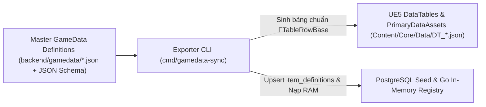

# 01. Data-Driven Schemas & 3D Asset Production Pipeline

**Phân hệ:** `05_GAME_CONTENT` · **Tài liệu:** `01_Data_Driven_Schemas_and_Asset_Pipeline.md`  
**Trạng thái:** Quy chuẩn kỹ thuật cho Content Designers, Technical Artists & AI Agents

---

## 1. Kiến Trúc Dữ Liệu Nguồn Duy Nhất (`Dual-Target Data-Driven Pipeline`)

Một lỗi kinh điển trong phát triển MMORPG là sửa chi phí `Chi` hoặc cấp độ trang bị trong Unreal Editor nhưng quên sửa ở Go Backend (hoặc ngược lại), dẫn tới lỗi lệch dữ liệu (`Desync`). Dự án giải quyết bằng quy trình **1 Nguồn Định Nghĩa → Xuất Kép Tự Động**:



### Khung JSON Chuẩn Cho Định Nghĩa Kỹ Năng (`gamedata/skills.json`)
```json
{
  "skill_id": "sk_valoran_solar_lance",
  "display_name": "Solar Lance",
  "archetype": "PIERCING_BEAM",
  "allowed_races": ["VALORAN", "TERRAN", "SYLVANAR"],
  "unlock_level": 8,
  "mastery_mark_cost": 120,
  "damage_type": "CHI",
  "chi_cost": 35,
  "cooldown_sec": 10.0,
  "min_charge_sec": 0.45,
  "max_charge_sec": 1.20,
  "max_charge_bonus_pct": 35.0,
  "tick_count": 6,
  "skill_multiplier_per_tick": 0.42,
  "stagger_power_per_tick": 18.0,
  "beam_radius_cm": 90.0,
  "beam_range_cm": 4500.0,
  "ue_ability_class": "/Script/ZIUCombatGAS.GA_ZIU_SolarLance",
  "ue_icon_path": "/Game/UI/Icons/Skills/T_Icon_SolarLance"
}
```

---

## 2. Quy Chuẩn Sản Xuất Nhân Vật & Trang Bị Mô-đun (`Modular Character Pipeline`)

Để sản xuất nhanh nhiều chủng tộc, hàng chục bộ trang bị và nhiều bậc Hóa Cảnh mà không nổ dung lượng bộ nhớ:

### 2.1. Phân Tách `Skeletal Mesh` 6 Thành Phần Ghép Khớp (`Master Pose / Leader Pose Component`)
Mỗi nhân vật người chơi được lắp ghép thời gian thực từ 6 thành phần bám theo xương của `Mesh_Torso`:
1. `Head_Base` (Khuôn mặt + Biểu cảm Morph Targets + Đôi mắt có tham số đổi màu đồng tử khi biến hình).
2. `Hair_Or_Crest` (Tóc đối với *Valoran/Terran*, hoặc cụm Tinh Thể *Bio-Crystal* đối với *Sylvanar*).
3. `UpperBody_Armor` (Áo võ phục / Giáp ngực).
4. `Hands_Gauntlets` (Găng tay / Hộ uyển).
5. `LowerBody_Legs` (Quần / Giáp đùi).
6. `Feet_Boots` (Giày chiến đấu).
*(Phụ kiện `Resonance Visor` gắn qua `Socket_Head_Visor`; hiệu ứng `Aura Mantle` và `Vòng Tinh Văn Hóa Cảnh` gắn qua `Socket_Spine_Aura` bằng Niagara + Mesh động!)*

### 2.2. Quy Tắc Thực Hiện Trạng Thái Hóa Cảnh (`Zero-Mesh-Duplication Ascension`)
Khi nhân vật bật `Solar Surge` hay `Overlimit`, **KHÔNG thay thế nguyên một con nhân vật 3D mới**, mà điều khiển bằng một `UZIUAscensionVisualProfile` (DataAsset) tác động đồng thời lên 4 kênh:
1. **Material Parameter Collection / Dynamic Material Instance:** Đẩy cường độ phát sáng `EmissiveCrestIntensity` trên da/giáp từ `0.0 → 8.0`, đổi dải màu viền `CelRimLightColor`.
2. **Hair / Crest Wind Simulation:** Tăng lực đẩy hướng lên trên cho vật lý xương tóc/dải lụa để tạo cảm giác luồng nội khí thổi bùng liên tục.
3. **Attachable Aura Mantle Niagara (`NS_ZIU_AuraMantle_*`):** Bật lớp áo choàng khí quang bán trong suốt và vòng tinh văn xoay chậm sau lưng.
4. **Audio Layer:** Trộn thêm lớp âm thanh cộng hưởng tần số trầm đặc trưng lúc di chuyển và ra đòn.

---

## 3. Ngân Sách Hiệu Năng Đồ Họa & Giới Hạn VFX Đông Người (`Technical Art Budgets`)

Để đảm bảo máy cấu hình tầm trung (**RTX 3060 / RX 6600, 16GB RAM, độ phân giải 1080p/1440p**) giữ vững **`>= 60 FPS`** ngay trong trận đánh *World Boss* 40 người:

| Loại Tài Nguyên | LOD 0 (`< 12m`) | LOD 1 (`12 – 30m`) | LOD 2 (`30 – 80m`) | LOD 3 (`> 80m`) | Số Material Slots Tối Đa |
| :--- | :---: | :---: | :---: | :---: | :---: |
| **Player Character (Tổng 6 mảnh)** | `<= 32,000 tris` | `16,000 tris` | `7,500 tris` | `2,800 tris` | `4 – 5` *(Gộp Atlas Texture)* |
| **Normal / Elite Monster** | `<= 15,000 tris` | `7,500 tris` | `3,000 tris` | `1,200 tris` | `2` |
| **Regional / World Boss** | `<= 55,000 tris` | `28,000 tris` | `12,000 tris` | `5,000 tris` | `4` |

### Hệ Thống Phân Cấp Ngân Sách Hạt Niagara (`Multiplayer VFX Scalability Budget`)
Trong cài đặt đồ họa và bộ điều phối `UNiagaraEffectType`, hiệu ứng kỹ năng tự động thu phóng theo nguồn phát:
- **Bản thân Người chơi (`Local Player`) & Boss:** Hiển thị **`100%`** số hạt, tia sét phụ, biến dạng khúc xạ không khí và đèn động (`Dynamic Point Light` tối đa 1 bóng cho đòn chưởng chính).
- **Thành viên Cùng Tổ đội (`Party Members`):** Hiển thị **`60%`** mật độ hạt, tắt đèn động phụ, giảm độ chói tâm tia chưởng `30%` để không làm mù màn hình đồng đội.
- **Người chơi Khác Ngoài Tổ đội (`Other Players in World Boss`):** Hiển thị **`25%`** mật độ hạt rút gọn (`Simplified Beam Core`), tắt hoàn toàn rung màn hình (`Camera Shake`) và tắt biến dạng màn hình của người ngoài!

---

## 4. Thư Viện Hoạt Ảnh Tiêu Chuẩn Cho Vertical Slice (`Minimum Viable Animation Set`)

Danh sách **28 hoạt ảnh cốt lõi** cần thiết để vận hành trọn vẹn *Cragspire Highlands Vertical Slice*:
- **Ground Locomotion (5):** `Idle_Ready`, `Jog_Fwd/Bwd/Left/Right` (BlendSpace), `Sprint_Fwd`, `Jump_Start`, `Jump_Land`.
- **3D Flight (5):** `Hover_Idle`, `Flight_Cruise_BlendSpace` (Pitch/Bank), `Flight_Boost_Loop`, `Air_Dash_8Way`, `Fast_Landing_Impact`.
- **Melee & Aerial Combo (8):** `Ground_LMB_1..4`, `Ground_RMB_GuardBreak`, `Uppercut_Launch`, `Aerial_Pursuit_Rush`, `Air_LMB_1..3`, `Air_RMB_MeteorSlam`.
- **Chi, Defense & Ascension (6):** `Guard_Loop` (+ `PerfectGuard_Parry`), `Chi_Charge_Loop`, `Cast_ChiVolley_UpperBody`, `Cast_SolarLance_ChargeAndFire`, `Ascension_Burst_Activate`, `Vanish_Counter_Strike`.
- **Hit Reactions (4):** `Hit_Flinch_Light`, `Hit_Airborne_Float`, `Hit_Knockback_Fly`, `Knockdown_Ground_And_Recover`.
