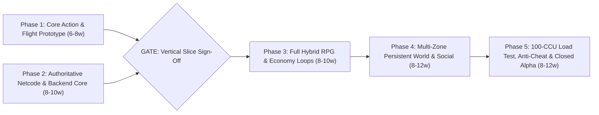

# 01. Phased MVP Roadmap, Acceptance Gates & Post-Launch Vision

**Phân hệ:** `06_DEVELOPMENT_ROADMAP` · **Tài liệu:** `01_Phased_MVP_Roadmap_and_Acceptance.md`  
**Thời gian lập kế hoạch định hướng:** `38 – 52 Tuần` (Đội ngũ tinh gọn `8 – 12 nhân sự` kết hợp AI Coding Agents)

---

## 1. Chiến Lược Triển Khai Ưu Tiên Triệt Tiêu Rủi Ro (`Risk-First Sequencing`)

Sai lầm phổ biến nhất của các dự án MMORPG 3D là dành 6 tháng đầu vẽ hàng chục bản đồ và cốt truyện trước khi kiểm chứng xem **20 người chơi bay 3D đánh nhau trên Dedicated Server có mượt không**. Do đó, lộ trình 5 giai đoạn dưới đây đặt toàn bộ rủi ro kỹ thuật lên đầu:

---

## 2. Chi Tiết 5 Giai Đoạn Phát Triển MVP

### Phase 1 — Core 3D Flight & Action Combat Prototype (`Tuần 1 – 8`)
- **Mục tiêu:** Chứng minh cảm giác điều khiển nhân vật, bay lượn 3 chiều, camera khóa mục tiêu không trung và chuỗi đòn đánh cận chiến + chưởng lực đạt độ "đã tay" chuẩn game hành động.
- **Hạng mục bàn giao:** `UZIUFlightMovementComponent` (4 chế độ bay), Camera không chiến, GAS Core (`LMB 1–4`, `Launch`, `Pursuit`, `Slam`, `Solar Lance`, `Solar Surge`), hộp thử nghiệm *Cragspire Highlands* và AI quái cơ bản.

### Phase 2 — Multiplayer Foundation & Vertical Slice Completion (`Tuần 9 – 18`)
- **Mục tiêu:** Đưa toàn bộ gameplay của Phase 1 lên kiến trúc **UE5 Dedicated Server + Go Backend + PostgreSQL/Redis/NATS**, hoàn thành trọn vẹn **Cragspire Highlands Vertical Slice**.
- **Hạng mục bàn giao:** Đăng nhập JWT, `WorldCoordinator` Lease Fencing, đồng bộ mạng bay/GAS cho `20 người chơi`, Boss 3 giai đoạn *Colossus Kael*, đường ống `Personal Loot + Pity Token`, túi đồ 8 ô và `Party` 5 người.
- **Cổng chặn bắt buộc (`Vertical Slice Gate`):** Không chuyển sang sản xuất hàng loạt nội dung Phase 3 nếu 20 người chơi thật (hoặc 15 bots + 5 testers) đánh Boss *Kael* còn bị giật lag, mất đồng bộ vị trí bay hoặc lỗi rơi đồ.

### Phase 3 — Full Hybrid Progression, Crafting & Content Scaling (`Tuần 19 – 28`)
- **Mục tiêu:** Mở rộng đầy đủ 3 chủng tộc MVP (`Valoran`, `Terran`, `Sylvanar`), dải tiến trình `Level 1 – 100`, hệ thống *Gravity Training Trials*, Cường hóa `+1 → +15`, `Reforge`, `Transmog` và chuỗi nhiệm vụ dẫn dắt.

### Phase 4 — Multi-Zone Persistent World & Guild Ecosystem (`Tuần 29 – 40`)
- **Mục tiêu:** Hoàn thiện cả 5 Zones của hành tinh *Terra Prime* (`Neo Haven City`, `Cragspire`, `Emerald Canopy`, `Sunken Badlands`, `Riftscar Wasteland`), bàn giao liên vùng *Zone Transfer*, hệ thống *Guild*, *Direct Trade*, *World Boss* phân kênh tự động và *Balanced Arena PvP*.

### Phase 5 — Scale Hardening, Security Audit & Closed Alpha (`Tuần 41 – 52`)
- **Mục tiêu:** Tối ưu hóa CPU/RAM Dedicated Server với *Iris / ReplicationGraph*, kiểm thử tải tự động `10 → 50 → 100 CCU/Zone`, kiểm thử phá hoại chống nhân đôi vật phẩm (*Chaos / Fault-Injection Testing*), cân bằng kinh tế và mở máy chủ **Closed Alpha**.

---

## 3. Ma Trận Nghiệm Thu Kỹ Thuật Của MVP (`MVP Acceptance Criteria`)

| Phân hệ | Tiêu chí Đo lường Định lượng (Pass/Fail) |
| :--- | :--- |
| **3D Flight & Movement** | Chuyển tiếp mượt Đất ↔ Bay; ở độ trễ mạng giả lập `RTT = 100ms, Packet Loss = 1%`, tỉ lệ giật vị trí (`Rubberbanding`) `< 0.5%` tổng thời gian bay. |
| **Action Combat & GAS** | Phản hồi hoạt ảnh trên màn hình người bấm `< 16ms` (nhờ Client Prediction); Server xác thực 100% sát thương, `Cooldown` và `Chi`. |
| **Server Performance (100 CCU)** | Trên máy chủ `2 vCPU @ 3.4GHz, 4GB RAM`, một Zone chứa `100 người chơi` (trong đó `40 người` đang giao chiến Boss) giữ `p95 Server Frame Time <= 30.0 ms` (`>= 30 Hz`). |
| **Client Performance** | Trên cấu hình chuẩn `RTX 3060 / 16GB RAM @ 1080p High`, giữ `>= 60 FPS` tại *Neo Haven City* và trong trận *World Boss* 40 người (nhờ ngân sách hạt VFX phân tầng). |
| **Zone Transfer & Anti-Dupe** | Thực hiện `1,000 lượt` chuyển Zone tự động liên tục kèm ngắt kết nối ngẫu nhiên (`Chaos Kill Dedicated Server`) → **`0` trường hợp kẹt nhân vật, `0` trường hợp mất đồ, `0` trường hợp nhân đôi `Kora`/vật phẩm**. |
| **Economy & Loot Integrity** | Mọi thay đổi số dư `character_wallets` khớp `100%` đến từng đơn vị với tổng cộng dồn trên bảng `wallet_ledger`. |

---

## 4. Cơ Cấu Đội Ngũ Tinh Gọn Đề Xuất (`8 – 12 Nhân Sự`)

| Vai trò | Số lượng | Trọng trách chính |
| :--- | :---: | :--- |
| **Game Director / Lead System Designer** | `1` | Giữ tầm nhìn sản phẩm, cân bằng toán học Combat/Loot/Economy, nghiệm thu cảm giác chơi. |
| **Senior UE5 C++ Gameplay & Network Engineers** | `2` | Phát triển `ZIUMovement`, `ZIUCombatGAS`, `ReplicationGraph`, tối ưu hóa Dedicated Server. |
| **Backend & Distributed Infrastructure Engineers (Go)** | `2` | Phát triển `ziu-backend`, PostgreSQL/Redis Lease Fencing, NATS, Agones/K8s & Anti-Cheat. |
| **3D Character & Equipment Artists** | `2` | Tạo hình 3 chủng tộc gốc, trang bị lắp ghép mô-đun và biểu cảm Cel-Shaded. |
| **3D Environment & World Partition Artist** | `1` | Dựng cảnh 5 Zones hành tinh *Terra Prime*, tối ưu HLOD và ánh sáng. |
| **Combat Animator** | `1 – 2` | Thực hiện bộ hoạt ảnh đấm đá không chiến, Montage Cancel Windows và chuyển động Boss. |
| **Technical Artist (Shaders / Niagara VFX / UI)** | `1` | Viết Cel-Shader, `Aura Mantle` Hóa Cảnh, chưởng lực tối ưu đa người chơi và hỗ trợ CommonUI. |
| **QA Automation & Balance Analyst** | `1` | Vận hành khung bot tải giả lập 100 người chơi, kiểm thử khai thác lỗ hổng kinh tế. |

---

## 5. Hàng Rào Chống Phình Dự Án (`Strict Out-of-Scope for MVP`)

Để đảm bảo dự án về đích đúng hạn thay vì sa lầy vô thời hạn, các tính năng sau **bị khóa cứng để dành cho các bản cập nhật sau MVP**:
- Chưa làm các hành tinh thứ 2, 3, 4 (*Veridia, Valora, Celestia*) và chưa làm 3 chủng tộc mở rộng (*Cryon, Aetherborn, Machina*).
- Chưa làm hệ thống lái tàu vũ trụ tự do ngoài khoảng không giữa các hành tinh.
- Chưa làm không chiến bang hội quy mô `100 vs 100` trong cùng một khu vực mô phỏng.
- Chưa làm nhà riêng người chơi (*Player Housing*) hay căn cứ đảo bay tùy biến chi tiết của Bang hội.
- Chưa làm hệ thống nghề chế tạo phức tạp nhiều nhánh phụ; giữ gọn ở **Cường hóa + Tinh luyện (`Reforge`) + Đổi `Pity Shop`** để tập trung tối đa vào vòng lặp săn quái/Boss.

---

## 6. Lộ Trình Mở Rộng Sau Phát Hành & LiveOps (`Post-MVP Versions 1.0 → 4.0`)

- **Version 1.0 (`Tháng +4 sau Alpha`):** Mở hành tinh **Veridia**, chủng tộc thứ 4 (**Cryon**), hệ thống *Party Dungeons* hoàn chỉnh, *Auction House* liên kênh và *Guild Boss*.
- **Version 2.0 (`Tháng +8`):** Mở hành tinh trọng lực cao **Valora**, chủng tộc thứ 5 (**Aetherborn**), nhánh Hóa Cảnh Bậc 3 và *Skyhold Guild War (20 vs 20)*.
- **Version 3.0 (`Tháng +14`):** Mở thượng giới **Celestia Sanctum**, chủng tộc thứ 6 (**Machina**), *10-Player Endgame Raids* và trang bị *Mythic Relic*.
- **Version 4.0 (`Tháng +20`):** Mở đấu trường liên thiên hà **The Crucible**, giải đấu liên máy chủ theo mùa và cốt truyện cấp Tinh Vực.
- **Nhịp vận hành LiveOps:** Xoay vòng *Weekly Mutated Boss*, *Seasonal Cosmetic Pass*, giải đấu *Balanced Arena* mỗi 8 tuần và mở thêm bộ *Set Equipment* đổi mới lối chơi thay vì chỉ tăng cấp độ tối đa một cách cơ học.
