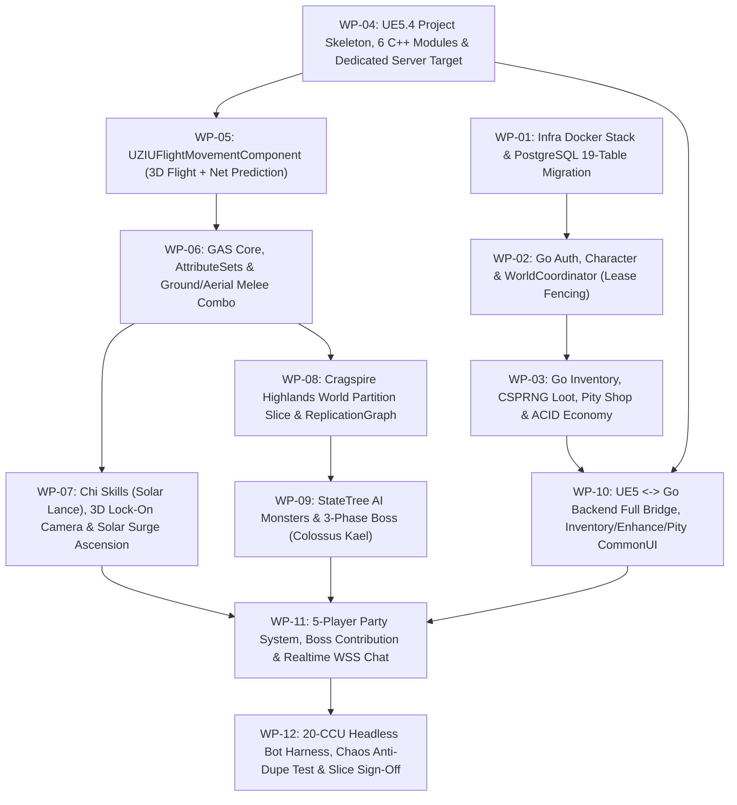

# 02. Vertical Slice AI Coding Agent Task Breakdown (`WP-01` → `WP-12`)

**Phân hệ:** `06_DEVELOPMENT_ROADMAP` · **Tài liệu:** `02_Vertical_Slice_AI_Agent_Task_Breakdown.md`  
**Mục tiêu thực thi:** Xây dựng hoàn chỉnh bản chơi được **Cragspire Highlands Vertical Slice** (`1 Zone 2km×2km×800m`, `Valoran Lv 1–15`, `Bay 3D + Aerial Action Combat + Ascension`, `Crag Ravager + Boss Colossus Kael`, `Personal Loot + Pity Shop`, `20 CCU Authoritative Dedicated Server`).

---

## 1. Sơ Đồ Phụ Thuộc Thực Thi Giữa 12 Work Packages (`Execution DAG`)

Các nhánh **Backend (`WP-01 → WP-03`)** và nhánh **UE5 Core Gameplay (`WP-04 → WP-07`)** có thể được giao cho **2 luồng AI Coding Agent chạy song song**, sau đó hội tụ tại bước tích hợp thế giới, Boss, UI và kiểm thử tải (`WP-08 → WP-12`):

---

## 2. Đặc Tả Chi Tiết Từng Gói Công Việc (`Work Package Specifications`)

---

### `WP-01`: Local Infrastructure, PostgreSQL Migrations & Master GameData Loader
- **Dependencies:** Không có (Gói khởi đầu nhánh Backend).
- **Context Files bắt buộc đọc:**
  - `00_IP_BIBLE_AND_GLOSSARY/IP_Bible_and_Terminology.md`
  - `02_TECHNICAL_ARCHITECTURE/03_Database_Schema_and_Persistence.md`
  - `02_TECHNICAL_ARCHITECTURE/05_Deployment_Observability_and_Security.md`
  - `05_GAME_CONTENT/01_Data_Driven_Schemas_and_Asset_Pipeline.md`
  - `05_GAME_CONTENT/02_MVP_and_Vertical_Slice_Content_Catalog.md`
- **Deliverables cần tạo:**
  1. `docker-compose.dev.yml` khởi chạy `PostgreSQL 16`, `Redis 7` và `NATS 2.10 (JetStream)`.
  2. `backend/go.mod` (`github.com/zenith-mmo/ziu-backend`), `backend/migrations/000001_init_schema.up.sql` & `.down.sql`.
  3. Bộ file cấu hình gốc `backend/gamedata/{skills_vs.json, items_vs.json, mobs_vs.json, loot_tables_vs.json, enhance_rates.json}` chứa đầy đủ dữ liệu từ `05_GAME_CONTENT/02`.
  4. CLI `backend/cmd/migrate/main.go` chạy migration và seed toàn bộ `item_definitions` vào PostgreSQL.
- **Definition of Done & Verification:**
  - Chạy `docker compose -f docker-compose.dev.yml up -d` và `go run ./cmd/migrate up seed` trả về mã thoát `0`; kiểm tra đủ 19 bảng và 15 bản ghi `item_definitions` trong PostgreSQL; chạy `down` rồi `up` lại sạch sẽ không lỗi.

---

### `WP-02`: Go Backend Core — Auth, Character Stat Compiler & World Coordinator
- **Dependencies:** `WP-01`.
- **Context Files bắt buộc đọc:**
  - `02_TECHNICAL_ARCHITECTURE/04_API_and_Event_Contracts.md`
  - `04_MULTIPLAYER_BACKEND/01_Go_Modular_Monolith_Structure.md`
  - `04_MULTIPLAYER_BACKEND/02_Gateway_Session_and_World_Coordinator.md`
  - `01_GDD/04_Character_and_Hybrid_Progression.md`
- **Deliverables cần tạo:**
  1. Biên dịch `pkg/proto/ziu/internal/v1/world_backend.proto` ra Go gRPC code.
  2. Các module `auth`, `character` (bao gồm bộ tổng hợp chỉ số `CompileCharacterStats`), `worldcoord` (kèm kịch bản Lua `claim_character_lease.lua` và `renew_lease.lua` trên Redis).
  3. Binary `cmd/gateway` (`/api/v1/auth/*`, `/api/v1/characters`, `/api/v1/world/enter`) và `cmd/gamesvc` (gRPC `WorldCoordinatorService`, `CharacterPersistenceService`).
- **Definition of Done & Verification:**
  - Bộ `go test ./... -race` kiểm chứng: (1) Đăng ký → Đăng nhập → Tạo nhân vật `VALORAN` → Gọi `EnterWorld` nhận được vé `connect_ticket`; (2) Hai giả lập Zone Server tranh quyền cùng 1 nhân vật → Server cũ bị từ chối ghi DB ngay khi `lease_epoch` tăng!

---

### `WP-03`: Go Backend RPG Authority — Inventory, CSPRNG Loot, Pity & ACID Economy
- **Dependencies:** `WP-02`.
- **Context Files bắt buộc đọc:**
  - `01_GDD/05_Loot_Equipment_and_Economy.md`
  - `04_MULTIPLAYER_BACKEND/03_Inventory_Loot_and_Economy_Services.md`
- **Deliverables cần tạo:**
  1. Module `inventory` (48 ô túi đồ, 8 ô mặc trang bị, tự đẩy vào `MAIL_ESCROW` khi đầy túi).
  2. Module `economy` (Ví `Kora`, ghi sổ cái `wallet_ledger` bắt buộc, API Cường hóa có bảo hiểm `Artisan's Energy` và `Reforge` khóa 1 dòng).
  3. Module `loot` lắng nghe NATS `combat.mob.killed.v1` và `combat.boss.defeated.v1`, quay `Affix` không trùng lặp, tích lũy `boss_pity_progress` và API đổi đồ `Pity Shop`.
- **Definition of Done & Verification:**
  - Unit & Integration Tests với `50 goroutines` bắn đồng thời cùng một `Idempotency-Key` cường hóa / đổi thưởng Boss → chỉ thực thi đúng `1 lần`, tổng biến động `character_wallets` khớp `100%` với `SUM(delta_amount)` trong `wallet_ledger`.

---

### `WP-04`: UE5.4+ Project Skeleton, 6 C++ Modules & Dedicated Server Build Target
- **Dependencies:** Không có (Gói khởi đầu nhánh Unreal Engine).
- **Context Files bắt buộc đọc:**
  - `00_IP_BIBLE_AND_GLOSSARY/IP_Bible_and_Terminology.md`
  - `03_UNREAL_GAME_CLIENT/01_UE5_Project_and_Module_Structure.md`
- **Deliverables cần tạo:**
  1. Khung dự án `unreal/ZenithInfinite/ZenithInfinite.uproject` cùng 3 file `.Target.cs` (`ZenithClient`, `ZenithServer`, `ZenithEditor`).
  2. Khởi tạo 6 module C++ (`ZIUCore`, `ZIUMovement`, `ZIUCombatGAS`, `ZIUInventory`, `ZIUNetwork`, `ZIUUI`) với ranh giới `#if ZIU_WITH_BACKEND_GRPC` chuẩn xác.
  3. Các lớp khung `AZIUGameMode`, `AZIUGameState`, `AZIUPlayerState`, `AZIUPlayerController`, `AZIUCharacterBase`, `AZIUPlayerCharacter`.
- **Definition of Done & Verification:**
  - Biên dịch thành công không cảnh báo lỗi cho cả `ZenithEditor Win64 Development` và `ZenithServer Win64/Linux Development`.

---

### `WP-05`: 3D Free Flight Physics & Network Prediction (`ZIUMovement`)
- **Dependencies:** `WP-04`.
- **Context Files bắt buộc đọc:**
  - `01_GDD/02_World_Design_and_Flight_Mechanics.md`
  - `03_UNREAL_GAME_CLIENT/02_Character_Movement_and_3D_Flight_CPP.md`
- **Deliverables cần tạo:**
  1. Cài đặt đầy đủ `UZIUFlightMovementComponent`, `FSavedMove_ZIUFlight` và `FNetworkPredictionData_Client_ZIUFlight`.
  2. Hỗ trợ đủ chuyển trạng thái `Grounded ↔ Hover ↔ FlightCruise ↔ FlightBoost ↔ AerialPursuit`, cơ chế đáp đất mượt và hạ cánh an toàn khi cạn `Chi` (`Graceful Chi Exhaustion`).
  3. Thiết lập `Enhanced Input` cho toàn bộ thao tác di chuyển và bay 3D trên PC.
- **Definition of Done & Verification:**
  - Chạy `2 Clients + 1 Dedicated Server` trong PIE với cấu hình giả lập mạng `Net PktLag=80, PktLoss=1`: cả 2 nhân vật cất cánh, lượn vòng tốc độ cao `2,400 cm/s` và dừng `Hover` mượt mà không bị kéo giật lùi bất thường.

---

### `WP-06`: GAS Core, Modular AttributeSets & Ground-to-Air Melee Combo (`ZIUCombatGAS`)
- **Dependencies:** `WP-05`.
- **Context Files bắt buộc đọc:**
  - `01_GDD/03_Action_Combat_System.md`
  - `03_UNREAL_GAME_CLIENT/03_GAS_Combat_and_Ascension_Architecture.md`
- **Deliverables cần tạo:**
  1. Đăng ký cây `Native GameplayTags` (`ZIU_GameplayTags.h/.cpp`) và 3 lớp `AttributeSet` (`Vital`, `Combat`, `Potential`).
  2. Cài đặt `UZIUDamageExecCalc` chuẩn công thức sát thương PvE & Arena PvP.
  3. Cài đặt `UGA_ZIUMeleeCombo` (`LMB 1–4`, `RMB Guard Break`, `Uppercut Launch`), `UGA_ZIUAerialPursuit`, `Air LMB 1–3 → Meteor Slam`, `Energy Guard / Perfect Guard` và `Burst Dash / Vanish Counter`.
- **Definition of Done & Verification:**
  - Automation Test trong UE5 xác minh: (1) Chuỗi `LMB 1→2→3 → Uppercut Launch → Aerial Pursuit → Air Combo → Meteor Slam` nối liền mạch; (2) Client không thể tự sửa sát thương khi gửi yêu cầu lên Server; (3) `Perfect Guard` trong cửa sổ `0.15s` chặn 100% sát thương và hồi `+15 Chi`.

---

### `WP-07`: Chi Combat Skills, Smart 3D Lock-On Camera & Valoran Ascension
- **Dependencies:** `WP-06`.
- **Context Files bắt buộc đọc:**
  - `01_GDD/04_Character_and_Hybrid_Progression.md`
  - `03_UNREAL_GAME_CLIENT/04_Camera_Targeting_Animation_and_UI.md`
  - `05_GAME_CONTENT/02_MVP_and_Vertical_Slice_Content_Catalog.md`
- **Deliverables cần tạo:**
  1. Cài đặt 6 kỹ năng Vertical Slice (`Starbreaker Barrage`, `Comet Fang`, `Solar Lance` có bù trễ `<= 150ms`, `Aegis Sphere`, `Astral Blink`, `Nova Collapse`).
  2. Cài đặt `UGA_ZIUAscensionToggle` cho trạng thái **`Solar Surge`** (kèm rút `Chi` định kỳ, hiệu ứng `Aura Mantle` và tự tắt khi `Chi == 0`).
  3. Cài đặt `UZIUAerialSpringArm` và `UZIUTargetingComponent` (chấm điểm ưu tiên Boss `+0.40`).
- **Definition of Done & Verification:**
  - Đặt 1 Boss đứng giữa 6 quái nhỏ: bấm khóa mục tiêu từ hướng nhìn chính diện bắt trúng Boss `10/10` lần; bay vòng trên đỉnh đầu Boss góc `70°` vẫn nhìn rõ cả nhân vật lẫn Boss.

---

### `WP-08`: `Cragspire Highlands` World Partition Slice & ReplicationGraph Config
- **Dependencies:** `WP-06`.
- **Context Files bắt buộc đọc:**
  - `01_GDD/02_World_Design_and_Flight_Mechanics.md`
  - `02_TECHNICAL_ARCHITECTURE/02_Network_Protocol_and_Combat_Sync.md`
- **Deliverables cần tạo:**
  1. Bản đồ `CragspireHighlands` (`2,048m × 2,048m × 800m`) bật `World Partition` (`Cell 128m`), gồm đủ 4 phân khu: *Skywatch Outpost* (kết giới an toàn), *Shattered Basin*, *Windcarved Pillars* (luồng gió bay dọc) và đảo bay *Titan's Altar*.
  2. Hệ thống `AZIUMonsterSpawnVolume` quản lý số lượng và hồi sinh quái tự động trên Server.
  3. Cấu hình `UZIUReplicationGraph` chia lưới không gian 3D và giới hạn tần suất cập nhật theo cự ly.
- **Definition of Done & Verification:**
  - Bay từ đáy thung lũng `Z = +20m` lên đỉnh *Titan's Altar* `Z = +620m` nạp ô bản đồ mượt không khựng hình; các thực thể cách xa `> 250m` tự động ngừng tiêu tốn băng thông mạng (trừ Boss).

---

### `WP-09`: StateTree AI Monsters & 3-Phase Boss `Vanguard Colossus Kael`
- **Dependencies:** `WP-07`, `WP-08`.
- **Context Files bắt buộc đọc:**
  - `05_GAME_CONTENT/02_MVP_and_Vertical_Slice_Content_Catalog.md`
  - `01_GDD/06_Multiplayer_and_Social_Systems.md`
- **Deliverables cần tạo:**
  1. Cài đặt `AZIUNPCCharacter` và cây `StateTree` cho 4 loại quái vùng *Cragspire* (`Crag Crawler`, `Crag Ravager`, quái bay `Galewing Drone` và tinh anh `Apex Ravager`).
  2. Cài đặt `AZIUBossCharacter` cho **Vanguard Colossus Kael** với đầy đủ thanh `Stagger Gauge`, bộ ghi nhận điểm đóng góp `ContributionScore` và kịch bản **3 Giai đoạn** (bao gồm cơ chế bay lên `+80m` triệu hồi 3 `Solar Pylons` ở Phase 2!).
  3. Đẩy sự kiện `combat.boss.defeated.v1` và `combat.mob.killed.v1` từ Dedicated Server sang NATS/Backend ngay khi quái/Boss ngã xuống.
- **Definition of Done & Verification:**
  - Một nhóm 3–5 người chơi phối hợp đánh bại Kael qua đủ 3 giai đoạn; phá kịp 3 `Solar Pylons` trên không làm Kael rơi xuống choáng `6s` đúng thiết kế; bảng điểm đóng góp xuất ra khớp tổng sát thương + phá giáp + phá trụ.

---

### `WP-10`: Full Client/Server ↔ Go Backend Integration & CommonUI MVVM Screens
- **Dependencies:** `WP-03`, `WP-04`, `WP-07`.
- **Context Files bắt buộc đọc:**
  - `02_TECHNICAL_ARCHITECTURE/04_API_and_Event_Contracts.md`
  - `03_UNREAL_GAME_CLIENT/04_Camera_Targeting_Animation_and_UI.md`
- **Deliverables cần tạo:**
  1. `UZIUServerBackendSubsystem` trên Dedicated Server (kết nối gRPC `ClaimCharacterLease`, `RenewCharacterLeases` mỗi 15s, `BatchCheckpointSave` mỗi 60s và nhận luồng `SubscribeCharacterStateUpdates`).
  2. Khung đăng nhập, tạo nhân vật `Valoran`, chọn nhân vật và kết nối tự động vào Zone Server.
  3. Toàn bộ màn hình `CommonUI + MVVM`: HUD (`Vitals`, `5+1 Skill Slots`, `Boss Phase/Stagger Bar`, thông báo nhận Loot), Túi đồ 8 ô trang bị, Cửa sổ Cường hóa an toàn và Cửa hàng Đổi `Colossus Core Token`.
- **Definition of Done & Verification:**
  - Luồng khép kín đầu-cuối: Đăng nhập → Vào *Cragspire* → Hạ Boss *Kael* → Nhận mảnh *Epic Vanguard* + `2 Core Tokens` → Mặc đồ thấy chỉ số `Combat Resonance` và sát thương `Solar Lance` tăng ngay lập tức mà không cần thoát game → Thoát game vào lại vẫn giữ nguyên 100% vị trí, cấp độ, trang bị và `Kora`.

---

### `WP-11`: 5-Player Party System, Tactical 3D Ping & Realtime WebSocket Chat
- **Dependencies:** `WP-09`, `WP-10`.
- **Context Files bắt buộc đọc:**
  - `01_GDD/06_Multiplayer_and_Social_Systems.md`
- **Deliverables cần tạo:**
  1. Module `party` và `social` hoàn chỉnh trên Go Backend + kết nối `WSS` ổn định có tự động kết nối lại (`Exponential Backoff Reconnect`) trên UE5 Client.
  2. Giao diện lập nhóm 5 người, thanh máu đồng đội thời gian thực, cơ chế cộng thưởng `Party Synergy EXP`, con trỏ đánh dấu 3D (`Alt + LMB`) và nút dịch chuyển về Trạm Tiền Tiêu của Đội trưởng.
  3. Khung Chat đa kênh (`Local`, `Zone`, `Party`, `System`).
- **Definition of Done & Verification:**
  - 5 Client lập 1 Party cùng đánh quái/Boss nhận đúng hệ số thưởng `EXP` nhóm (`240% / 5 = 48%` mỗi người) và thấy rõ con trỏ 3D đánh dấu mục tiêu trên không của Đội trưởng.

---

### `WP-12`: 20-CCU Load Test Bot Harness, Chaos Anti-Dupe Verification & Sign-Off
- **Dependencies:** `WP-11` (Gói khóa sổ nghiệm thu Vertical Slice).
- **Context Files bắt buộc đọc:**
  - `02_TECHNICAL_ARCHITECTURE/05_Deployment_Observability_and_Security.md`
  - `06_DEVELOPMENT_ROADMAP/01_Phased_MVP_Roadmap_and_Acceptance.md`
- **Deliverables cần tạo:**
  1. Bộ điều khiển Bot kiểm thử tải (`AZIUSimulatedBotController`) có khả năng kết nối **20 nhân vật đồng thời** vào Dedicated Server, tự động bay lượn, bắn chưởng `Solar Lance`, bật `Solar Surge` và vây đánh Boss *Kael*.
  2. Bộ kịch bản kiểm thử hỗn loạn (`tests/chaos_lease_and_economy_test.go`) giả lập rớt mạng, sập tiến trình Dedicated Server đột ngột (`kill -9`) và gửi gói tin cường hóa/đổi thưởng song song.
  3. Bảng theo dõi Grafana cơ bản hiển thị `ziu_ds_frame_time_ms`, băng thông mạng mỗi Client và độ trễ PostgreSQL.
- **Definition of Done & Verification (Cổng Nghiệm Thu Cuối Cùng Của Vertical Slice):**
  - 20 người chơi/bots chiến đấu liên tục trong `30 phút` tại *Titan's Altar*: Dedicated Server giữ `p95 Frame Time < 25 ms`, băng thông mỗi Client `< 40 KB/s`, `0` crash, `0` sai lệch sổ cái `wallet_ledger` và `0` lỗi nhân đôi vật phẩm!
