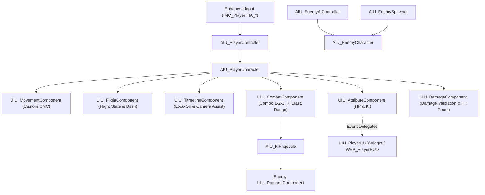

# Step 1 Architecture Specification (`InfiniteUniverse`)

**Scope:** Single-Player C++ Core + Blueprint Presentation Prototype

---

## 1. System Overview Diagram

---

## 2. Class Responsibility, Inputs, Outputs & Dependencies

| C++ Class & Header Path | Responsibility | Inputs | Outputs / Events | Direct Dependencies |
| :--- | :--- | :--- | :--- | :--- |
| `AIU_GameMode` `Core/IU_GameMode.h` | Sets default Pawn, PlayerController, and HUD classes for prototype maps. | Map load settings | Spawns default player | `Engine` |
| `AIU_PlayerController` `Core/IU_PlayerController.h` | Registers `IMC_Player` on `EnhancedInputLocalPlayerSubsystem`; binds `IA_*` actions and forwards intents to Pawn. | Keyboard & Mouse `FInputActionValue` | Calls semantic intent methods on `AIU_PlayerCharacter` | `EnhancedInput`, `IU_PlayerCharacter` |
| `FIU_*` / `EIU_*` `Data/IU_GameplayTypes.h` | Central lightweight enums (`EIU_PlayerMovementMode`, `EIU_CombatState`, `EIU_EnemyAIState`) and `FIU_DamageSpec`. | — | Shared value types | `CoreMinimal` |
| `UIU_AttributeComponent` `Attributes/IU_AttributeComponent.h` | Stores and clamps `HP`, `MaxHP`, `Ki`, `MaxKi`; handles timer-based passive `Ki` regen. | `ModifyHP(Delta)`, `ConsumeKi(Cost)` | `OnHPChanged`, `OnKiChanged`, `OnDepletedHP` | `IU_GameplayTypes` |
| `UIU_MovementComponent` `Movement/IU_MovementComponent.h` | Subclasses `UCharacterMovementComponent`; implements `PhysCustom` 3D flight velocity, acceleration, braking, and wall sliding. | 3D Move vector, Flight config | Smooth capsule motion without teleportation | `IU_GameplayTypes` |
| `UIU_FlightComponent` `Movement/IU_FlightComponent.h` | Manages `Grounded / Jumping / Flying / Landing` transitions, Space-hold liftoff timer, Hover state, Flight Dash, and Landing ground trace. | Flight toggle/hold, Vertical axis, Dash | `OnMovementModeChanged` | `IU_MovementComponent`, `IU_AttributeComponent` |
| `UIU_TargetingComponent` `Combat/IU_TargetingComponent.h` | Sphere-queries valid living targets, cycles targets, auto-clears dead/out-of-range targets, smoothly assists SpringArm rotation. | Lock-on toggle, Cycle axis | `OnTargetLocked`, `OnTargetCleared` | `IU_DamageComponent` |
| `UIU_CombatComponent` `Combat/IU_CombatComponent.h` | Controls `EIU_CombatState` (`Idle, Attacking, Dodging, HitReaction, Defeated`), 3-hit melee combo window, `Dodge` impulse, and `AIU_KiProjectile` spawning. | Light Attack, Ki Blast, Dodge | `OnCombatStateChanged`, `OnComboStepTriggered` | `IU_AttributeComponent`, `IU_TargetingComponent`, `IU_KiProjectile` |
| `UIU_DamageComponent` `Combat/IU_DamageComponent.h` | Validates incoming `FIU_DamageSpec`, ignores dead/invulnerable actors, deducts HP, triggers hit reaction montage/event. | `ApplyDamageSpec(FIU_DamageSpec)` | `OnDamageTaken`, `OnDeath` | `IU_AttributeComponent` |
| `AIU_KiProjectile` `Combat/IU_KiProjectile.h` | Pooled/spawned energy projectile with configurable speed, lifetime, collision channel `KiProjectile`, VFX, and impact damage. | Spawn transform, `FIU_DamageSpec` | Calls target `UIU_DamageComponent` on hit | `IU_DamageComponent`, `Niagara` |
| `AIU_EnemyCharacter` & `AIU_EnemyAIController` `Characters/Enemy/`, `AI/` | Executes deterministic state machine (`Idle → Detect → Chase → Attack → Recover → HitReaction → Dead`) and supports clean `ResetEnemy()` for repeatable testing. | Player proximity, Damage events | Melee attacks on Player, Death/Respawn state | `AIModule`, `IU_AttributeComponent`, `IU_DamageComponent` |
| `UIU_HUDManager` & `UIU_PlayerHUDWidget` `UI/IU_HUDManager.h` | Event-driven UMG HUD displaying HP bar, Ki bar, Flight mode indicator, and 3D Lock-On screen reticle. | Attribute & Target delegates | Visual feedback | `UMG`, `IU_AttributeComponent`, `IU_TargetingComponent` |

---

## 3. Future Extensibility Note (Post-Step 1)
By isolating `UIU_AttributeComponent`, `UIU_CombatComponent`, and `FIU_DamageSpec` behind clean C++ interfaces and event delegates, the project can later migrate combat abilities to Unreal's `Gameplay Ability System (GAS)` in Step 2 without rewriting camera, 3D flight physics, input bindings, or character animation assets.
