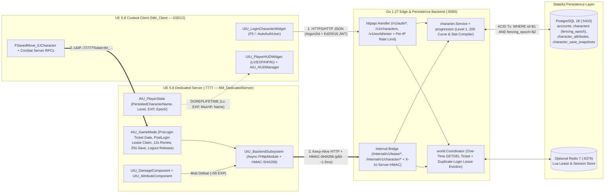

# Step 1, Step 2 & Step 3 Architecture Specification (`InfiniteUniverse` — UE `5.8.4` + Go `1.27` + PostgreSQL `18`)

**Scope:**
- **Step 1 (`Step1_Stable`):** C++ Core 3D Action Gameplay, 2-Stage Momentum Flight, Combo/Ki/Mirage Evade Combat & Enemy AI
- **Step 2 (`Step2_Stable`):** Dedicated Server (`NM_DedicatedServer`), `FSavedMove` 6-DOF Flight Prediction & Multi-Client Replication
- **Step 3 (`Step3_Stable`):** Go Modular Backend (`Argon2id` + `Ed25519 JWT`), One-Time World Connect Tickets, Lease-Fenced PostgreSQL Persistence (`fencing_epoch`), and Authoritative `Level / EXP` Progression

---

## 1. End-to-End Step 3 Full-Stack Topology

---

## 2. Go Backend Module Matrix (`c:\MMORPGNRO\backend\`)

| Go Package | Tables / Keys Owned | Core Responsibility |
| :--- | :--- | :--- |
| `internal/modules/account` | `accounts` (`CITEXT` username/email) | Hashes passwords with `Argon2id` (`m=64MB, t=2, p=2, salt=16B`), verifies credentials in constant time (`subtle.ConstantTimeCompare`), and records `last_login_at` / `last_login_ip`. |
| `internal/modules/auth` | `sess:acc:*`, `sess:rt:*` | Signs & verifies `Ed25519` (`EdDSA`) Access JWTs, rotates one-time Refresh Tokens, enforces **Single-Active-Session** superseding (`ERR_SESSION_SUPERSEDED`), and verifies `X-IU-Server-HMAC` (`HMAC-SHA256`). |
| `internal/modules/world` | `sess:ticket:*`, `char:lease:*` | Issues `30s` one-time connect tickets (`GETDEL` semantics — replay rejected `401`), revokes stale leases on duplicate login, and processes `12s` server lease renewals (`TTL=45s`) via Redis Lua scripts or in-memory mutex table. |
| `internal/modules/progression` | Pure deterministic math | Defines `ExpRequiredForNextLevel(L) = 100*L + 25*(L-1)^2` (`Lv.1->2 = 100 EXP`, `Lv.2->3 = 225 EXP`) and `CompileCharacterStats(raceID, level)` (`Lv.1 = 100 HP / 100 Ki / 1.0x Atk` matching Step 1–2 baseline). |
| `internal/modules/character` | `characters`, `character_attributes`, `character_potential`, `character_save_snapshots` | Enforces 4-slot cap & `CITEXT` name uniqueness, atomically increments `fencing_epoch` on `AdvanceEpochAndLoad`, fences all writes with `WHERE id = $1 AND fencing_epoch = $2`, deduplicates concurrent `idempotency_key` mob kills via `inFlightKill`, and records `SHA-256` audit snapshots. |
| `internal/httpapi` | `/v1/*` & `/internal/v1/*` | Mounts token-bucket rate-limited public client endpoints and HMAC-authenticated internal Dedicated Server endpoints on `cmd/gateway`. |

---

## 3. UE `5.8.4` C++ Class Responsibility Matrix (`InfiniteUniverse`)

| C++ Class & Header Path | Net Role / Replication | Core Responsibility |
| :--- | :--- | :--- |
| `UIU_BackendSubsystem` `Network/IU_BackendSubsystem.h` | `UGameInstanceSubsystem` | Implements dependency-free FIPS 180-4 `SHA-256` & RFC 2104 `HMAC-SHA256`, async `FHttpModule` client auth (`Register`, `Login`, `CreateCharacter`, `EnterWorld` -> `ClientTravel`), `-AutoAuthUser=` CLI automation, and Dedicated Server bridge (`ClaimLease`, `RenewLeases`, `SaveCheckpoint`, `GrantEXP`, `ReleaseLease`). Inactive when `-UseBackend` is omitted so all offline tests run unchanged. |
| `AIU_GameMode` `Core/IU_GameMode.h` | **Server-Only** | Rejects unauthenticated UDP joins in `PreLogin` (`-RequireBackendTicket`), claims character lease in `PostLogin`, restores saved transform & vitals, runs `12s` lease renewal (evicting superseded duplicate logins *without* DB writes) & `25s` periodic checkpoints, and flushes final `LOGOUT` snapshot on `Logout` / `EndPlay`. |
| `AIU_PlayerState` `Core/IU_PlayerState.h` | **`bReplicates = true`** | Replicates `PersistedCharacterName`, `CharacterRaceID`, `CharacterLevel`, `CurrentEXP`, `NextLevelEXP`, `EnemyKills`, `PvPKills`, `Deaths`, and owner-only `ActiveFencingEpoch`; broadcasts `OnCharacterEXPChanged` & `OnCharacterLevelUp`. |
| `UIU_AttributeComponent` `Attributes/IU_AttributeComponent.h` | **`SetIsReplicatedByDefault(true)`** | Replicates `MaxHP`, `MaxKi`, `CurrentHP`, `CurrentKi`, `AttackPowerMultiplier`, and `bIsDead`; applies scaled level vitals via Server-only `ApplyPersistedVitals()`. |
| `UIU_DamageComponent` `Combat/IU_DamageComponent.h` | **`SetIsReplicatedByDefault(true)`** | Enforces Co-op PvE vs West Arena PvP rules and, upon `AIU_EnemyCharacter` defeat by a leased player, dispatches idempotent `GrantCharacterEXP(55)` to the Go Backend to award EXP & trigger Level-Up stat upgrades. |
| `UIU_LoginCharacterWidget`, `UIU_PlayerHUDWidget` & `AIU_HUDManager` `UI/` | **Client-Local UMG / Canvas HUD** | Provides programmatic UMG Login/Register/Character modal (`F5` / `-ShowLoginUI`), reactive `LV. X | EXP` progress bar, `[Lv.X Name]` overhead nameplates, gold `[ LEVEL UP! ]` banners, and `DB: ... | Epoch #N` telemetry. |
