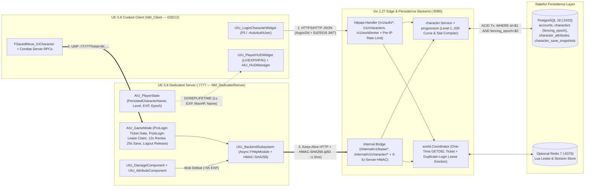

# Step 1, Step 2 & Step 3 Architecture Specification (`InfiniteUniverse` — UE `5.8.4` + Go `1.27` + PostgreSQL `18`)

**Scope:**
- **Step 1 (`Step1_Stable`):** C++ Core 3D Action Gameplay, 2-Stage Momentum Flight, Combo/Ki/Mirage Evade Combat & Enemy AI
- **Step 2 (`Step2_Stable`):** Dedicated Server (`NM_DedicatedServer`), `FSavedMove` 6-DOF Flight Prediction & Multi-Client Replication
- **Step 3 (`Step3_Stable`):** Go Modular Backend (`Argon2id` + `Ed25519 JWT`), One-Time World Connect Tickets, Lease-Fenced PostgreSQL Persistence (`fencing_epoch`), and Authoritative `Level / EXP` Progression

---

## 1. End-to-End Step 3 Full-Stack Topology

---

## 2. Go Backend Module Matrix (`c:\MMORPGNRO\backend\`)

| Go Package | Tables / Keys Owned | Core Responsibility |
| :--- | :--- | :--- |
| `internal/modules/account` | `accounts` (`CITEXT` username/email) | Hashes passwords with `Argon2id` (`m=64MB, t=2, p=2, salt=16B`), verifies credentials in constant time (`subtle.ConstantTimeCompare`), and records `last_login_at` / `last_login_ip`. |
| `internal/modules/auth` | `sess:acc:*`, `sess:rt:*` | Signs & verifies `Ed25519` (`EdDSA`) Access JWTs, rotates one-time Refresh Tokens, enforces **Single-Active-Session** superseding (`ERR_SESSION_SUPERSEDED`), and verifies `X-IU-Server-HMAC` (`HMAC-SHA256`). |
| `internal/modules/world` | `sess:ticket:*`, `char:lease:*` | Issues `30s` one-time connect tickets (`GETDEL` semantics — replay rejected `401`), revokes stale leases on duplicate login, and processes `12s` server lease renewals (`TTL=45s`) via Redis Lua scripts or in-memory mutex table. |
| `internal/modules/progression` | Pure deterministic math | Defines NRO per-hit dual-track progression: `ComputeHitProgressionReward(dmg) = Round(1.5 * dmg)` awarded on **every** hit to both **Điểm Sức mạnh** (`ExpRequiredForNextLevel(L) = 100*L + 25*(L-1)^2`, Level **ONLY** — never auto-increases stats) and **Điểm Tiềm năng**; `PotentialUpgradeCost` escalates per track (`100*(n+1)` for `+100 HP`/`+100 Ki`, `150*(n+1)` for `+10 Sức đánh`) from `200 HP / 200 Ki / 100 Sức đánh`. |
| `internal/modules/character` | `characters`, `character_attributes`, `character_potential`, `character_save_snapshots` | Enforces 4-slot cap & `CITEXT` name uniqueness, atomically increments `fencing_epoch` on `AdvanceEpochAndLoad`, fences all writes (`SaveCheckpointFenced`, `GrantEXPFenced`, `AllocatePotentialFenced`) with `WHERE id = $1 AND fencing_epoch = $2`, stores `PotentialPoints` in `character_potential.potential_exp`, deduplicates concurrent `idempotency_key` mob kills via `inFlightKill`, and records `SHA-256` audit snapshots. |
| `internal/httpapi` | `/v1/*` & `/internal/v1/*` | Mounts token-bucket rate-limited public client endpoints and HMAC-authenticated internal Dedicated Server endpoints (`claim`, `renew`, `release`, `save`, `exp`, `potential`) on `cmd/gateway`. |

---

## 3. UE `5.8.4` C++ Class Responsibility Matrix (`InfiniteUniverse`)

| C++ Class & Header Path | Net Role / Replication | Core Responsibility |
| :--- | :--- | :--- |
| `UIU_BackendSubsystem` `Network/IU_BackendSubsystem.h` | `UGameInstanceSubsystem` | Implements dependency-free FIPS 180-4 `SHA-256` & RFC 2104 `HMAC-SHA256`, async `FHttpModule` client auth (`Register`, `Login`, `CreateCharacter`, `EnterWorld` -> `ClientTravel`), `-AutoAuthUser=` CLI automation, and Dedicated Server bridge (`ClaimLease`, `RenewLeases`, `SaveCheckpoint`, `GrantCharacterEXP`, `AllocateCharacterPotential`, `ReleaseLease`). Inactive when `-UseBackend` is omitted so all offline tests run unchanged. |
| `AIU_GameMode` & `AIU_PlayerController` `Core/IU_GameMode.h`, `IU_PlayerController.h` | **Server Authority + RPC** | `AIU_GameMode` rejects unauthenticated UDP joins in `PreLogin`, claims character lease in `PostLogin`, restores `200 HP / 200 Ki / 100 Sức đánh` + upgraded stats, runs `12s` lease renewal & `25s` periodic checkpoints, and flushes `LOGOUT` snapshot. `AIU_PlayerController::Server_RequestAllocatePotential` validates and routes Potential stat upgrades (`P` panel & `1/2/3` hotkeys) to Go Backend. |
| `AIU_PlayerState` `Core/IU_PlayerState.h` | **`bReplicates = true`** | Replicates `PersistedCharacterName`, `CharacterRaceID`, `CharacterLevel`, `CurrentEXP`, `NextLevelEXP`, `PotentialPoints`, `HPUpgradeCount`, `KiUpgradeCount`, `AtkUpgradeCount`, `NextHPCost`, `NextKiCost`, `NextAtkCost`, `EnemyKills`, `PvPKills`, `Deaths`, and owner-only `ActiveFencingEpoch`; broadcasts `OnCharacterEXPChanged`, `OnCharacterLevelUp`, and `OnCharacterPotentialChanged`. |
| `UIU_AttributeComponent` `Attributes/IU_AttributeComponent.h` | **`SetIsReplicatedByDefault(true)`** | Replicates `MaxHP`, `MaxKi`, `CurrentHP`, `CurrentKi`, `AttackPower` (`Sức đánh`), `AttackPowerMultiplier` (`AttackPower / 100.0`), and `bIsDead`; applies persisted & upgraded vitals via Server-only `ApplyPersistedVitals()`. |
| `UIU_DamageComponent` `Combat/IU_DamageComponent.h` | **`SetIsReplicatedByDefault(true)`** | Enforces Co-op PvE vs West Arena PvP rules and, on **every valid hit** against `AIU_EnemyCharacter` (not waiting for lethal kill!), awards `Round(1.5 * OutgoingDamage)` to both Điểm Sức mạnh & Điểm Tiềm năng via idempotent `GrantCharacterEXP`. |
| `UIU_PotentialUpgradeWidget`, `UIU_LoginCharacterWidget`, `UIU_PlayerHUDWidget` & `AIU_HUDManager` `UI/` | **Client-Local UMG / Canvas HUD** | Provides programmatic NRO Potential & Stat Upgrade modal (`P` / `1,2,3`), Gateway Login modal (`F5`), live `LV. X | DIEM LV` & `TIEM NANG | SUC DANH` HUD readouts, `+350 TIEM NANG!` / `CHI SO TANG!` popups, and `F3` telemetry. |
