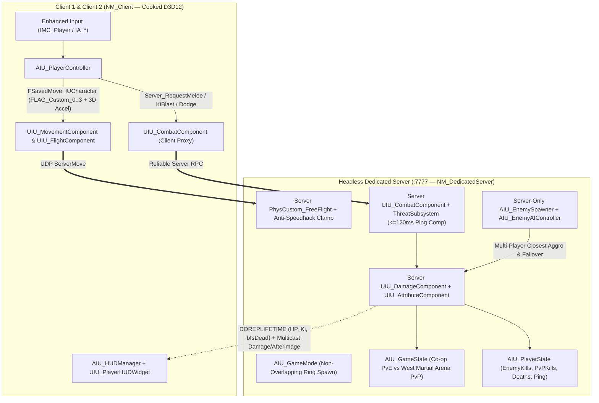

# Step 1 & Step 2 Architecture Specification (`InfiniteUniverse` — UE `5.8.4`)

**Scope:** C++ Core Gameplay + **Dedicated Server (`NM_DedicatedServer`) & Client-Predicted 3D Action Multiplayer (`Step2_Stable`)**

---

## 1. Client–Dedicated Server Authority & Replication Diagram

---

## 2. Class Responsibility, Replication & Authority Matrix

| C++ Class & Header Path | Net Role / Replication | Core Responsibility |
| :--- | :--- | :--- |
| `InfiniteUniverseServerTarget` `Source/InfiniteUniverseServer.Target.cs` | Dedicated Server Build Target | Configures headless `TargetType.Server` for CI/Linux/Cloud source engine deployments alongside `UnrealEditor.exe -server` on Launcher Installed Builds. |
| `AIU_GameMode` `Core/IU_GameMode.h` | **Server-Only** | Assigns `AIU_GameState`, `AIU_PlayerState`, `AIU_PlayerCharacter`, `AIU_PlayerController`, `AIU_HUDManager`; distributes connecting players on a non-overlapping `180 cm` ring (`AllocateMultiplayerSpawnTransform`). |
| `AIU_GameState` `Core/IU_GameState.h` | **`bReplicates = true`** | Replicates `bAllowGlobalPvPSparring` (`F4`) and defines `MartialSparringArenaBox` (`36m × 36m` West Arena) via `ArePlayersAllowedToSpar()` — blocking friendly fire in Co-op PvE sectors while enabling live 1v1 PvP sparring inside the Arena. |
| `AIU_PlayerState` `Core/IU_PlayerState.h` | **`bReplicates = true`** | Replicates authoritative `EnemyKills`, `PvPKills`, `Deaths`, and provides `GetPingInMilliseconds()` for HUD telemetry & server ping compensation. |
| `UIU_MovementComponent` & `FSavedMove_IUCharacter` `Movement/IU_MovementComponent.h` | **Client Prediction + Server Authority** | Packs `FLAG_Custom_0` (Sprint/FlightBoost), `FLAG_Custom_1` (`CMOVE_FreeFlight`), `FLAG_Custom_2` (`Ascend`), `FLAG_Custom_3` (`Descend`) into `FSavedMove_Character`; enforces pre-move 3D speedhack clamp on Server. |
| `UIU_FlightComponent` `Movement/IU_FlightComponent.h` | **`SetIsReplicatedByDefault(true)`** | Preserves Step 1's 2-stage momentum flight curve, recovers 3D directional intent on Server via `GetCurrentAcceleration()`, and replicates `bReplicatedFlightDashing` (`COND_SkipOwner`) + visual lean to `SimulatedProxy` peers. |
| `UIU_AttributeComponent` `Attributes/IU_AttributeComponent.h` | **`SetIsReplicatedByDefault(true)`** | Guards `ModifyHP`, `TryConsumeKi`, `RestoreKi` with `HasAuthority()`; replicates `CurrentHP`, `CurrentKi`, `MaxHP`, `MaxKi`, `AttackPowerMultiplier`, and `bIsDead` (`OnRep_*` drives client HUD & respawn collision recovery). |
| `UIU_DamageComponent` `Combat/IU_DamageComponent.h` | **`SetIsReplicatedByDefault(true)`** | Authoritative damage gatekeeper: enforces `IsDead()`, `i-frames`, and `AIU_GameState::ArePlayersAllowedToSpar()`, updates `AIU_PlayerState` kill/death counters, and broadcasts `Multicast_NotifyDamageApplied` for floating numbers & hit reactions. |
| `UIU_CombatComponent`, `AIU_KiProjectile` & `AIU_AfterimageGhost` `Combat/` | **Server RPC + Replicated Actors + Multicast Cosmetics** | Validates `1-2-3` melee combos, `Ki` deduction, replicated `AIU_KiProjectile` (`ReplicatedLaunchVelocity`), and bounded `<= 120 ms` ping-compensated **Mirage Perfect Evade** spawning `UPoseableMeshComponent` `AIU_AfterimageGhost` at Origin `A` across all Clients. |
| `AIU_EnemySpawner`, `AIU_EnemyCharacter` & `AIU_EnemyAIController` `AI/`, `Characters/Enemy/` | **Server-Only Spawner/AI + Replicated Character** | `AIU_EnemySpawner` (`bNetLoadOnClient=false`) and `AIU_EnemyAIController` execute strictly on Server with multi-player closest-target aggro & failover; `AIU_EnemyCharacter` replicates movement, `ReplicatedAIState`, `bWindingUpAttack` (`[ ! RMB EVADE ]`), and `Multicast_OnEnemyReset`. |
| `AIU_HUDManager` & `UIU_PlayerHUDWidget` `UI/` | **Client-Local HUD** | Handles delayed multiplayer `Pawn` replication binding, renders `[CO-OP ALLY]` / `[SPAR RIVAL]` overhead bars, floating damage numbers, kill/defeat banners, and `F3` Live Multiplayer Telemetry (`NetMode`, `Ping`, `Online`, `Zone`, `FPS`, `RAM`). |

---

## 3. Locked Boundary for Step 3+ Transition
With `Step2_Stable` proving deterministic 6-DOF flight prediction, server-authoritative Co-op/PvP combat, and multi-player AI synchronization over real UDP with `~7.8 KB/s` per client, Step 3 can cleanly introduce Backend Persistence (Go / PostgreSQL / Redis), Authentication, Character Progression, and Inventory without altering the core UE `5.8` movement or combat replication foundation.
