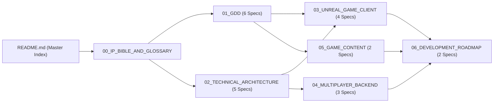

# ZENITH: INFINITE UNIVERSE — Master Specification Repository

**Phiên bản:** `v2.0-Production-Spec` · **Ngày ban hành:** `19/11/2026`  
**Thể loại:** 3D Open-World Action MMORPG (PC-First)  
**Tech Stack:** Unreal Engine 5.4+ (`C++` / `GAS` / `World Partition` / `Iris`) · Go 1.23+ Modular Monolith · PostgreSQL 16 · Redis 7 · NATS JetStream  
**Tiền tố mã nguồn (Code Prefix):** `ZIU` (`AZIUCharacter`, `UZIUAbilitySystemComponent`, `ziu-backend`)

---

## 1. Mục tiêu của Bộ Tài Liệu Này

Kho tài liệu này không phải là bản mô tả ý tưởng sơ bộ, mà là **Single Source of Truth (Nguồn tham chiếu chuẩn duy nhất)** được thiết kế chuyên biệt để:
1. **Đội ngũ Kỹ thuật & Thiết kế (Con người)** nắm bắt toàn bộ kiến trúc thế giới mở liên tục (*Persistent World*), cơ chế không chiến 3D tốc độ cao, toán học cân bằng *Hybrid Progression* và mô hình chống gian lận/nhân đôi dữ liệu.
2. **AI Coding Agents** có thể đọc từng phân hệ độc lập theo thứ tự phụ thuộc rõ ràng, nắm chính xác tên class C++, lược đồ SQL, hợp đồng gRPC/Protobuf, cây `GameplayTags` và tiêu chí nghiệm thu (*Definition of Done*) để lập trình trực tiếp **Vertical Slice** rồi mở rộng lên **MVP**.

---

## 2. Năm Nguyên Tắc Kiến Trúc Bất Biến (Architectural Invariants)

Mọi dòng code sinh ra bởi lập trình viên hoặc AI Agent bắt buộc tuân thủ 5 nguyên tắc bất biến sau:

1. **Illusion of One World, Reality of Distributed Zones**: Người chơi trải nghiệm một vũ trụ duy nhất (`Helios Expanse`), nhưng về mặt vật lý, thế giới được vận hành bởi nhiều process **UE5 Dedicated Server theo từng Zone/Channel** và **Instance Server** dưới sự điều phối của `World Coordinator`.
2. **Strict Server Authority with Client Prediction**: Client được phép dự đoán chuyển động bay 3D (`FSavedMove_ZIUFlight`) và phát hoạt ảnh đánh đòn ngay lập tức (`GAS Local Predicted`), nhưng **100% kết quả sát thương, tiêu hao Chi, rơi vật phẩm, cường hóa và giao dịch** đều do Server xác thực.
3. **Single-Owner Lease Fencing (Zero Duplication)**: Tại mọi thời điểm, một nhân vật chỉ thuộc quyền ghi của **duy nhất một Zone/Instance Server** thông qua khóa phân tán Redis kèm số thứ tự tăng đơn điệu `lease_epoch`. Mọi gói lưu dữ liệu có `lease_epoch` cũ đều bị PostgreSQL từ chối ở tầng câu lệnh SQL.
4. **Data-Driven Content & Clean Original IP**: Toàn bộ thông số kỹ năng, quái vật, trang bị, tỉ lệ rơi đồ được cấu hình qua bảng dữ liệu chuẩn hóa đồng bộ giữa UE5 và Go Backend. Toàn bộ thế giới, chủng tộc, kỹ năng tuân thủ **Original IP (`ZENITH: INFINITE UNIVERSE`)** để đảm bảo an toàn pháp lý thương mại 100%.
5. **Vertical Slice First**: Không sản xuất hàng loạt hành tinh hay hàng trăm nhiệm vụ trước khi **Cragspire Highlands Vertical Slice** (1 Zone `2km × 2km × 800m`, 1 tộc `Valoran`, Bay 3D + Action Combat, 1 Quái + 1 Boss, Personal Loot, 20 CCU) vượt qua bài kiểm thử thực tế.

---

## 3. Sơ Đồ Tổ Chức Kho Tài Liệu (24 Tài Liệu Đặc Tả)

### Danh mục chi tiết các file

| Phân hệ | Tài liệu | Mục đích cốt lõi |
| :--- | :--- | :--- |
| **00. IP Bible** | [IP_Bible_and_Terminology.md](./00_IP_BIBLE_AND_GLOSSARY/IP_Bible_and_Terminology.md) | Bối cảnh vũ trụ *Helios Expanse*, 6 chủng tộc gốc, từ điển định danh `ZIU_*` và hàng rào bản quyền thương mại. |
| **01. GDD** | [01_Product_Vision_and_Core_Loop.md](./01_GDD/01_Product_Vision_and_Core_Loop.md) | Định vị sản phẩm, 7 bước Core Loop, 3 vòng lặp thời gian (`1–5m`, `15–30m`, `1–3h`) và 3 mục tiêu dài hạn. |
| **01. GDD** | [02_World_Design_and_Flight_Mechanics.md](./01_GDD/02_World_Design_and_Flight_Mechanics.md) | Quy hoạch hành tinh *Terra Prime* (5 Zones), phân tầng độ cao 3D, 7 chế độ di chuyển và công thức tiêu hao `Chi` khi bay. |
| **01. GDD** | [03_Action_Combat_System.md](./01_GDD/03_Action_Combat_System.md) | Điều khiển PC, Melee/Aerial Combo, Frame Data, `Cancel Window`, 6 nhóm kỹ năng `Chi`, Lock-on 3D và cân bằng PvE/PvP. |
| **01. GDD** | [04_Character_and_Hybrid_Progression.md](./01_GDD/04_Character_and_Hybrid_Progression.md) | Tạo nhân vật, toán học 3 tầng chỉ số, đường cong Level 1–100, *Training Trials*, nhánh *Ascension Forms* và Build. |
| **01. GDD** | [05_Loot_Equipment_and_Economy.md](./01_GDD/05_Loot_Equipment_and_Economy.md) | 8 ô trang bị, Transmog, 6 bậc Rarity, *Affix Budget*, Cường hóa có bảo hiểm, *Personal Loot + Pity Token* và kinh tế `Kora`. |
| **01. GDD** | [06_Multiplayer_and_Social_Systems.md](./01_GDD/06_Multiplayer_and_Social_Systems.md) | Phân lớp World/Instance, Party 5 người, Guild, cơ chế tính đóng góp & giới hạn 40 người/kênh của *World Boss*, luật PvP. |
| **02. Architecture** | [01_System_Architecture_Overview.md](./02_TECHNICAL_ARCHITECTURE/01_System_Architecture_Overview.md) | Kiến trúc 4 lớp, phân tách UE5 Dedicated Server và Go Modular Monolith, chiến lược mở rộng ngang. |
| **02. Architecture** | [02_Network_Protocol_and_Combat_Sync.md](./02_TECHNICAL_ARCHITECTURE/02_Network_Protocol_and_Combat_Sync.md) | Tick rate (`60Hz/30Hz`), Client Prediction, Lag Compensation (`150ms`), *Iris Spatial Grid* và giao thức *Zone Transfer*. |
| **02. Architecture** | [03_Database_Schema_and_Persistence.md](./02_TECHNICAL_ARCHITECTURE/03_Database_Schema_and_Persistence.md) | Mã SQL DDL đầy đủ cho 19 bảng PostgreSQL 16, Double-entry Ledger, Optimistic Locking và cấu trúc khóa Redis 7. |
| **02. Architecture** | [04_API_and_Event_Contracts.md](./02_TECHNICAL_ARCHITECTURE/04_API_and_Event_Contracts.md) | Hợp đồng `.proto` (gRPC nội bộ), REST/WebSocket Gateway cho Client và danh mục sự kiện NATS JetStream có `idempotency_key`. |
| **02. Architecture** | [05_Deployment_Observability_and_Security.md](./02_TECHNICAL_ARCHITECTURE/05_Deployment_Observability_and_Security.md) | Docker Compose dev stack, Kubernetes + Agones, bộ metrics Prometheus/Grafana và ma trận chống Speedhack/Dupe. |
| **03. UE5 Client/Server** | [01_UE5_Project_and_Module_Structure.md](./03_UNREAL_GAME_CLIENT/01_UE5_Project_and_Module_Structure.md) | Cấu trúc `ZenithInfinite.uproject`, 6 C++ Modules, Build Targets Client/Server và ranh giới C++ vs Blueprint. |
| **03. UE5 Client/Server** | [02_Character_Movement_and_3D_Flight_CPP.md](./03_UNREAL_GAME_CLIENT/02_Character_Movement_and_3D_Flight_CPP.md) | Đặc tả C++ `UZIUFlightMovementComponent`, vật lý 4 chế độ bay 3D và `FSavedMove_ZIUFlight` cho Client Prediction. |
| **03. UE5 Client/Server** | [03_GAS_Combat_and_Ascension_Architecture.md](./03_UNREAL_GAME_CLIENT/03_GAS_Combat_and_Ascension_Architecture.md) | 3 `AttributeSets`, cây `GameplayTags`, C++ `GameplayAbilities` (Combo, Pursuit, Beam, Ascension) và `UZIUDamageExecCalc`. |
| **03. UE5 Client/Server** | [04_Camera_Targeting_Animation_and_UI.md](./03_UNREAL_GAME_CLIENT/04_Camera_Targeting_Animation_and_UI.md) | Camera không chiến 3D, chấm điểm Lock-on, Motion Warping, Montage Notifies và giao diện CommonUI + MVVM. |
| **04. Backend** | [01_Go_Modular_Monolith_Structure.md](./04_MULTIPLAYER_BACKEND/01_Go_Modular_Monolith_Structure.md) | Cấu trúc thư mục `ziu-backend`, ranh giới 12 domain modules, `pgxpool`/`sqlc` và quy tắc tách Microservices. |
| **04. Backend** | [02_Gateway_Session_and_World_Coordinator.md](./04_MULTIPLAYER_BACKEND/02_Gateway_Session_and_World_Coordinator.md) | Xác thực JWT, chống đăng nhập kép, quản lý sức chứa Zone/Channel và máy trạng thái `Lease Fencing` chuyển vùng. |
| **04. Backend** | [03_Inventory_Loot_and_Economy_Services.md](./04_MULTIPLAYER_BACKEND/03_Inventory_Loot_and_Economy_Services.md) | Quay thưởng Loot CSPRNG, sinh Affix, tích lũy Pity Token, giao dịch ACID chống Deadlock và Transactional Outbox. |
| **05. Content** | [01_Data_Driven_Schemas_and_Asset_Pipeline.md](./05_GAME_CONTENT/01_Data_Driven_Schemas_and_Asset_Pipeline.md) | Pipeline xuất dữ liệu kép (`UE DataTable` + `Backend JSON`), bộ xương dùng chung, ngân sách LOD và giới hạn VFX. |
| **05. Content** | [02_MVP_and_Vertical_Slice_Content_Catalog.md](./05_GAME_CONTENT/02_MVP_and_Vertical_Slice_Content_Catalog.md) | Bảng thông số thực tế cho *Cragspire Highlands*, 3 chủng tộc, 6 kỹ năng mẫu, 12 quái, Boss *Colossus Kael* và 15 trang bị. |
| **06. Roadmap** | [01_Phased_MVP_Roadmap_and_Acceptance.md](./06_DEVELOPMENT_ROADMAP/01_Phased_MVP_Roadmap_and_Acceptance.md) | Lộ trình 5 Phase (38–52 tuần), cổng nghiệm thu MVP, kịch bản Stress Test `10 → 50 → 100 CCU` và lộ trình LiveOps. |
| **06. Roadmap** | [02_Vertical_Slice_AI_Agent_Task_Breakdown.md](./06_DEVELOPMENT_ROADMAP/02_Vertical_Slice_AI_Agent_Task_Breakdown.md) | **Tài liệu thực thi trung tâm cho AI Agent:** 12 gói công việc (`WP-01` → `WP-12`) kèm đầu vào, đầu ra và kiểm thử tự động. |

---

## 4. Hướng Dẫn Sử Dụng Cho AI Coding Agent

Khi bắt đầu bất kỳ phiên lập trình nào trên kho mã nguồn của dự án:
1. **Bước 1 — Đọc quy ước gốc**: Luôn đọc [IP_Bible_and_Terminology.md](./00_IP_BIBLE_AND_GLOSSARY/IP_Bible_and_Terminology.md) để dùng đúng tiền tố `ZIU`, tên thuộc tính và quy chuẩn đặt tên.
2. **Bước 2 — Chọn gói công việc (`WP`)**: Mở [02_Vertical_Slice_AI_Agent_Task_Breakdown.md](./06_DEVELOPMENT_ROADMAP/02_Vertical_Slice_AI_Agent_Task_Breakdown.md) để xác định gói `WP-XX` hiện tại và danh sách **Context Files bắt buộc đọc** của gói đó.
3. **Bước 3 — Tuân thủ ranh giới module**: Không tự ý thêm cột vào DB ngoài [03_Database_Schema_and_Persistence.md](./02_TECHNICAL_ARCHITECTURE/03_Database_Schema_and_Persistence.md) hoặc sửa đổi `.proto` ngoài [04_API_and_Event_Contracts.md](./02_TECHNICAL_ARCHITECTURE/04_API_and_Event_Contracts.md) nếu chưa cập nhật lại tài liệu đặc tả trước.
4. **Bước 4 — Chạy kiểm thử nghiệm thu**: Hoàn thành 100% bài kiểm tra được quy định trong mục `Verification` của từng `WP` trước khi chuyển sang `WP` kế tiếp.
