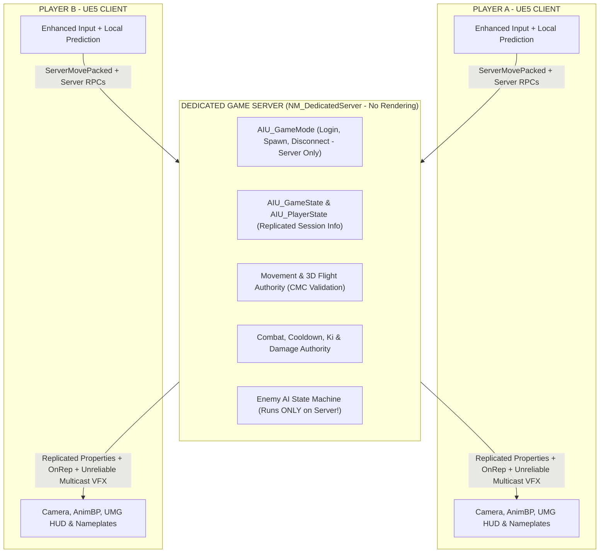

# Step 2 Technical Plan & AI Agent Specification — Multiplayer Foundation (`MP-01` → `MP-41`)

**Dự án:** `InfiniteUniverse` · **Giai đoạn:** Bước 2 – Multiplayer Foundation *(Chỉ kích hoạt SAU KHI Bước 1 – Core Gameplay Prototype đạt 26/26 tiêu chí nghiệm thu)*  
**Engine:** Unreal Engine `5.5` (`C++ Authoritative Client–Server` + Standard UE Replication)  
**Chiến lược 2 Máy (`Dual-Machine Workflow`):**
- **Trên Laptop (`196 GB` trống ổ `D:`, `16GB RAM`, `RTX 3050 4GB`):** Dùng **UE 5.5 bản Epic Launcher (`~50 GB`)**, chạy tiến trình **Dedicated Server độc lập không đồ họa** qua cờ `UnrealEditor.exe ... -server -log` (`NM_DedicatedServer` chuẩn 100%) + `2 – 4 Clients` cửa sổ nhỏ (`960×540`) để lập trình và kiểm thử `MP-02` → `MP-40`.
- **Trên Máy Ở Nhà (Đủ dung lượng `>= 300 GB`):** Dùng **UE 5.5 Source Build** để biên dịch đóng gói file thực thi `InfiniteUniverseServer.exe` (`MP-01` `TargetType.Server`) và chạy Stress Test `10 – 20 Clients` (`MP-41` / Phase 2.7).

---

## 1. Kiến Trúc Mạng Mục Tiêu & Phạm Vi Khóa Chặt (`Scope & Authority Model`)



### Quy tắc Phạm vi Bắt buộc ở Bước 2
- **LÀM TRONG BƯỚC 2:** Dedicated Server runtime, Client Connect/Disconnect/Reconnect cơ bản, Đồng bộ đi bộ/chạy/nhảy/bay 3D/Hover/Flight Dash, Server-Authoritative Melee Combo + `Ki Blast` + `Dodge` + `HP/Ki`, Server-Only Enemy AI, Tên hiển thị (`Nameplate`) & UI trạng thái mạng, Kiểm thử độ trễ/mất gói và tải `2 → 4 → 10 → 20` Clients.
- **TUYỆT ĐỐI CHƯA LÀM (Đẩy sang Bước 3 – 5):** Hệ thống đăng nhập Tài khoản, Backend Go, PostgreSQL/Redis, Lưu nhân vật lâu dài (`Persistence`), Túi đồ (`Inventory`), Trang bị (`Equipment`), Rơi đồ (`Loot`), Tổ đội (`Party`), Bang hội (`Guild`), Ghép trận (`Matchmaking`), Chuyển vùng (`Zone Server`) và `Persistent World`.

---

## 2. Cấu Trúc Mở Rộng Từ Bước 1 Lên Bước 2 (`Delta Folder Structure`)

Giữ nguyên toàn bộ cấu trúc Bước 1, chỉ bổ sung `IU_GameState`, `IU_PlayerState`, nhánh `Network/` và `InfiniteUniverseServer.Target.cs`:

```text
InfiniteUniverse/
├── Source/
│   ├── InfiniteUniverse.Target.cs
│   ├── InfiniteUniverseEditor.Target.cs
│   ├── InfiniteUniverseServer.Target.cs          # [NEW - MP-01] Chỉ biên dịch trên máy có UE5 Source Build
│   └── InfiniteUniverse/
│       ├── Core/
│       │   ├── IU_GameInstance.h / .cpp          # Mở rộng quản lý lệnh Connect(IP:Port) & Disconnect reason
│       │   ├── IU_GameMode.h / .cpp              # [MODIFY - MP-02..05] PostLogin, SpawnPlayer, Logout cleanup
│       │   ├── IU_GameState.h / .cpp             # [NEW] Trạng thái phiên chơi chung được Replicate
│       │   ├── IU_PlayerState.h / .cpp           # [NEW - MP-31] Replicated DisplayName, SessionPlayerId, Ping
│       │   └── IU_PlayerController.h / .cpp
│       ├── Movement/
│       │   ├── IU_MovementComponent.h / .cpp     # [MODIFY - MP-08..15] FSavedMove_IUFlight & FNetworkPredictionData
│       │   └── IU_FlightComponent.h / .cpp       # [MODIFY] Replicate FlightState cho SimulatedProxy
│       ├── Combat/
│       │   ├── IU_CombatComponent.h / .cpp       # [MODIFY - MP-16..23] Server RPCs + Cooldown/Ki check trên Server
│       │   ├── IU_DamageComponent.h / .cpp       # [MODIFY - MP-20] HasAuthority() guard bắt buộc
│       │   └── IU_KiProjectile.h / .cpp          # [MODIFY - MP-19] bReplicates = true, chỉ Server xử lý va chạm sát thương
│       ├── Attributes/
│       │   └── IU_AttributeComponent.h / .cpp    # [MODIFY - MP-21] DOREPLIFETIME_NOTIFY cho HP/MaxHP, COND_OwnerOnly cho Ki
│       ├── AI/
│       │   └── IU_EnemyAIController.h / .cpp     # [MODIFY - MP-24..30] Chỉ spawn & tick trên HasAuthority()
│       ├── Network/                              # [NEW FOLDER]
│       │   ├── IU_NetworkManager.h / .cpp        # Điều phối kết nối Direct IP, theo dõi trạng thái NetDriver
│       │   ├── IU_SessionManager.h / .cpp        # Quản lý tham số phiên chơi cục bộ / LAN
│       │   ├── IU_ConnectionState.h              # Enum Disconnected, Connecting, Connected, Reconnecting, Error
│       │   └── IU_NetworkDebug.h / .cpp          # Ghi log mạng, gói lệnh PktLag/PktLoss & phát hiện lệch vị trí (Desync)
│       └── UI/
│           ├── IU_NameplateWidget.h / .cpp       # [NEW - MP-32..33] Thanh tên & máu gắn WidgetComponent trên đầu nhân vật
│           └── IU_NetworkStatusWidget.h / .cpp   # [NEW - MP-34] Hiển thị Ping (ms), trạng thái kết nối & thông báo rớt mạng
└── Tools/
    ├── RunLocalDedicatedServer.ps1               # [NEW - MP-07] Chạy UnrealEditor.exe -server -log trên cổng 7777
    └── SpawnTestClients.ps1                      # [NEW - MP-07/Phase 2.7] Bật N cửa sổ Client kết nối vào 127.0.0.1:7777
```

---

## 3. Năm Thiết Kế Kỹ Thuật Cốt Lõi Của Bước 2 (`Core Netcode Contracts`)

### 3.1. Chạy Dedicated Server Thực Thụ Trên Cả Hai Máy (`MP-01` & `MP-07`)
1. **Trên Laptop (UE 5.5 Launcher — Không cần 250GB Source Build):**
   `Tools/RunLocalDedicatedServer.ps1` khởi chạy tiến trình Server độc lập hoàn toàn không mở giao diện Editor và không dùng GPU render:
   ```powershell
   & "$UE5Dir\Engine\Binaries\Win64\UnrealEditor.exe" "$UProject" /Game/Maps/MultiplayerTest/M_MPTest -server -log -nosteam -port=7777
   ```
   Sau đó `Tools/SpawnTestClients.ps1 -Count 2` bật 2 cửa sổ Client độc lập:
   ```powershell
   & "$UE5Dir\Engine\Binaries\Win64\UnrealEditor.exe" "$UProject" 127.0.0.1:7777 -game -windowed -ResX=960 -ResY=540 -WinX=50 -WinY=50 -nosteam -log
   ```
   Trong code C++, hàm `GetNetMode()` trả về chính xác **`NM_DedicatedServer`** trên cửa sổ Server và **`NM_Client`** trên 2 cửa sổ Client — hành vi mạng giống hệt 100% bản đóng gói thực tế!
2. **Trên Máy Ở Nhà (UE 5.5 Source Build):**
   Biên dịch `Source/InfiniteUniverseServer.Target.cs` (`Type = TargetType.Server;`) thông qua `RunUAT.bat BuildCookRun ... -server -target=InfiniteUniverseServer` để xuất ra binary `InfiniteUniverseServer.exe` nhẹ phục vụ kiểm thử tải `8 – 20 Clients`.

### 3.2. Đồng Bộ Di Chuyển & Bay Tự Do 3D (`MP-08` → `MP-15`)
- **Tuyệt đối không tự dùng `Tick` gửi `Server_SetActorLocation` mỗi frame!** Việc đó vừa tốn băng thông vừa gây giật hình và dễ bị hack dịch chuyển.
- Mở rộng chuẩn `UCharacterMovementComponent` (`UIU_MovementComponent`):
  1. **Owning Client (`ROLE_AutonomousProxy`):** Đóng gói cờ `bWantsFlight` (`FLAG_Custom_0`) và `bWantsFlightDash` (`FLAG_Custom_1`) cùng vector đầu vào 3 trục `(X, Y, Z)` vào `FSavedMove_IUFlight`. Client di chuyển mượt tức thì trên màn hình của mình; nếu lệch so với kết quả xác nhận của Server vượt ngưỡng cho phép, CMC tự động thực hiện `ClientAdjustPosition` và làm mượt lưới nhân vật (`NetworkSmoothingMode = Exponential`).
  2. **Other Players (`ROLE_SimulatedProxy`):** Không nhận từng frame hoạt ảnh qua mạng! Server chỉ replicate biến gọn nhẹ `UPROPERTY(ReplicatedUsing=OnRep_FlightMode) EIU_PlayerMovementMode ReplicatedFlightMode` cùng `Velocity` chuẩn của CMC. `ABP_Player` trên máy người khác tự đọc `ReplicatedFlightMode` và `Velocity` để chuyển mượt giữa `Idle / Walk / Run / Jump / Hover / Fly / FlightDash / Landing`!

### 3.3. Quyền Quyết Định Chiến Đấu Phía Server (`MP-16` → `MP-23`)
- **Luồng Đánh Cận Chiến & Combo 1→2→3 (`MP-17, MP-18`):**
  1. Client bấm đánh: Kiểm tra sơ bộ cục bộ để phát hoạt ảnh dự đoán ngay (tạo cảm giác nhạy), đồng thời gọi `Server_RequestMeleeAttack(uint8 ExpectedComboIndex)`.
  2. Server kiểm tra: Nhân vật còn sống (`State != Defeated`), không đang bị choáng, thời gian giữa 2 đòn hợp lệ. Nếu hợp lệ, Server cập nhật `CurrentComboIndex`, phát `NetMulticast_PlayCombatMontage` (bỏ qua `IsLocallyControlled()` để không phát đúp trên máy chủ nhân!) và **chỉ Server thực hiện quét va chạm sát thương** rồi trừ `HP` qua `UIU_DamageComponent`.
- **Luồng Bắn `Ki Blast` (`MP-19`):**
  1. Client gọi `Server_RequestKiBlast(FVector_NetQuantize10 AimDirection)`.
  2. Server kiểm tra `AttributeComp->GetKi() >= KiBlastCost` và hết `Cooldown`. Nếu thiếu `Ki` hoặc đang hồi chiêu → Server từ chối yêu cầu.
  3. Nếu hợp lệ: Server trừ `Ki`, gọi `GetWorld()->SpawnActor<AIU_KiProjectile>(...)` (với `bReplicates = true`). Sự kiện va chạm `OnProjectileOverlap` **chỉ tính sát thương khi `HasAuthority() == true`**, sau đó hủy đạn và kích hoạt hiệu ứng nổ trên các Client.

### 3.4. Enemy AI Chạy Duy Nhất Trên Server (`MP-24` → `MP-30`)
- Trên `AIU_EnemyCharacter`, thiết lập `AutoPossessAI = EAutoPossessAI::PlacedInWorldOrSpawned` (trong Unreal Engine, `AIController` mặc định **chỉ tồn tại trên Server**, không bao giờ tồn tại trên Client!).
- Toàn bộ logic `Detect → Chase → Attack → Recover → Dead` nằm trong `AIU_EnemyAIController` (chỉ chạy trên Server) kèm kiểm tra cứng `check(HasAuthority())`.
- Server chọn mục tiêu gần nhất còn sống trong danh sách `AIU_PlayerCharacter`, di chuyển Enemy (tự động đồng bộ vị trí qua `CharacterMovement`), và replicate biến `EIU_EnemyAIState ReplicatedAIState` + `HP` xuống tất cả Client để mọi người chơi nhìn thấy cùng một hành động, cùng một thanh máu và cùng cảnh ngã xuống lúc `HP == 0`.

### 3.5. Network Relevancy & Kiểm Thử Mạng Kém (`MP-36` → `MP-41`)
- Thiết lập `NetCullDistanceSquared` hợp lý trên `AIU_PlayerCharacter`, `AIU_EnemyCharacter` (ví dụ bán kính `150m` → `225,000,000` $\text{cm}^2$) và `AIU_KiProjectile` (`100m`), tránh phát sóng mọi thực thể toàn bản đồ.
- Tích hợp sẵn cấu hình kiểm thử mạng xấu trong `IU_NetworkDebug`:
  - Độ trễ trung bình: `Net PktLag=80`, `Net PktLagVariance=15`.
  - Mất gói thực tế: `Net PktLoss=2` (`2%` rớt gói UDP).

---

## 4. Bảng Phân Rã 41 Tasks & Thứ Tự Triển Khai (`Phase 2.1` → `Phase 2.7`)

| Phase | Mã Task | Nhóm Công Việc Chính | Cổng Nghiệm Thu Bắt Buộc (`Acceptance Gate`) |
| :--- | :---: | :--- | :--- |
| **Phase 2.1: Dedicated Server** | `MP-01` → `MP-07` | `Server.Target.cs`, `AIU_GameMode` (`PostLogin`/`Logout`), kết nối IP cục bộ, Server spawn Pawn, dọn dẹp khi Client tắt ngang, script bật 1 Server + 2 Clients. | Chạy 1 tiến trình `-server` + 2 cửa sổ Client; mỗi người điều khiển đúng nhân vật của mình, thấy nhau xuất hiện và biến mất sạch sẽ khi 1 bên đóng cửa sổ. |
| **Phase 2.2: Movement & 3D Flight Sync** | `MP-08` → `MP-15` | Đồng bộ vị trí/góc quay, làm mượt `SimulatedProxy`, nhảy/tiếp đất, và `FSavedMove_IUFlight` cho `Hover / Flying 6 hướng / Flight Dash`. | Bật giả lập `PktLag=80`: Player A bay vọt lên trời, `Hover`, lượn vòng và bật `Flight Dash` → Player B nhìn thấy đúng hướng, đúng tư thế bay, không bị giật/teleport liên tục. |
| **Phase 2.3: Authoritative Combat** | `MP-16` → `MP-23` | Server xác thực `Melee`, `Combo 1→2→3`, `Ki Blast` (kiểm tra `Ki` + `Cooldown`), `Dodge`, `HitReaction` và đồng bộ `HP` chuẩn xác. | Cố tình bấm `Ki Blast` khi `Ki == 0` bị Server chặn; Player A bắn trúng Enemy hoặc Player B thì số `HP` hiển thị giống hệt nhau trên mọi cửa sổ. |
| **Phase 2.4: Server Enemy AI** | `MP-24` → `MP-30` | AI chạy độc quyền trên Server, chọn mục tiêu giữa nhiều người chơi, đồng bộ rượt đuổi, ra đòn, mất máu, chết và hồi sinh. | Hai người chơi vây đánh chung 1 Enemy; Enemy không bị nhân đôi, chỉ đánh 1 mục tiêu xác định tại một thời điểm, chết cùng lúc trên cả 2 màn hình. |
| **Phase 2.5: Identity & UI** | `MP-31` → `MP-35` | `AIU_PlayerState` cấp tên thử nghiệm (`Warrior_01`, `Warrior_02`), gắn `Nameplate + HP Bar` trên đầu người chơi khác, HUD báo Ping & số sát thương nảy lên. | Phân biệt rõ nhân vật của mình và người khác; khi Player B thoát, bảng tên của B biến mất sạch không để lại Widget rác. |
| **Phase 2.6: Network Reliability** | `MP-36` → `MP-41` | Kịch bản kiểm thử `PktLag=120 / PktLoss=3`, xử lý mất kết nối về màn hình thông báo kèm nút `Reconnect`, ghi log phát hiện lệch trạng thái. | Ngắt kết nối Server đột ngột → Client bắt được sự kiện `OnNetworkFailure`, quay về màn hình chờ an toàn không văng crash (`Fatal Error`). |
| **Phase 2.7: Load Test & Final Build** | Stress Suite | Chạy kiểm thử bậc thang `2 → 4 Clients` (trên Laptop) và đóng gói `Server + Client Build` kiểm thử `8–10 → 20 Clients` (trên Máy ở nhà), xuất báo cáo CPU/RAM/Bandwidth. | 4 Clients chiến đấu đồng thời mượt mà; có đầy đủ bản build và báo cáo giới hạn hiệu năng thực đo. |

---

## 5. Master Prompt Cho AI Coding Agent (Dành Riêng Cho Bước 2)

> Sao chép và sử dụng khối chỉ thị dưới đây khi và chỉ khi **Bước 1 (`Core Gameplay Prototype`)** đã hoàn thành và nghiệm thu xong:

```markdown
# PROJECT: INFINITE UNIVERSE
# STEP 2: MULTIPLAYER FOUNDATION (DEDICATED SERVER & REPLICATION)

## 1. ROLE
You are the Lead Unreal Engine 5 Multiplayer & Network Gameplay Programmer.
Step 1 (Single-Player Core Gameplay Prototype) is complete. Your responsibility in Step 2 is to convert the prototype into a rock-solid Server-Authoritative Multiplayer Foundation using Unreal Engine 5's native C++ Replication and CharacterMovement prediction.

## 2. STRICT SCOPE BOUNDARIES
Implement ONLY:
- Dedicated Server execution & Server Build Target (`MP-01` to `MP-07`)
- Replicated Ground & Free 3D Flight Movement with Client Prediction (`MP-08` to `MP-15`)
- Server-Authoritative Melee, 3-Hit Combo, Ki Blast, Dodge, Hit Reaction & HP/Ki sync (`MP-16` to `MP-23`)
- Server-Only Enemy AI & state replication (`MP-24` to `MP-30`)
- PlayerState Display Name, Overhead Nameplates & Network Status UI (`MP-31` to `MP-35`)
- Latency/Packet-Loss testing, Disconnect/Reconnect flow & 2->4->10->20 client load testing (`MP-36` to `MP-41`)

Do NOT implement:
- Account login, Go Backend, PostgreSQL, or Redis
- Character persistence across server restarts
- Inventory, Equipment, Loot drops, Economy, or Trading
- Party, Guild, Quests, Matchmaking, Zone Transfer, or Persistent World
- Custom raw socket protocols or Iris (until standard UE Replication is profiled)

## 3. MANDATORY NETCODE INVARIANTS
1. **Never Trust the Client:** Clients send input intents only (`ServerMovePacked` and `Server_` RPCs). Only `HasAuthority()` may spawn gameplay projectiles, validate Ki/Cooldowns, compute hit detection, modify HP, or run Enemy AI.
2. **Use Native CMC Prediction for 3D Flight:** Extend `FSavedMove_Character` and `FNetworkPredictionData_Client_Character` for `Flying / Hover / FlightDash`. Never replicate raw `SetActorLocation` on Tick.
3. **Replicate State, Not Animation Frames:** Replicate compact gameplay states (`EIU_PlayerMovementMode`, `EIU_CombatState`, `EIU_EnemyAIState`) and let Animation Blueprints drive visuals locally on `SimulatedProxy` actors.
4. **Dual-Machine Compatibility:** Support headless Dedicated Server testing on Launcher UE 5.5 via `UnrealEditor.exe <Map> -server -log` (`Tools/RunLocalDedicatedServer.ps1`) as well as standalone `InfiniteUniverseServer.Target.cs` builds on Source Engine workstations.

## 4. EXECUTION ORDER & EVIDENCE RULE
Execute Phases `2.1 -> 2.2 -> 2.3 -> 2.4 -> 2.5 -> 2.6 -> 2.7` strictly in order. Do not start `2.3 (Combat)` until `2.2 (3D Flight Replication)` passes a 2-client test under `Net PktLag=80`.
After every task (`MP-01` through `MP-41`), compile, run at least `1 Dedicated Server + 2 Clients`, and report using the standard Task Report format (`Task ID`, `Status`, `Files Modified`, `Build Result`, `2-Client Test Result`, `Known Issues`, `Next Task`).
```
